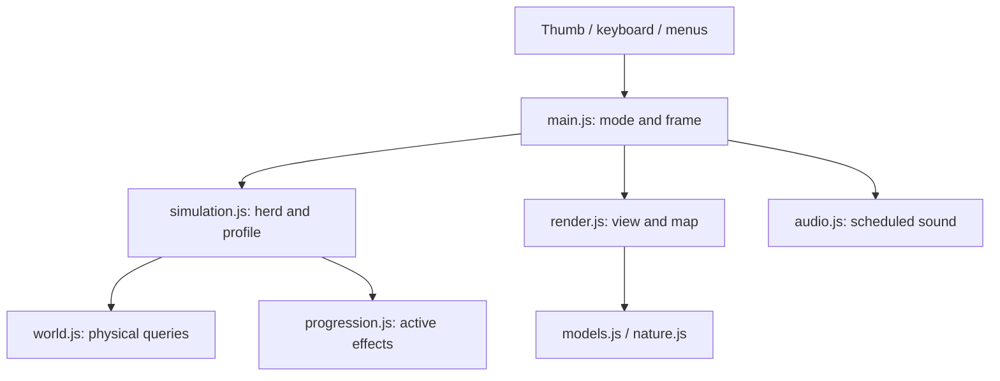

# Architecture and system contracts

[Documentation home](README.md) · [Requirements](REQUIREMENTS.md) · [Issue tracker](ISSUES.md)

The current game is a static browser application: Vite bundles JavaScript, CSS and local fonts; Three.js renders WebGL 2; WebAudio synthesizes music and ambience. Browser storage holds a validated profile. There is no server, account system, multiplayer or cloud save.

## Module map

| Source | Responsibility | Important boundary |
|---|---|---|
| `src/main.js` | Browser UI state, input, game loop, profile actions, effect/audio dispatch | Owns mode and pause; simulation is called only while playing |
| `src/world.js` | Seeded levels, routes, barrier queries, body movement and navigation | Shared physical geometry; render geometry must agree |
| `src/simulation.js` | Herd movement, companion behavior, delivery and profile functions | Mutates the level/dog; returns events, not DOM operations |
| `src/progression.js` | Upgrade catalog, gates, costs, validation and effects | Ownership is separate from activation in the selected level |
| `src/models.js` | Robot/scenery model construction and shared model resources | Shared material changes may affect many objects |
| `src/render.js` | Camera, scene, static/actor batches, map, transient effects | Visual state must not decide rewards or collision |
| `src/nature.js` | Decorative weather, clouds and wildlife | Current weather does not change gameplay rewards or control |
| `src/audio.js` | Music scheduling, UI/game sounds and ambience lifecycle | Browser activation is asynchronous and can be invalidated |

Source links: [controller](../src/main.js), [world](../src/world.js), [simulation](../src/simulation.js), [progression](../src/progression.js), [renderer](../src/render.js), [models](../src/models.js), [nature](../src/nature.js), [audio](../src/audio.js).



## Data and coordinate contracts

Public campaign levels are 1–100, while `level.index` and saved completion entries are 0–99. The requested QA selector 0–100 remains an explicit mapping decision (F-018). Do not equate index 100 with public level 100.

The ground plane uses `x` and `z`; Three.js `y` is elevation. Some input APIs accept `y` as a compatibility alias for planar `z`; that does not change world coordinates. Headings are radians. Bridge longitudinal/lateral coordinates derive from the heading, not an axis-aligned box.

The main loop requests animation frames and caps the per-frame simulation `dt` at 0.05 seconds. It is a variable-step loop, not an accumulator-based fixed-tick loop. Long frame gaps do not simulate the entire elapsed wall time. Headless fixtures commonly use fixed `1/60` increments for repeatability.

```js
// Runnable: node --input-type=module from the repository root.
import { createLevel, stepSimulation } from './src/simulation.js';
const level = createLevel(0);
const dog = { ...level.dog };
const result = stepSimulation(level, dog, { x: 0, z: 0 }, 1 / 60, {});
console.log({ publicLevel: level.index + 1, saved: result.saved, total: result.total });
```

## State ownership

`level` contains mutable runtime animals, helper state, time and completion. `dog` is updated by the simulation. A profile contains points, paid upgrade tiers, completed level indexes, highest unlocked index and music preference. Creating/replaying a level replaces transient state; completing one can mutate the profile once. Full Restart Game replaces profile progress with defaults, keeps music preference, persists the reset and begins the tutorial.

Rendering consumes the same level and dog, adding mesh/cache/resource state of its own. Collision belongs in world/simulation queries. Minimap, target highlight and model bounds must remain consistent with the shared world; F-010 records the current circle-versus-enclosure gap.

## Cross-system changes

| Change | Coordinate before implementation |
|---|---|
| Bridges/gates/walls | Generator, physical footprint, navigation, render model, minimap and journey checks |
| Goal shape/countdown/scoring | Admission geometry, completion event, reward ledger, UI, replay policy and save migration |
| Changing weather | One severity/time contract shared by wildlife, clouds/light, audio and accumulated wetness |
| Model size/detail | Placement clearance, culling bounds, shared materials, shadows and disposal |
| QA animal editing | Pause ownership, selection/placement override, profile isolation and release gating |

F-009/F-012/F-018/F-022–F-024 include unresolved design semantics. Their proposed contracts are future work, not hidden runtime features. See [issue acceptance criteria](ISSUES.md).

## Resource and async invariants

Level replacement must dispose owned geometries/materials/nature resources without destroying shared cached robot geometry. Culling must retain visible limbs and shadows as well as bodies. Temporary bark/celebration effects must finish and release resources.

Audio start/resume may complete after a pause, newer activation or disposal. Generation guards invalidate stale requests. Never follow an awaited start with an unconditional resume. Music catch-up skips overdue steps arithmetically and bounds scheduling work rather than replaying a backlog.

## Evidence and extension points

Tests run actual simulation/profile code and construct real Three.js geometry, with browser graphics/audio surfaces substituted where needed. They do not establish rendered appearance, physical Safari interactions, sound quality or mobile FPS. [Quality record](QUALITY.md) preserves those limits and historical review scores.

Use [system documentation](README.md) for narrower APIs. Start work from [the tracker](ISSUES.md), claim ownership, retain regression checks and record source versus deployment milestones separately.
