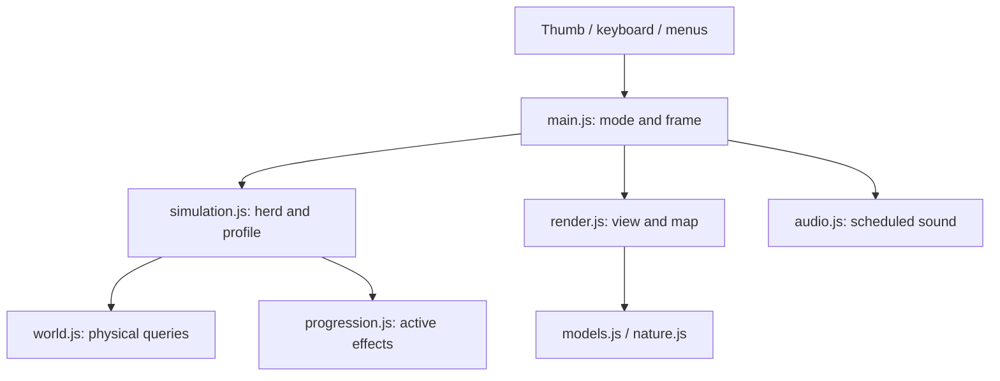

# Architecture and system contracts

## P1 ownership — 24 October 2026

Simulation owns seeded herd temperaments, local social weights, unattended browsing, relaxation and saved arrival reservations through `herd-behavior.js`. Presentation reads that state through `herd-pose.js`, grazing and instanced animal geometry. `bark.js` owns controller-side transient Pip charges and gameplay-time cooldown, while progression supplies the exact force/charge definitions and Buddy retains independent state. `FarmAudio` owns bounded livestock schedules and cached vocal buffers; the controller passes current animals/listener only during play and resets schedules on level replacement. Quit builds a fresh landing scene while preserving the campaign profile.

## Dynamic scenery contract — 23 October 2026

Meshes whose owner changes material or pose after level setup must opt out of immutable scenery batching with `userData.dynamicScenery`. Gate lamp domes use this contract so the visible mesh remains under gate-view control after `MeadowRenderer.setLevel`. State remains owned by simulation; renderer batching cannot snapshot a stateful indicator into permanent red scenery.

## Visual follow-up ownership — 23 October 2026

Gate illumination remains a presentation concern: visible lamp color follows actual gate state, without changing contact, safe closing or navigation. The playable polygon and surrounding ground now share the same grass material, with aligned UVs including the plane's inverted Z/V orientation. This gives both sides the same weather and receiving glow. Physical collision/fences/minimap still own the field boundary. Road join/shared-ending changes stay in presentation geometry; simulation road centerlines and grazing remain authoritative.

The renderer builds one road network mesh for each of core and shoulder using `roadNetwork`, so shared junctions have one coverage surface. Both meshes own their geometry and share two per-level owned materials. Water ribbons keep their separate API and physical widths.

## Gate and surface feedback — 23 October 2026

`gates.js` owns fixed wall-panel descriptors, reachable ground approaches and the shared Pip/Buddy contact latch; `gate-view.js` reads actual gate state for mounted red/green lights. Contact evaluation follows active companion filtering and movement. No autonomous gate-seeking is added. `surfaces.js` supplies road-only rounded terminal geometry and hashed coverage materials, preserving ordinary river ribbons and barn-floor materials. The renderer owns per-level road clones, restores weather baselines before cloning and registers road cores for wetness. Barn roofs use one continuous pitched sheet so transparent cutaways do not stack overlapping roof faces. Collision and saved profiles are unaffected.

## Map feedback and camera ownership — 22 October 2026

F-038 follow-up keeps generated corner routes, bridges, fences, tree groves and final-arm destination geometry in the simulation/world layer. F-UI-013 removes flock-centroid camera attraction: gameplay framing follows Pip on both axes with bounded lag, independent of destination direction. The renderer still consumes world boundary and target descriptors for turf, minimap and goal arrow; camera changes do not move actors, alter collision or save state. Source completion, dev publication and user acceptance remain separate.

## Read-only tracker

`tracker/index.html`, `styles.css`, `app.js` and `parser.js` form a standalone buildless site. It has no dependency on game initialization or saved profiles. A refresh resolves public main to a commit SHA, validates and parses both Markdown overview tables from that SHA, then atomically replaces the view. Only authoritative overview rows create tickets; matching detail headings and scoped execution records add details and branch evidence. Deferred/Blocked remain labelled under Open. Repository Markdown is rendered as text, with branch URLs safely encoded. There are no write requests or drag handlers. Refresh failures preserve the prior snapshot with a visible warning.

### Grazing presentation

`grazing.js` uses shared world geometry to veto paths, rotated decks, water and barn floors. Renderer-owned per-animal settling/pose state never changes simulation or saved progress. Heads are baked into neck-local material meshes with shared pivot/drop metadata, alongside the existing hip-local limbs. Instancing applies one head transform to every facial material; culling retains a conservative rotation envelope. Bushes are decorative grass-ground placements. No per-frame geometry/material creation is added.

### Pip presentation rig contract

Pip's motion presentation must not feed back into simulation position, collision or herding. Root coordinates and heading remain authoritative; a child rig owns float/roll/pitch and a head pivot owns anticipatory yaw. `parts.pods` describes animated anchors in root-local coordinates so ring and ground-glow consumers continue using the same world projection contract. Guidance graphics stay on the root. Motion history is scoped to a model/level and freezes with pause; discontinuous moves clear inertial pose history.

Buddy's reference puppy factory shares this pose/hover contract but owns independent motion history, baked shell/head geometry, pulse materials and blue/red tail feedback. Its renderer scale is .82 of Pip's, an implementation choice for legibility. `ThrusterGroundGlow` keeps a separate four-position Buddy uniform array and scaled footprint; both characters illuminate actual receiving terrain/deck. Missing helpers clear their glow slots and hide cached actors. `moveBuddy` owns transient acceleration-limited arrival speed, uses the existing physical .6 radius and reports actual collision-constrained velocity; visual tilt never changes simulation positions.

## User sign-off - 15 October 2026, 16:34 Vancouver

Novy explicitly signed off all pending Review items: **F-022, F-023, F-024 and F-040 are Done**. Acceptance applies to the live development build at Pages `bf26e67732434e902fdbaef10cac72d6814c33b0`, runtime source `1909c87bc1f70c4e53f4b38d64beaa2d4bb6d3aa`, including full-view/angled rain, no storm wildlife, accumulating puddles, deeper variable 3-5 second reverberant thunder after lightning, the 50% master volume increase and brighter lightning. This is user acceptance; historical headless checks and device-performance evidence retain their original limits. **At that weather sign-off checkpoint no items remained in Review.** The later flock-behavior batch F-035/F-037/F-039/F-041 is now Review. Open queued items remain Open; F-008 clouds remain Deferred. Older Review/pending wording below describes earlier checkpoints and is superseded by this sign-off. Documentation only; game bytes are unchanged.


Current weather repairs: [requirements](REQUIREMENTS.md#weather-follow-up---15-october-2026-1222-vancouver). Weather is Done by user acceptance on 15 October 2026 at 16:34 Vancouver; clouds remain Deferred.


[Documentation home](README.md) · [Requirements](REQUIREMENTS.md) · [Issue tracker](ISSUES.md)

The current game is a static browser application: Vite bundles JavaScript, CSS and local fonts; Three.js renders WebGL 2; WebAudio synthesizes music and ambience. Browser storage holds a validated profile. There is no server, account system, multiplayer or cloud save.

## Module map

| Source | Responsibility | Important boundary |
|---|---|---|
| `src/main.js` | Browser UI state, input, game loop, profile actions, effect/audio dispatch | Owns mode and pause; full simulation runs only while playing, saved-only goal roaming also runs behind results |
| `src/world.js` | Seeded levels, routes, barrier queries, body movement and navigation | Shared physical geometry; render geometry must agree |
| `src/bridge-crossing.js` | Per-animal committed deck-to-bank traversal, including a short pressured approach zone | Body-clear local waypoints; no goal choice, score or profile writes |
| `src/chokepoints.js` | Lanes, yielding and bounded deadlock escape at bridge mouths, open gates and the destination entrance | Shapes a pressured animal's desired velocity only; transient per-animal state; never chooses goals or moves bodies |
| `src/buddy-navigation.js` | Cached tree detours and bounded Buddy turning/movement | Uses physical ground clearance and existing route/crossing navigation |
| `src/buddy.js` | Buddy flock grouping, rear positioning, smaller-group selection, retrieval, local pressure and bark decisions | Per-level transient state; local passage guidance; no DOM or profile writes |
| `src/simulation.js` | Herd movement, confined delivered-animal roaming, companion behavior, delivery and profile functions | Mutates the level/dog; returns events, not DOM operations |
| `src/progression.js` | Upgrade catalog, gates, costs, validation and effects | Ownership is separate from activation in the selected level |
| `src/wandering.js` | Seeded straggler opportunity cohort and conditional bolt selection | Simulation-time cadence; normal world collision remains authoritative |
| `src/gates.js`, `src/gate-view.js` | Nearby gate action/state and owned gate/stone-wall meshes | Gate panel state follows `level.gates`; collision/map read the same geometry |
| `src/models.js` | Robot/scenery model construction and shared model resources | Shared material changes may affect many objects |
| `src/tail-light.js` | Pip's bark-state tail-light color/emission | Mutates only the dedicated light material; restore after the bark window |
| `src/goal-view.js` | Shared-footprint highlight, border, barn floor and minimap polygon | Consumes world corners; does not define admission |
| `src/vegetation.js` | Seeded, route-aware decorative bush clusters | Decorative only; avoids collision and play-critical areas |
| `src/wildlife.js`, `src/wildlife-models.js` | Area-scaled ambient populations, movement, fence permeability and weather shelter | Fauna do not move robotic herd bodies or award progress; water/tree occupancy remains shared |
| `src/weather.js` | Fixed seeded level weather and deterministic paired storm events | `MeadowNature` is the single advancing owner; other systems read the same object |
| `src/water-effects.js` | Directional river flow, surface wetness, puddles and splashes | Per-level resources are bounded and disposed; zero dt/pause freezes effects |
| `src/atmosphere.js` | Dormant cloud/shadow implementation, deferred by user | Not instantiated or updated by the game renderer |
| `src/surfaces.js` | Non-overlapping ribbon union and surface-aware bark geometry | Geometry construction only; retains normal depth testing |
| `src/cutaway.js` | Occupied-structure roof/facing-side visibility and material clone lifecycle | Changes visibility only, never collision or rewards |
| `src/qa.js` | Development-only isolated QA controls and scenario export | Dynamically imported only in development/QA builds |
| `src/render.js` | Camera, scene, static/actor batches, map, transient effects | Visual state must not decide rewards or collision |
| `src/nature.js` | Advances shared weather once and updates instanced fauna/precipitation | Weather presentation does not change movement speed or rewards |
| `src/audio.js` | Music scheduling, UI/game sounds and ambience lifecycle | Browser activation is asynchronous and can be invalidated |

Source links: [controller](../src/main.js), [world](../src/world.js), [simulation](../src/simulation.js), [progression](../src/progression.js), [renderer](../src/render.js), [models](../src/models.js), [nature](../src/nature.js), [audio](../src/audio.js).



## Data and coordinate contracts

Public campaign levels are 1–100, while `level.index` and saved completion entries are 0–99. The QA selector maps 0 to the tutorial (index 0), and 1–100 to indexes 0–99. Do not equate index 100 with public level 100.

The ground plane uses `x` and `z`; Three.js `y` is elevation. Some input APIs accept `y` as a compatibility alias for planar `z`; that does not change world coordinates. Headings are radians. Bridge longitudinal/lateral coordinates derive from the heading, not an axis-aligned box.

The main loop requests animation frames and caps the per-frame simulation `dt` at 0.05 seconds. It is a variable-step loop, not an accumulator-based fixed-tick loop. Long frame gaps do not simulate the entire elapsed wall time. Headless fixtures commonly use fixed `1/60` increments for repeatability.

```js
// Runnable: node --input-type=module from the repository root.
import { createLevel, stepSimulation } from './src/simulation.js';
const level = createLevel(0);
const dog = { ...level.dog };
const result = stepSimulation(level, dog, { x: 0, z: 0 }, 1 / 60, {});
console.log({ publicLevel: level.index + 1, saved: result.saved, total: result.total });
```

## State ownership

`level` contains mutable runtime animals, helper state, time and completion. `dog` is updated by the simulation. A version-2 profile contains points, paid upgrade tiers, positive-delivery completion indexes, highest unlocked index, music preference, and per-level `bestEarnedBolts`/`bestScores` ledgers. Creating/replaying a level replaces transient state; a completed run pays only its lifetime best-score improvement. `bestEarnedBolts` is authoritative across spending and reloading; `bestScores` and completion indexes are rebuilt from it when loading. Full Restart Game replaces profile progress with defaults, keeps music preference, persists the reset and begins the tutorial.

Rendering consumes the same level and dog, adding mesh/cache/resource state of its own. Collision belongs in world/simulation queries. Minimap, target highlight, enclosure and full-body admission use `targetFootprint`, `targetWorldPoint`, `targetLocalPoint` and `containsTarget` from `world.js`. The target radius remains a sizing/attendance input, not a circular admission test.

## Cross-system changes

| Change | Coordinate before implementation |
|---|---|
| Bridges/gates/walls | Generator, physical footprint, navigation, render model, minimap and journey checks |
| Goal shape/countdown/scoring | Admission geometry, completion event, reward ledger, UI, replay policy and save migration |
| Fixed weather | `MeadowNature` advances the weather clock once; wildlife, rain, `WaterEffects`, renderer lighting and audio consume the same object; cloud rendering is disabled |
| Model size/detail | Placement clearance, culling bounds, shared materials, shadows and disposal |
| QA animal editing | Pause ownership, selection/placement override, profile isolation and release gating |

Gates/walls, wildlife, vegetation, tail feedback and fixed weather/wetness have user acceptance recorded in the tracker. Clouds/Atmosphere remain deferred and dormant. The current flock-behavior candidate F-035/F-037/F-039/F-041 is Review; its per-level state and random schedules are described below. F-013/F-015 remain Open for human pacing and phone performance evidence. See [current acceptance criteria](ISSUES.md).

## Resource and async invariants

Level replacement must dispose owned geometries/materials/nature resources without destroying shared cached robot geometry. Culling must retain visible limbs and shadows as well as bodies. Temporary bark/celebration effects must finish and release resources.

Audio start/resume may complete after a pause, newer activation or disposal. Generation guards invalidate stale requests. Never follow an awaited start with an unconditional resume. Music catch-up skips overdue steps arithmetically and bounds scheduling work rather than replaying a backlog.

## Evidence and extension points

Tests run actual simulation/profile code and construct real Three.js geometry, with browser graphics/audio surfaces substituted where needed. They do not establish rendered appearance, physical Safari interactions, sound quality or mobile FPS. [Quality record](QUALITY.md) preserves those limits and historical review scores.

Use [system documentation](README.md) for narrower APIs. Start work from [the tracker](ISSUES.md), claim ownership, retain regression checks and record source versus deployment milestones separately.


## Fixed weather contract — 15 October 2026

F-040 supersedes weather cycling and snow. `createWeatherState(level)` chooses the fixed kind/intensity/severity/daylight once; `stepWeather(state,dt)` advances only elapsed time and paired storm events. Nature, rain, terrain, lights and audio consume the same object. Clouds are deferred. The mission panel labels it. `WaterEffects.setLevel` accepts `weather` to establish wet ground and a seeded empty/small puddle baseline before the first frame; shared materials restore on replacement. RainView uses camera-unprojected screen coordinates, overscanning to +/-1.25 on both axes, with depth testing disabled for the foreground curtain. Camera updates precede its projection. [Presentation context](systems/PRESENTATION.md) has the exact tiers and lifecycle.

Cloud removal, 15 October 2026: `MeadowRenderer` no longer imports, constructs, sets up or updates `Atmosphere`. Its module/tests remain dormant; cloud puffs and associated shadows allocate no runtime resources. Rain/nature, weather state, sky/fog/lights, water effects and audio retain their existing contracts. F-008 is Deferred.

## Per-level straggler state

`wandering.js` owns seeded cohort selection, public-level bands and each animal's 5-8s check schedule. `simulation.js` applies excursions and local home roaming through ordinary body collision. All transient fields live on the level/animals, never profile storage or module globals. See [current behavior](REQUIREMENTS.md#flock-wandering-and-bolting-revision---15-october-2026). F-035/F-037/F-039/F-041 remain Review for new gameplay acceptance.

QA debug is installed by the development-only qa.js import. It wraps updateAnimalBatches to apply colors after visible-instance compaction and before drawing, without altering simulation or shared model-material colors; destruction restores the original method and neutral instance colors. The main loop updates the numeric HUD through a QA-compile-gated callback. Release artifact checks exclude debug identifiers.


## Buddy decisions and events

`buddy.js` shares ground-visible flock grouping with the drone and returns per-animal local forces to `simulation.js`. It owns `level.buddyHerd` (group cache, travel heading, retrieval ID) and Buddy helper fields (mode, members, desired rear position, bark deadlines). The simulation combines Buddy pressure with Pip/drone behavior, interrupts excursions only under effective herding, and preserves player-attended admission. `main.js` routes `buddyBark` events to audio and `render.bark(event)`; rendering maintains separate Buddy/Pip ring origins and dedicated tail lights. All state is transient and cleared with a fresh level; only purchased tiers persist.


Buddy navigation follow-up: `buddy-navigation.js` composes route/bridge/goal waypoints with cached tree visibility paths and turn-limited locomotion. `buddy.js` adds committed tier-2 bridge/goal passage state and a stable circling side; per-animal pressure uses actual passage waypoints. The renderer takes Buddy's simulation heading. `simulation.js` computes connected component membership using cached neighbor visibility so cohesion/alignment cannot cross a split; the original 18m range remains available within each component. This grouping also includes singleton components, which receive no distant attraction. Navigation/heading/passage state is transient and never saved to profiles.


Forward-flow follow-up: the simulation caches direct Pip signals once per animal, derives each connected component's travel direction/pressure, and keeps transient `level.flockTravel` member/direction records across stops/splits. Leading animals reject backward cohesion and receive only missing forward flow when outside direct dog pressure. `bridge-crossing.js` owns `animal.bridgeCrossing`, selecting a safe far-bank point with the animal's actual radius. The simulation applies committed local walking before movement and refreshes a held animal's drone anchor upon arrival; saved animals clear traversal state. Profiles, rewards and attended admission are unchanged. Buddy bark availability now uses active tier >=2; retrieval still uses >=3.


### Pip hover model

F-053 separates player `createPip` from the legacy walking `createDog` factory. F-061 uses dedicated `createBuddy` for the hovering puppy. `updatePipHover` owns a bounded four-pod/twelve-ring presentation pool per hovering character and per-pod world-space trailing positions. Simulation state and collision remain on their existing ground coordinates. Ring materials are owned by the level actor; baked shell geometries follow the existing disposal lifecycle.


## Clay dry-stone wall view (F-033)

`gate-view.js` derives deterministic stone placement from segment coordinates without consuming simulation randomness. Three softly beveled, deformed shared geometries are instanced with a single matte material and muted per-instance colors. Larger foundation stones taper through three variable-width body courses to an uneven upright coping row. All vertices remain inside segment endpoints and the existing ±.30-unit physical strip at every orientation. No mortar, backing slab or scattered obstruction is added. Owned geometry, instance buffers and material are disposed on level replacement. Generation probability, map/collision descriptors and gate interactions are unchanged.


F-033 weathering refinement: asymmetric hull corners/wedge profiles and deterministic vertex colors supply worn clay faces, pale warm mottling and subdued lower moss/damp tones. Per-instance 180-degree flips and bounded local roll vary the silhouettes. Width is reduced by the projected rotated height contribution before composing each transform; this keeps the rotated geometry in its original longitudinal slot and ±.30 strip, including tiny segments. Foundation centers follow their rotated lower bounds; upper courses/coping receive restrained vertical contour variation. Materials enable vertex colors; instancing, 44-triangle geometry ceiling, resource ownership and simulation state are unchanged.


## Herd pivot presentation (F-065)

Branch `herd_turning_visual`, owner Codex. Review: cap visible turning at 180°/s for sheep and 120°/s for cows, following the shortest angular path. Keep walking legs active during stationary turns and freeze presentation on pause. Initialize facing from the level; retain simulation-owned movement, collisions and heading targets. User visual sign-off and development publication pending.


## Crossing bottlenecks (F-HERD-005, F-WORLD-001) — 20 October 2026

`chokepoints.js` finds the opening an animal is approaching (bridge deck ends, including the bank beside a deck, open gates, and the destination entrance from outside only, within 8 m). Only openings narrower than 9 m queue: wider ones, such as the 10 m gates from level 6, measured better with normal flocking. The list is cached per level geometry and gate state and shapes the desired velocity of a pressured animal whose forward intent points into it. Intent is only the direct Pip and Buddy push, never the flock's travel direction, which can point back across a river the flock straddles, so deliberate backward pressure from Pip is never altered. An animal pushed back toward a deck it already crossed gets no queuing help. Otherwise, in order: separation cannot push it back out; an animal lined up with its lane cannot back out; an animal beside the opening slides along the bank into its lane, easing back when wedged against an end post; and it follows, rather than shoves, the animal just ahead. Yielding lasts at most 3 s, then a 2 s escape lets it push. `openingSteer` aims each body at its own lane at the near deck end instead of the deck centre. `bridgeCrossing` also commits a pressured animal that is lined up with the deck and walking onto it within 3 m of the deck end, but never back over a deck it already crossed in the other direction. State (`chokeYield`, `lastBridge`, `pushed`) lives on the animal, is cleared on delivery and freezes with pause.

`createLevel` adds `breathing` trail before the gate on non-early levels, from 0 m at 30 animals up to 14 m at 65. Rivers keep their distance from the spawn, so the extra length sits between the last bridge and the gate.


## Map boundary and gate-contact ownership — 22 October 2026

The `map_generation_improvements` candidate keeps `world.js` authoritative for the ordered `level.boundary` polygon, physical boundary/interior fences, gate descriptors and largest-body route geometry. Axis-aligned `bounds` still frame generation/camera/minimap work; they do not imply that concave cutouts are playable. Renderer ground and minimap use the boundary polygon, while world occupancy/path queries enforce it. Concave `ShapeGeometry` forms brighter playable turf above darker surrounding scenery; its geometry is level-owned and disposed on replacement. On large maps, the minimap uses a Pip-following local viewport clamped to the AABB, clipping geometry and markers to the frame; compact levels retain fit-to-map framing. Angular/L-shaped maps must preserve routes, spawn, target and safe gate-pad access.

`gates.js` owns two-sided pad coordinates, Pip-only fresh-contact activation, release hysteresis and occupied-panel closing refusal. `stepSimulation` invokes it only during active simulation; `main.js` announces toggle/refusal events through the existing status toast. `gate-view.js` displays both pads from the shared open state. Successful toggles increment geometry revision and clear visibility caches; world queries and minimap read that same state. Gate contact remains transient level data, and no DOM control or helper independently owns panel state. See the [current world contract](systems/WORLD.md#map-generation-candidate--22-october-2026).

