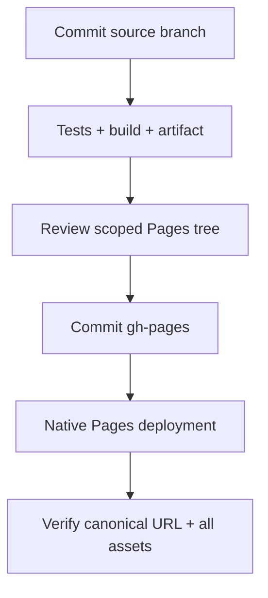

# Development, QA and release context

[Documentation home](README.md) · [Architecture](ARCHITECTURE.md) · [Issue tracker](ISSUES.md)

## Local setup

Use Node.js 22 or newer and the locked dependencies. Run commands from the repository root.

```sh
npm ci
npm run dev -- --host 0.0.0.0
# Production checks and static build:
npm test
npm run build
# Explicit development distribution with isolated QA controls:
npm run build:dev
```

Vite writes `dist/`; `npm run preview -- --host 0.0.0.0` serves that build when a browser-enabled environment is available. Local font assets are included. WebGL 2 is required by the current renderer. Audio requires browser user interaction; initial play or enabling sound initiates activation.

## Agent cost and review policy

Use the least expensive available model and reasoning effort appropriate to the change for implementation and blind review. Escalate only when complexity, failed checks or review findings justify it. Keep blind reviewers independent of implementation reasoning and earlier scores; use the user-requested 8.5/10 minimum for the current weather repair loop. Before committing, update requirements, system context, tracker, validation records and other affected documents, then regenerate/check HTML.

## Documentation maintenance

Markdown in `docs/` and the root README is the editable source. Generated HTML is checked in under `docs/html/`, including local CSS, navigation/search JavaScript and Mermaid. To refresh and validate:

```sh
npm run docs:build
npm run docs:check
# Open docs/html/index.html directly in a browser.
```

The generator resolves links among the documented pages, creates heading anchors and a page table of contents, and emits an offline search index. Documentation checks also parse all Mermaid diagrams and exercise search, focus, copy cleanup and theme rerendering using jsdom; these DOM substitutes do not verify native browser rendering. Edit Markdown, not generated HTML. Regeneration must be deterministic. Keep third-party diagram code and license notices together. Adding a page requires adding it to the generator's explicit document list, then rebuilding and checking links.

## Test map

| Tests | What they support |
|---|---|
| `tests/simulation.test.js` | Herd delivery, body collision, reward/profile behavior |
| `tests/companions.test.js` | Drone largest connected herd, holds, attendance, barriers |
| `tests/flock-flow.test.js` | Leading movement, weaker cohesion, rear/side pressure flow, split isolation and direct steering |
| `tests/bridge-crossing.test.js` | Committed sheep/cow deck traversal, rotated/reverse crossings, pause and drone far-bank hold |
| `tests/buddy.test.js` | Buddy tier behavior, rear pressure, split flock, retrieval, bridge traversal and autonomous bark |
| `tests/world.test.js` | Generation, route/footprint validity, clearance and seeded fixtures |
| `tests/herding-journey.test.js` | Entire flocks delivered with ordinary simulated dog inputs in selected levels |
| `tests/progression.test.js` | Tier cost/unlock/activation and legacy data validation |
| `tests/ui.test.js` | Production controller against DOM/audio substitutes; navigation, rewards, restart and input |
| `tests/delivery.test.js` | First-arrival timer, partial score, lifetime earned ledger and legacy migration |
| `tests/goal-view.test.js` | Shared target highlight/border/floor and projected minimap corners |
| `tests/world-geometry.test.js` | Perpendicular crossings, deck/path ratio and shared full-body target footprint |
| `tests/gates.test.js` | Operable gate reachability/state, stone wall geometry and shared collision/map behavior |
| `tests/surfaces.test.js` | Ribbon union topology and bark surfaces on land/deck transitions |
| `tests/cutaway.test.js` | Camera-ray section fading, pause, hysteresis and material restoration |
| `tests/qa.test.js` | QA mapping, edit constraints, isolated controller state and build gating |
| `tests/deploy-pages.test.js` | Validated relative assets, canonical staging, redirects and preserved Pages bytes |
| `tests/render.test.js` | Geometry, camera matrices, culling, batches and disposal |
| `tests/nature.test.js` | Wildlife, weather, resource budgets and cleanup |
| `tests/weather.test.js` | Seeded weather episodes, shared severity, lightning and atmosphere resources |
| `tests/wandering.test.js` | Seeded straggler cohorts, five-second opportunities and conditional bolts |
| `tests/water-effects.test.js` | Wetness/drying, pause/reset, safe puddles, bounded splashes and directional river flow |
| `tests/audio.test.js` | Audio activation races, scheduling, ambience and disposal |

```sh
# Targeted examples; not a substitute for relevant integration checks.
node --test tests/ui.test.js tests/audio.test.js
node --test tests/world.test.js tests/herding-journey.test.js
```

No screenshot or human listening claim follows from a mocked Canvas/WebGL/WebAudio test. Record real device/browser, revision, scenario and evidence for native touch, scrolling, visibility, audio and GPU performance. Large headless triangle counts are not phone FPS.

Current P2 source candidates include operable gates/stone walls, weather-driven atmosphere and water, area-scaled wildlife, fence-permeable wildlife movement, vegetation, straggler wandering and bark-state tail lighting. Their focused tests support source-level behavior only; they have independent source reviews recorded in QUALITY.md; rendered/device acceptance remains pending. Keep level-5 human pacing (F-013) and mobile GPU performance (F-015) Open until their respective evidence exists.

## CI and current publishing behavior

The source branch is `flock_3D_chatgpt-work`. [The workflow](../.github/workflows/deploy-dev2.yml) installs dependencies, checks documentation/tests, builds release and verifies QA exclusion, then builds the development game and verifies QA inclusion before uploading `dist/`. Its artifact upload **does not publish Pages**. GitHub Pages uses the separate `gh-pages` branch and its native deployment workflow.

F-025 is complete. The helper stages the game under `dev2/` for **https://novydhillon.github.io/Flock/dev2/** and replaces `flock/dev2/` with a redirect preserving query/fragment. It validates the emitted relative asset dependency graph before changing a Pages worktree, rejects unsafe/missing assets and build symlinks, and preserves existing root `.nojekyll` bytes. It uses a locally fetched `origin/gh-pages` and never fetches, commits or pushes.

The verified migration Pages commit is `baca95c7ba618d736730194b433254bf5058dd66`: all 15 game files and the redirect were hash-verified, and 17 unrelated blobs stayed unchanged. The live migration contains the preceding game revision; do not infer that the new P1 source batch is deployed. See [validation evidence](validation/P0-P1.md).

`npm run dev` and `npm run build:dev` enable QA; normal `npm run build` removes the dynamic QA branch/module and its mutation handlers. CI packages the checked development build after checking both modes. `node scripts/check-build-mode.mjs release` rejects QA chunks/signatures in a release artifact; `node scripts/check-build-mode.mjs development` requires the QA JavaScript/CSS and expected entry/export signatures. For a development publication, use the checked final `build:dev` artifact.

The isolated QA panel supports level jumps, test bolts, session reset and scenario export. Animal selection and coordinate positioning are temporarily hidden; the panel can be closed with its × button or Resume.



## Release checklist

1. Read the latest issue/requirements decisions and fetch source and `gh-pages`. Require a clean intended source revision; do not overwrite another publisher's newer Pages head.
2. Pass relevant tests and both build modes when QA is affected. Rebuild the intended final distribution (`build:dev` for this development game); inspect QA presence/absence in each bundle. Stage only the intended `dev2/` output and any explicitly agreed old-URL redirect. Preserve the root, existing `flock/dev/` and unrelated content. Do not alter saved profile keys.
3. Review the Pages-tree diff against the latest parent. Verify relative asset paths and the `/Flock/` repository URL prefix. Record the source SHA associated with the build.
4. Commit/push Pages with a checked expected parent/ref. Wait for successful native Pages deployment, not just successful source CI.
5. Fetch the new live HTML and every generated asset; compare bytes/hashes with the build. Run real-browser smoke checks when available. Record Pages SHA, workflow result, canonical URL and any validation limits.

Documentation HTML is a repository deliverable in `docs/html/`; it is not automatically copied into the game build or published as another Pages site. A future hosted docs URL needs an explicit publishing location and preserved-content review.

## Agent handoff

Use isolated worktrees for parallel owned files; integrate commits only after inspection. Blind reviewers should receive the candidate, task/requirements and scope, not historical scores or desired wording. Record confirmed problems, concrete evidence and checks. A threshold score is not a reason to relabel unverified browser behavior as tested.

See [P0/P1 runbook](validation/P0-P1.md) for concrete manual scenarios. F-014 is Done by Novy’s real-phone acceptance on 14 October 2026. Independent agent/device verification of this new P2 candidate remains unavailable; fresh rendered/device acceptance is pending. The installed Sites instruction says “If `$control-browser` is unavailable, skip browser QA” (`/root/.codex/plugins/cache/openai-curated-remote/sites/1.0.0/skills/sites/SKILL.md`); capability discovery found no browser tools, so this session supplies no browser screenshots or native-device claim.

Before ending a session, update the issue execution record, regenerate HTML, run documentation checks, commit/push the intended branch and state exactly what was deployed. Do not close open features just because their requirements were documented.

### Deployment validator parser

The Pages preparation helper uses Rollup’s JavaScript AST parser to inspect literal static imports, re-exports, dynamic imports and `new URL(..., import.meta.url)` assets. It does not treat words such as “Export scenario” in QA markup or comments as dependencies. Every emitted stylesheet is also checked, including lazy QA styles loaded through Vite dependency tables. Runtime-computed URLs still require final live asset verification. Rollup is an explicit development dependency; install the lockfile before invoking the helper.


## Fixed-weather smoke checks

Use QA public levels **9** (light rain), **16** (heavy rain) and **24** (storm). The level's weather kind must remain unchanged even after several minutes. Check the mission weather label, visible rain streaks and soft clouds immediately; heavy/storm ground should already be wet with puddles. In level 24, observe a brief lightning flash after 8–12 presentation seconds and delayed thunder with sound enabled. Pause, mute/unmute, hide the tab, restart and jump to a sunny level; no stale thunder, accumulated rain burst or dark-material carry-over should remain. Wildlife stays active in light rain and retreats in heavier weather. New queued gate/wall/wander/map changes are not part of this weather implementation.

Clouds are temporarily disabled at Novy’s request on 15 October 2026 (F-008 Deferred), including cloud ground shadows. Rain, fixed-level weather, storm lighting/thunder and wet-ground effects remain active. Test QA 9/16/24 for light/heavy/storm weather; no cloud overlay or cloud shadow should appear.

## QA flock behavior debug - 15 October 2026, 17:37 Vancouver

Open QA and enable the single **Flock debug** checkbox, then resume test play. A numeric countdown with tenths appears immediately above Woof at bottom right: seconds until the soonest check among eligible undelivered animals that are not already wandering/bolting or locally settled. It shows a dash when there is no eligible pending check (including early levels or before schedules initialize). Checks that occur under player/helper pressure can still be suppressed normally.

Chosen wanderers have a clear yellow tint; chosen bolters a clear red tint. Each tint remains until that animal's next scheduled check, including after settling or active herding; delivered animals are untinted. Selection history lives only in the QA renderer, leaving simulation state untouched. The toggle is off by default and survives level jumps for the current page; reloading resets it to off; it is not saved to normal progress. Menu/pause/results hide the countdown, and paused simulation leaves scheduled time frozen. Disabling debug clears all instance tint slots, including currently culled slots; replacing a level rebuilds instance state. No simulation/scheduling/profile state is modified. This feature is included only in the QA development build; release artifacts exclude its toggle, countdown, CSS and code.

## QA workshop level gates - 15 October 2026

In an isolated QA session, workshop unlocks and purchases use the public level currently being tested, including after backward jumps. Each next tier still requires its normal bolt cost and unlock level. Owned upgrades and test bolts carry between jumps; higher tiers stay inactive below their normal activation level. QA purchases never save to the normal campaign. Normal play continues to use earned campaign progress for purchases.


## Buddy smoke checks

On public QA levels 20, 24 and 28, buy the available Buddy tiers using test bolts. At tier 1, move the flock and observe Buddy behind its actual direction of travel; reverse direction and stop. At tier 2 split a group of at least two from a larger flock: Buddy should stay with the smaller group. At tier 3 let a wanderer/bolter separate and settle: Buddy should run around behind it, bring it to the closest flock group, and bark with its own ring/red tail without consuming Woof. Check a bridge, pause/resume, level restart, and simultaneous Pip bark. Drone ownership should preserve its existing main-herd hold behavior. Human gameplay, rendered effects and listening remain pending review.


### Buddy follow-up smoke checks

At QA public 24, buy Buddy tier 2. Split the flock beyond a 6.5m clear gap and verify the groups stay separate. Put a tree between Buddy and its rear position (both on/off a trail): it should walk around the trunk on dry ground. Circle inside a flock and reverse its travel: Buddy should turn progressively and keep a circling side. Approach a bridge from an angle and a goal entrance, including the last sheep after others cross/are delivered; Buddy should help the selected local flock through. Confirm nearby walls and water still block bodies, closed gates require the existing action, and leaving Pip far away prevents scoring. Repeat tier-3 retrieval around a tree and pause/restart during a turn. Rendered/mobile feel remains for user testing.


### Forward-flow and bridge smoke checks

With a moving flock, watch animals ahead of the centroid: they should continue in group travel rather than turn back to its middle. Pressure from Pip/Buddy at the rear or side should carry forward; move Pip ahead to deliberately turn them and check that separate groups remain independent. Cohesion is 30% weaker. On a bridge, move Pip away after sheep/cows start walking: they should finish onto the opposite bank, without returning to a drone's old anchor. Pause mid-crossing and restart/jump levels to check frozen/fresh intent. At QA 24 with Buddy tier 2, observe autonomous bark sound/ring/red tail and press Woof independently; tier 1 should not bark and tier 2 should not retrieve a remote stray. Saved counts still require Pip at the goal.


## Production root publication

`main` is the production source branch; `flock_3D_chatgpt-work` remains development. Source CI checks both branches independently. For the root [Flock game](https://novydhillon.github.io/Flock/), use a clean `npm run build -- --emptyOutDir` and verify release QA exclusion. Replace root `index.html` and its generated `assets/` only in a fresh Pages worktree. Preserve `dev2/`, legacy `flock/`, workflows and other unrelated files. The normal staging helper still targets development; do not use its `dev2/` output for a root release. Verify every production artifact and canonical root HTML after successful native Pages deployment.

Main CI uploads `flock-production-standalone` immediately after the verified production build. The QA build step is skipped on `main`; development CI continues to build and upload `flock-dev2-standalone`.
## F-051 HUD smoke checks and workflow

Use the least expensive suitable model at medium effort for routine implementation and independent reviews, escalating only with evidence. Keep fresh critics unaware of implementation reasoning and prior scores. Flock changes require at least 8/10 blind review, current requirements/context/tracker/validation records, generated HTML checks, full regressions and both artifact-mode checks before development publication. Publish the checked QA build to `dev2/` from `flock_3D_chatgpt-work`; preserve production root and unrelated Pages files, wait for CI/native Pages success, then verify live hashes. Production main changes require the separate release instruction.

For F-051 on a phone, check mission and minimap beside each other in portrait and landscape; check the narrower mission text does not overlap or clip. Let the first meadow's tips run without delivering an animal: the final tip should disappear after 14 active gameplay seconds and expose ? immediately after pause. Reopen/hide with ?, dismiss with ×, pause midway and restart/jump to reset. Reopened help stays until hidden. Check the round Woof title/symbol/double-tap label and cooldown; rotate Pip in place while confirming the triangle outside its ring keeps facing the goal. Native phone acceptance remains pending.


## Pip candidate workflow (F-053)

Use `pip_update`, based on the current development branch. Its push runs the same source CI, including both build modes. Publish its checked development artifact to `dev2/` only, preserving production and unrelated Pages content. Smoke-check silver angular Pip, four hover pods, three blue rings descending/fading per pod, attached top rings and lagging lower rings during turns; pause/resume and restart/jump must not leave old trails. Check Buddy walking, bark tail light, selection halo and goal pointer. Record source-level checks separately from native phone appearance.


## F-033 stone wall acceptance

Use QA public 8 and 24 for stone walls, including perimeter/interior runs, corners and gate endpoints. At normal play zoom check softly sculpted clay shapes, varied warm-grey stones, staggered joints and uneven upright coping; compare horizontal, vertical and oblique walls. Walk Pip and the largest animals beside walls and through opened gates; no visible stone should project into the passage. Restart/jump repeatedly to check stable placement and cleanup. Check phone shadow cost/FPS separately; source triangle and draw-call budgets are not device performance evidence. F-034's 15% distribution remains queued.
