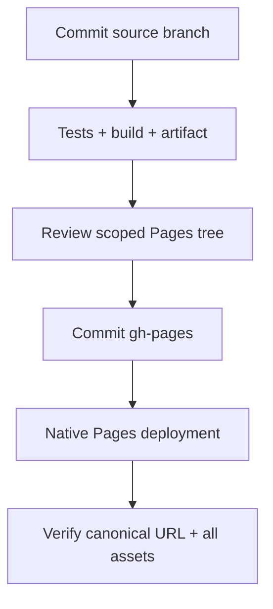

# Development, QA and release context

[Documentation home](README.md) · [Architecture](ARCHITECTURE.md) · [Issue tracker](ISSUES.md)

## Local setup

Use Node.js 22 or newer and the locked dependencies. Run commands from the repository root.

```sh
npm ci
npm run dev -- --host 0.0.0.0
# Production checks and static build:
npm test
npm run build
```

Vite writes `dist/`; `npm run preview -- --host 0.0.0.0` serves that build when a browser-enabled environment is available. Local font assets are included. WebGL 2 is required by the current renderer. Audio requires browser user interaction; initial play or enabling sound initiates activation.

## Documentation maintenance

Markdown in `docs/` and the root README is the editable source. Generated HTML is checked in under `docs/html/`, including local CSS, navigation/search JavaScript and Mermaid. To refresh and validate:

```sh
npm run docs:build
npm run docs:check
# Open docs/html/index.html directly in a browser.
```

The generator resolves links among the documented pages, creates heading anchors and a page table of contents, and emits an offline search index. Documentation checks also parse all Mermaid diagrams and exercise search, focus, copy cleanup and theme rerendering using jsdom; these DOM substitutes do not verify native browser rendering. Edit Markdown, not generated HTML. Regeneration must be deterministic. Keep third-party diagram code and license notices together. Adding a page requires adding it to the generator's explicit document list, then rebuilding and checking links.

## Test map

| Tests | What they support |
|---|---|
| `tests/simulation.test.js` | Herd delivery, body collision, reward/profile behavior |
| `tests/companions.test.js` | Largest connected herd, holds, attendance, barriers |
| `tests/world.test.js` | Generation, route/footprint validity, clearance and seeded fixtures |
| `tests/herding-journey.test.js` | Entire flocks delivered with ordinary simulated dog inputs in selected levels |
| `tests/progression.test.js` | Tier cost/unlock/activation and legacy data validation |
| `tests/ui.test.js` | Production controller against DOM/audio substitutes; navigation, rewards, restart and input |
| `tests/render.test.js` | Geometry, camera matrices, culling, batches and disposal |
| `tests/nature.test.js` | Wildlife, weather, resource budgets and cleanup |
| `tests/audio.test.js` | Audio activation races, scheduling, ambience and disposal |

```sh
# Targeted examples; not a substitute for relevant integration checks.
node --test tests/ui.test.js tests/audio.test.js
node --test tests/world.test.js tests/herding-journey.test.js
```

No screenshot or human listening claim follows from a mocked Canvas/WebGL/WebAudio test. Record real device/browser, revision, scenario and evidence for native touch, scrolling, visibility, audio and GPU performance. Large headless triangle counts are not phone FPS.

## CI and current publishing behavior

The source branch is `flock_3D_chatgpt-work`. [The workflow](../.github/workflows/deploy-dev2.yml) runs `npm ci`, `npm test` and `npm run build`, then uploads `dist/`. Its artifact upload **does not publish Pages**. GitHub Pages uses the separate `gh-pages` branch and its native deployment workflow.

**Current mismatch:** [the preparation script](../scripts/deploy-pages.mjs) still copies the build into `flock/dev2/`, giving `https://novydhillon.github.io/Flock/flock/dev2/`. F-025 is P0: migrate the output directory to `dev2/`, giving **https://novydhillon.github.io/Flock/dev2/**. That migration is not implemented by this documentation update. Do not treat the existing script as a compliant release procedure until corrected.



## Release checklist after F-025 is implemented

1. Read the latest issue/requirements decisions and fetch source and `gh-pages`. Require a clean intended source revision; do not overwrite another publisher's newer Pages head.
2. Pass relevant tests and production build. Stage only the intended `dev2/` output and any explicitly agreed old-URL redirect. Preserve the root, existing `flock/dev/` and unrelated content. Do not alter saved profile keys.
3. Review the Pages-tree diff against the latest parent. Verify relative asset paths and the `/Flock/` repository URL prefix. Record the source SHA associated with the build.
4. Commit/push Pages with a checked expected parent/ref. Wait for successful native Pages deployment, not just successful source CI.
5. Fetch the new live HTML and every generated asset; compare bytes/hashes with the build. Run real-browser smoke checks when available. Record Pages SHA, workflow result, canonical URL and any validation limits.

Documentation HTML is a repository deliverable in `docs/html/`; it is not automatically copied into the game build or published as another Pages site. A future hosted docs URL needs an explicit publishing location and preserved-content review.

## Agent handoff

Use isolated worktrees for parallel owned files; integrate commits only after inspection. Blind reviewers should receive the candidate, task/requirements and scope, not historical scores or desired wording. Record confirmed problems, concrete evidence and checks. A threshold score is not a reason to relabel unverified browser behavior as tested.

Before ending a session, update the issue execution record, regenerate HTML, run documentation checks, commit/push the intended branch and state exactly what was deployed. Do not close open features just because their requirements were documented.
