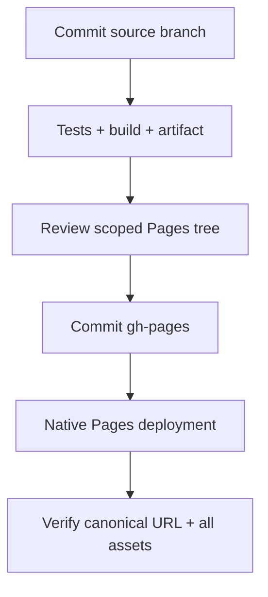

# Development, QA and release context

## Lo-fi and animal mix smoke checks — 24 October 2026

Listen to F-POLISH-002 on phone: livestock should be25%quieter and call less often than previous dev; pressure retains relative state mix and bolt onset. Trigger Pip and Buddy independently/simultaneously: Pip should sound deeper while Buddy retains the current voice. Listen to the generated lo-fi groove across several phrases for calm tempo, unobtrusive mix and no clipping or sharp note tails. Toggle mute, pause/background/resume, restart/jump and overlap async audio activation: no duplicate scheduler, catch-up burst, unwanted startup or stuck source. These listening/device checks remain pending until observed; automated gains/notes/lifecycle tests are separate evidence.

## Follow-up smoke checks — 24 October 2026

Compare livestock cadence/pitch/mix and dog bark on phone; mute/pause/restart with async samples pending. Observe waves in all weather and river bends. Watch birds fly, land on dry ground, fold wings, hop/peck, take off and hide in storms; pause and jump repeatedly. These listening/rendered/phone checks remain pending.

## P1 batch smoke checks — 24 October 2026

On `p1_gameplay_polish`, test phone portrait/landscape: Quit during motion/held input and during a bark, return to landing with sound stopped and saved bolts/upgrades intact, then start the continuation meadow anew. At public levels 8/13 or later, compare bark tier 1/2 force, workshop +33% wording, two distinct tier-3 taps, compatibility click/key repeat suppression, cooldown progress, pause/background freeze, restart and backward QA jumps. Listen to bark/bleat/moo identity and mix; watch immediate bolting calls, quieter/more frequent wandering and louder/less frequent herding. Mute/pause/restart repeatedly with no replayed call burst.

Observe mixed herds/all cow sizes with Pip/Buddy absent, approaching, holding and moving: bounded spreading, local split independence, barrier clearance, bridge/gate completion, immediate response and gradual relaxation. Look for desynchronized ears/tails/blinks/chewing, head attention and weight shifts without delayed escape. Keep heads up on roads/bridges/barns. Fill rotated destinations, verify arrival space, entrance clearance, containment, quiet spells and unchanged scores. Compare river crests along bends/banks/bridges in all weather and four wildlife paws while idle/moving/sheltering. These device/listening/appearance/FPS checks are pending until observed; automated behavior, matrix, shader-source and resource checks are separate evidence.

## Gate-state batching regression — 23 October 2026

In dev, touch a closed gate switch, walk through the open gap and confirm both visible domes/halos turn green; leave the switch, return to close and confirm red. Repeat from each side for wood/stone and restart the level. Check actual rendered lamps after normal scene initialization, rather than a standalone gate-view fixture. Source integration tests inspect live scene membership after scenery batching and real contact transitions; phone color appearance remains a separate observation.

## Gate visibility and road rounding follow-up — 23 October 2026

Check mounted gate lights at all fence headings from normal gameplay portrait/landscape framing, in sun and rain: a lit red dome when closed and green when open, with the same state on both sides. Check switching by Pip/Buddy, safe refusal and restart. Inspect tight road reversals and multiple starts/endings for rounded outlines and no overlapping/faded junction seam while retaining the accepted terminal fade. Cross the visual field boundary in QA and compare grass color, texture orientation, wetness and glow on both sides; physical crossing still follows world collision. Phone checks remain pending until observed. Barn roof appearance is accepted by Novy on 23 October.

## Visual feedback smoke checks — 23 October 2026

For F-032/F-VIS-001/F-VIS-002, check portrait and landscape on a phone: approach both wood/stone gate faces with Pip and Buddy; confirm a mounted red light becomes green once, held/simultaneous contacts do not chatter, and occupied closing is refused. Enter/leave a rotated barn in rain; check roof coverage across grooves, pause/resume, opaque shadows and restart. Inspect short/curved/shared road starts and terminals for rounded grass fading, grain, depth occlusion and wetness; confirm barn floors, rivers and bridges retain their appearance. Repeat level jumps/restarts for resource stability. These device checks remain pending; geometry, shader-source and GPU-substitute tests are separate evidence.

## Standard build and deployment commands — 19 October 2026

Use these checked-in entry points for future builds and deployments; do not create one-off publishing scripts.

| Task | Entry point | Result |
|---|---|---|
| Checked dev build | `npm run build:checked:dev` | Docs, full tests, release QA exclusion, then final dev QA inclusion |
| Checked production build | `npm run build:checked:production` | Docs, full tests, release build and QA exclusion |
| Deploy dev | Connector `actions_run_trigger` (`run_workflow`, workflow `deploy-pages.yml`, ref = feature branch, input `environment: dev`), or Actions → **Deploy Flock** → Run workflow | Publishes only build paths under `/Flock/dev/` |
| Deploy production | After user approval and merge: select `main`, environment `production`, confirmation `deploy-production` | Publishes production root |

One-time maintainer setup: create repository secret `PAGES_PUBLISH_TOKEN`, a fine-grained token restricted to this repository with Contents read/write and Pages read access. Keep the existing Pages configuration serving `gh-pages` root. The default GITHUB_TOKEN cannot trigger the native Pages build when it pushes; the workflow fails early if the publish secret is missing. Never paste a token into chat or source. Protect workflow editing and production execution with repository permissions/environment rules as appropriate. This request creates tooling; it does not authorize a production run or merge.

The existing checks workflow now covers every source branch except `gh-pages` and calls the same checked build script. Artifact upload alone remains distinct from deployment. The deployment workflow is manual only: its checked-build step is source CI for the selected immutable revision and satisfies the source-validation gate; it runs the checks, calls `scripts/publish-pages.cjs` through actions/github-script, writes only built file paths plus the environment manifest and a missing `.nojekyll`, and rejects a changed Pages parent/non-fast-forward update. It keeps old hashed assets for cached clients and preserves all other files, including dev2, legacy flock, tracker and the other environment. Cleanup is separate work.

`scripts/deploy-pages.mjs` now exports a pure deployment planner, using the existing dependency validator extracted to `scripts/validate-build.mjs`. It performs no shell Git, network calls or publication. The old dev2 worktree/redirect helper is retired. `scripts/verify-deployment.mjs deployment.json` compares every emitted file, including icons/fonts, with the live site. The workflow waits for the exact Pages commit's native build success and retries live hash verification for CDN propagation; failure is a failed deployment check, not a verified release. Download the `flock-deployment-evidence` artifact for source/Pages SHA, destination and file hashes, then record the workflow URL and actual device smoke checks in the issue/quality record. A failed verification does not roll back the already-published commit: diagnose and rerun a known approved source.

Agent repository operations remain connector-only. The committed Actions workflow may use its GitHub API client for its own publication; this is the standard automation entry point, not permission for agents to bypass the connector. Agents start **Deploy Flock** with the connector's workflow dispatch (`actions_run_trigger`, method `run_workflow`), as mapped in AGENTS.md. If that capability is missing or explicitly unsupported, use the connector-only gh-pages fallback below. For an ambiguous dispatch response, first inspect runs to avoid duplicate publication. Never use shell git/gh/direct API requests instead. The workflow is on main and dispatchable for any branch through integrations that expose dispatch.

The sections below that describe dev2 staging or the previous allowlisted build workflow are historical. This section supersedes them. Existing approvals and destination/sign-off rules remain in force.

## Connector-only gh-pages fallback — 19 October 2026

This section supersedes earlier instructions requiring an Actions UI handoff when dispatch is unavailable. Prefer **Deploy Flock** whenever the session exposes workflow dispatch. User deployment authorization carries over to this fallback; it does not authorize another source, destination, production merge or release. Use it only when dispatch is absent or explicitly unsupported. A workflow that starts and fails must be diagnosed, not bypassed. If a dispatch request times out or its result is uncertain, inspect recent runs for the selected source before proceeding. Do not race an active deployment.

1. Discover connector capabilities. The fallback requires reading refs/trees, creating blobs (including base64 binary content), creating trees and commits, and updating a ref with an expected head plus non-force/fast-forward protection. If any required capability is absent, preserve prepared work and report the precise limitation. Shell git/gh and direct GitHub HTTP requests remain prohibited.
2. Read the approved source branch head through the connector and pin its full SHA. Materialize that exact revision locally through connector reads, including binary assets; do not mix revisions. Run `npm ci` and the shared checked build (`npm run build:checked:dev` for non-main; `npm run build:checked:production` for approved main). Require all checks to pass and successful source CI for that pinned SHA before publication. The checked build verifies QA inclusion/exclusion; artifact upload alone is not publication.
3. Use the existing `deploymentPlan` export from `scripts/deploy-pages.mjs` to prepare the file list from that checked `dist/`. No replacement publisher is needed. Set `FLOCK_SOURCE_BRANCH` and `FLOCK_SOURCE_SHA` to the connector-read values and `FLOCK_DEPLOY_ENV` to `dev` or `production`, then run locally:

```sh
node --input-type=module <<'NODE'
import { writeFileSync } from 'node:fs';
import { deploymentPlan } from './scripts/deploy-pages.mjs';
const plan = deploymentPlan({
  environment: process.env.FLOCK_DEPLOY_ENV,
  branch: process.env.FLOCK_SOURCE_BRANCH,
  sourceSha: process.env.FLOCK_SOURCE_SHA,
});
writeFileSync('deployment.json', JSON.stringify(plan, null, 2) + '\n');
NODE
```

4. Read current `gh-pages` head and its tree through the connector. Upload plan file contents as blobs using `encoding: base64`, preserving bytes, then create a tree based on that exact existing tree. Include only the plan’s file paths, an environment manifest (`dev/.flock-deployment.json` or root `.flock-deployment.json`), and an empty `.nojekyll` only if missing. The manifest records environment, branch, source SHA, URL and file paths/hashes; omit base64 payloads. Keep every unrelated entry and old hashed asset. Never replace the whole tree or delete old files. Non-main plans must write only under `dev/`; main production plans must preserve dev, dev2, flock, tracker and unrelated root files.
5. Inspect the candidate diff/scope. Create a commit with the captured Pages head as its sole parent. Re-read `gh-pages`; if it changed, rebuild the candidate on the new head and recheck scope. Update the ref with `expected_sha` equal to the captured head and `force: false`. A lease/non-fast-forward rejection requires a fresh read and candidate review, never a forced retry. The single ref update publishes the complete tree atomically. Uploaded unreferenced blobs/commits do not publish anything.
6. Record the returned Pages commit SHA in local `deployment.json` as `pagesSha`. Wait for the native Pages run for that exact SHA to succeed. Run `node scripts/verify-deployment.mjs deployment.json`; retry CDN propagation mismatches for up to ten minutes. A failed native build or hash check is an unverified deployment, not success, and does not roll back the published commit. Diagnose before retrying an approved revision.
7. Record fallback reason, source SHA, Pages parent/SHA, destination, native Pages run URL/result, file hashes and live verification results in the issue/publication record. There is no Deploy Flock run/evidence artifact for this path; preserve the local plan/evidence in the source branch record without claiming one. Report device checks separately. Leave source completion, deployment and user acceptance distinct.

Both routes use the same checked builds, deployment planner, destination guards and live verifier. Production still requires explicit approval and main. This fallback changes the transport through the existing connector, not the release gates.

## Deploy Flock first live run — 19 October 2026

The standard delivery tooling has now run for real (F-OPS-003). Branch `claude/build-deployment-scripts-6p1dnt` was created from main `6edfa57` through the connector, and **Deploy Flock** was dispatched with `environment: dev` through the connector. Run [39327138760](https://github.com/novydhillon/Flock/actions/runs/39327138760) passed every step: the `PAGES_PUBLISH_TOKEN` check, checked build, scoped publication (Pages commit `d9e93aa`, parent `83125c0`), native Pages build and live SHA-256 verification of all 29 files. Only `dev/` changed; root, `dev2/`, `flock/`, `tracker/` and root `assets/` tree SHAs were unchanged.

Findings and fixes from that run:

- Both workflows used actions that target Node.js 20, and the runner warned that it was forcing them onto Node.js 24. They now use `actions/checkout@v5`, `actions/setup-node@v5`, `actions/github-script@v8` and `actions/upload-artifact@v6`.
- The native Pages status turns `built` a few seconds before its deploy job finishes. The live-hash retry already covers that gap, but the wait loop printed nothing, so a timeout could not be diagnosed. Each attempt now logs the native build status and any failed live verification.
- That session’s connector exposed workflow dispatch. Capabilities vary by integration/session; discover them rather than assuming the same action exists everywhere.

The fixed revision `032f03e` redeployed cleanly in run [39328751422](https://github.com/novydhillon/Flock/actions/runs/39328751422) with no deprecation warning. Evidence: [validation/F-OPS-003-dev-publication.json](validation/F-OPS-003-dev-publication.json).

Headless smoke checks are possible in this cloud container: Playwright Chromium with `--use-gl=swiftshader --enable-unsafe-swiftshader` created a WebGL2 context, rendered the dev build served under `/Flock/dev/`, and started level 1 in portrait (390×844) and landscape (844×390) with no page errors or failed requests. SwiftShader is a software renderer. This is not phone, GPU, FPS, touch or listening evidence.

## Agent instruction files — 19 October 2026

[AGENTS.md](../AGENTS.md) is the single instruction file for every coding agent and for people. `CLAUDE.md` (Claude Code) and `GEMINI.md` (Gemini CLI) are symlinks to it at the root and beside the folder guides `src/AGENTS.md`, `tests/AGENTS.md` and `docs/AGENTS.md`. Edit only the `AGENTS.md` files. AGENTS.md also maps the connector rule, the model tiers and the blind review procedure onto each tool. The Claude Code critic definition is [.claude/agents/flock-blind-critic.md](../.claude/agents/flock-blind-critic.md). This replaces the separate Claude guide added earlier the same day. A harness default to `git push` does not override the connector-only rule. Shell git needs an explicit user waiver for a named branch and task, recorded in the tracker item.


## Buddy behaviour review — 19 October 2026

Branch `buddy_behaviour` starts from main `1ad55f0`. Review F-COMP-001/002/003/007 at public QA levels 20/24/28. Guide a moving flock, stop/reverse it, split it with groups traveling opposite ways, and compare sheep/all cow sizes. Move Pip through Buddy's rear/flank route: Buddy should keep a stable side where space permits, without steering Pip or waiting forever in narrow gates/rotated bridges. Confirm tier-2 final-animal goal help still requires Pip attending and tier-3 stray retrieval stays physical.

With no valid work, watch Buddy return near Pip, route around a large tree and settle without circling. An impassable barrier should produce a safe wait. Block a work route, then reopen it: recovery should back out only through clear ground, retry calmly and clear stale state on task changes/restarts. An obstructed ideal work point with nearby valid standing ground should settle without repeated escapes. Check pause/background/resume, restart, level jumps, absent Buddy, independent barks and low-speed motion. Source regression/build evidence is separate from phone motion and FPS. Development publication was authorized 19 October 2026; see the Buddy publication record in QUALITY.md. User acceptance remains pending. Non-main deployment uses `/Flock/dev/`.


## Standalone tracker publication

The explicit 18 October request authorizes the standalone `tracker/` site at `https://novydhillon.github.io/Flock/tracker/`. This is a scoped tool publication, not a game build destination change. Novy accepted the deployed tracker on 18 October 2026 at 22:45 America/Creston and authorized merging `feature/work-tracker` through PR #11 to main. Copy only the four `tracker/` files to the same paths on the latest `gh-pages` tree through the GitHub connector and update its ref with the expected parent. Preserve all other Pages paths. Run `node --test tests/tracker-*.test.js`, generated-doc checks and independent review; inspect native Pages workflow success. The board always reads public main tracker files, including future updates without redeployment. Use `**Branch:** ` followed by a backtick-quoted branch name in each ticket detail to make ownership explicit; missing historical branches remain unrecorded. Verify source CI and record native/rendered verification limits.

## F-066 grazing smoke checks

On `livestock_grazing`, watch calm sheep/cows settle off-road on grass and among bushes. The whole head should lower close to grass with a small nibbling motion, then lift when walking, pivoting or under dog pressure. Compare all cow sizes, bridge/path edges and saved barn animals: no feeding on hard surfaces. Pause, resume, restart, jump levels and follow animals out of view and back. Source checks do not establish phone likeness, neck appearance or FPS. Keep F-066 Review until user acceptance; production needs separate approval.

## Buddy update workflow - 17 October 2026

`buddy_update` starts from main `8cc4275` and incorporates the current main deployment policy when resumed on 18 October. F-048 movement and F-061 model/pose are developed in isolated worktrees with disjoint owned files, integrated before a fresh blind review. Apply the established least-expensive-suitable model rule: routine work/reviews use `gpt-6-luna` at medium effort; escalate on concrete evidence. Critics receive only requirements and the candidate, not implementation rationale or prior scores; follow the current AGENTS.md gauntlet threshold of 9/10 and report evidence-constrained limits honestly. Run full source regressions, both clean build/artifact modes and generated documentation checks before publication to `/Flock/dev/`. Preserve production root, dev2, other branches' source and unrelated Pages files. Keep source checks, rendered/device evidence, deployment and user sign-off distinct.

Buddy phone checks at public QA 20/24/28: compare the silver rounded puppy and folded ears with the references beside Pip at ordinary zoom; Buddy is smaller but readable. Idle, creep, accelerate, brake, reverse and turn tightly; look for float/head/bank/pitch without stop-start or facing flicker. Herd split flocks and retrieve an escaped bolter around trees, walls and bridges; collision and scoring must stay physical. Ground blue light stays on grass/deck, independent of hover height. Pause/resume and restart/jump repeatedly to verify frozen/fresh pose, trails, lighting and target history. Native phone appearance and FPS require user/device evidence.

[Documentation home](README.md) · [Architecture](ARCHITECTURE.md) · [Issue tracker](ISSUES.md)

## Project-wide agent rules

Read [AGENTS.md](../AGENTS.md) before work. It is the current repository-wide policy for model/effort selection, parallel ownership, independent blind review gauntlets, tracking, validation, publication and explicit user sign-off. The default gauntlet threshold is 9/10 with no material blockers; dated thresholds below describe historical batches. Runtime changes use feature branches and reach development review before any authorized production merge.
## Deployment policy — effective 18 October 2026

All branches other than `main` publish to **https://novydhillon.github.io/Flock/dev/** (`dev/` on `gh-pages`). Only `main` publishes to the production root **https://novydhillon.github.io/Flock/**. New non-main publications must not target `dev2/` or the separate legacy `flock/dev/` game. This instruction supersedes older deployment directions and dated release records; existing published builds are not moved by this documentation change.

Read [AGENTS.md](../AGENTS.md) for the standing project rules, including when starting work on older branches. The previous dev2 staging helper is retired. Use the standard checked build commands and Deploy Flock workflow above. Preserve production, existing dev2, legacy paths and unrelated Pages content. Source/build checks and native Pages/live-hash verification remain required for actual publications.

## GitHub connector and issue archive — 18 October 2026

Use the GitHub connector for all repository operations (read/compare, branches, commits, publication, PRs, merges and Pages). Do not use shell `git`, `gh`, or direct GitHub HTTP calls as substitutes; older shell-git directions in this document are historical and superseded. Shell remains available for local files, dependency installation, builds and tests. Report unsupported connector operations and retain prepared work instead of switching to shell git.

[ISSUES.md](ISSUES.md) contains active work only. When an item becomes Done or Closed, move its entire overview row, detail, closure date/reason or user acceptance, and completed execution evidence into [ISSUES_CLOSED.md](ISSUES_CLOSED.md) in the same connector commit. Preserve evidence links and limitations, strike through closed overview cells and the detail title after the ID, and remove the active copy. Reopening reverses the move with a dated reason. Update moved-heading links and generated HTML, then run `npm run docs:check`. Do not close Review items without user sign-off.

## Local setup

Use Node.js 22 or newer and the locked dependencies. Run commands from the repository root.

```sh
npm ci
npm run dev -- --host 0.0.0.0
# Production checks and static build:
npm test
npm run build
# Explicit development distribution with isolated QA controls:
npm run build:dev
```

Vite writes `dist/`; `npm run preview -- --host 0.0.0.0` serves that build when a browser-enabled environment is available. Local font assets are included. WebGL 2 is required by the current renderer. Audio requires browser user interaction; initial play or enabling sound initiates activation.

## Agent cost and review policy

Use the least expensive available model and reasoning effort appropriate to the change for implementation and blind review. Escalate only when complexity, failed checks or review findings justify it. Keep blind reviewers independent of implementation reasoning and earlier scores; follow the current AGENTS.md 9/10 gauntlet threshold; older weather-loop thresholds describe historical work only. Before committing, update requirements, system context, tracker, validation records and other affected documents, then regenerate/check HTML.

## Documentation maintenance

Markdown in `docs/` and the root README is the editable source. Generated HTML is checked in under `docs/html/`, including local CSS, navigation/search JavaScript and Mermaid. To refresh and validate:

```sh
npm run docs:build
npm run docs:check
# Open docs/html/index.html directly in a browser.
```

The generator resolves links among the documented pages, creates heading anchors and a page table of contents, and emits an offline search index. Documentation checks also parse all Mermaid diagrams and exercise search, focus, copy cleanup and theme rerendering using jsdom; these DOM substitutes do not verify native browser rendering. Edit Markdown, not generated HTML. Regeneration must be deterministic. Keep third-party diagram code and license notices together. Adding a page requires adding it to the generator's explicit document list, then rebuilding and checking links.

## Test map

| Tests | What they support |
|---|---|
| `tests/simulation.test.js` | Herd delivery, body collision, reward/profile behavior |
| `tests/companions.test.js` | Drone largest connected herd, holds, attendance, barriers |
| `tests/flock-flow.test.js` | Leading movement, weaker cohesion, rear/side pressure flow, split isolation and direct steering |
| `tests/bridge-crossing.test.js` | Committed sheep/cow deck traversal, rotated/reverse crossings, pause and drone far-bank hold |
| `tests/buddy.test.js` | Buddy tier behavior, rear pressure, split flock, retrieval, bridge traversal and autonomous bark |
| `tests/world.test.js` | Generation, route/footprint validity, clearance and seeded fixtures |
| `tests/map-generation.test.js` | Seeded gate distribution/alternatives, late-map growth/angular boundaries, largest-body route walks and stone-wall distribution |
| `tests/herding-journey.test.js` | Entire flocks delivered with ordinary simulated dog inputs in selected levels |
| `tests/progression.test.js` | Tier cost/unlock/activation and legacy data validation |
| `tests/ui.test.js` | Production controller against DOM/audio substitutes; navigation, rewards, restart and input |
| `tests/delivery.test.js` | First-arrival timer, partial score, lifetime earned ledger and legacy migration |
| `tests/goal-view.test.js` | Shared target highlight/border/floor and projected minimap corners |
| `tests/world-geometry.test.js` | Perpendicular crossings, deck/path ratio and shared full-body target footprint |
| `tests/gates.test.js` | Operable gate reachability/state, stone wall geometry and shared collision/map behavior |
| `tests/surfaces.test.js` | Ribbon union topology and bark surfaces on land/deck transitions |
| `tests/tree-geometry.test.js` | Welded wood topology, taper, fork areas, intersections and width-dependent normals |
| `tests/cutaway.test.js` | Camera-ray section fading, pause, hysteresis and material restoration |
| `tests/chokepoints.test.js` | Mixed-crowd deck crossing without surging, lanes, open gate and entrance queues, opposing groups, early commit rules, player turn-back inside and outside the commit zone, bounded yielding, state cleanup and large-herd spacing |
| `tests/qa.test.js` | QA mapping, edit constraints, isolated controller state and build gating |
| `tests/deploy-pages.test.js` | Validated relative assets, destination guards, byte-preserving plans and concurrent-publication rejection |
| `tests/render.test.js` | Geometry, camera matrices, culling, batches and disposal |
| `tests/nature.test.js` | Wildlife, weather, resource budgets and cleanup |
| `tests/weather.test.js` | Seeded weather episodes, shared severity, lightning and atmosphere resources |
| `tests/wandering.test.js` | Seeded straggler cohorts, five-second opportunities and conditional bolts |
| `tests/water-effects.test.js` | Wetness/drying, pause/reset, safe puddles, bounded splashes and directional river flow |
| `tests/audio.test.js` | Audio activation races, scheduling, ambience and disposal |

```sh
# Targeted examples; not a substitute for relevant integration checks.
node --test tests/ui.test.js tests/audio.test.js
node --test tests/world.test.js tests/herding-journey.test.js
```

No screenshot or human listening claim follows from a mocked Canvas/WebGL/WebAudio test. Record real device/browser, revision, scenario and evidence for native touch, scrolling, visibility, audio and GPU performance. Large headless triangle counts are not phone FPS.

Current P2 source candidates include operable gates/stone walls, weather-driven atmosphere and water, area-scaled wildlife, fence-permeable wildlife movement, vegetation, straggler wandering and bark-state tail lighting. Their focused tests support source-level behavior only; they have independent source reviews recorded in QUALITY.md; rendered/device acceptance remains pending. Keep level-5 human pacing (F-013) and mobile GPU performance (F-015) Open until their respective evidence exists.

## CI and current publishing behavior

Every source branch except `gh-pages` runs [source CI](../.github/workflows/deploy-dev2.yml). Despite its historical filename, this workflow now calls the shared checked build script and uploads `flock-dev-standalone` for feature branches or `flock-production-standalone` for main. Uploading an artifact does not publish Pages.

The manual [Deploy Flock workflow](../.github/workflows/deploy-pages.yml) performs checked builds and scoped publication to `gh-pages`, waits for the native Pages build and verifies live file hashes. Use the standard commands/runbook above. `npm run dev` and development builds enable QA; release builds exclude it through `scripts/check-build-mode.mjs`.

Historical F-025 migration evidence remains in [P0/P1 validation](validation/P0-P1.md). Its worktree/redirect staging procedure is retired; it is not a current command.

The isolated QA panel supports level jumps, test bolts, session reset and scenario export. Animal selection and coordinate positioning are temporarily hidden; the panel can be closed with its × button or Resume.



## Release checklist

1. Read current requirements/tracker and select the approved source branch/revision through the connector. Production requires user authorization and main.
2. Use `npm run build:checked:dev` or `npm run build:checked:production` for local preparation. Do not alter saved profile keys.
3. Start **Deploy Flock** with the matching branch/environment and explicit production confirmation where applicable. If connector dispatch is unavailable, use the connector-only fallback above. A missing workflow secret is a setup failure, not a reason to bypass the workflow.
4. For the workflow route, require its native Pages and live-hash steps to succeed. For fallback, require the native Pages run for the exact Pages SHA plus the local live-hash verifier to succeed. A source artifact upload is insufficient.
5. For the workflow route, download its evidence artifact and record the workflow URL/result. For fallback, retain the local deployment plan/file hashes and native Pages run URL/result instead; do not claim a workflow evidence artifact. Both routes record source SHA, Pages SHA, destination and verification limits. Perform applicable device smoke checks; preserve sign-off separation.

Documentation HTML is a repository deliverable in `docs/html/`; it is not automatically copied into the game build or published as another Pages site. A future hosted docs URL needs an explicit publishing location and preserved-content review.

## Agent handoff

Use isolated worktrees for parallel owned files; integrate commits only after inspection. Blind reviewers should receive the candidate, task/requirements and scope, not historical scores or desired wording. Record confirmed problems, concrete evidence and checks. A threshold score is not a reason to relabel unverified browser behavior as tested.

See [P0/P1 runbook](validation/P0-P1.md) for concrete manual scenarios. F-014 is Done by Novy’s real-phone acceptance on 14 October 2026. Independent agent/device verification of this new P2 candidate remains unavailable; fresh rendered/device acceptance is pending. The installed Sites instruction says “If `$control-browser` is unavailable, skip browser QA” (`/root/.codex/plugins/cache/openai-curated-remote/sites/1.0.0/skills/sites/SKILL.md`); capability discovery found no browser tools, so this session supplies no browser screenshots or native-device claim.

Before ending a session, update the issue execution record, regenerate HTML, run documentation checks, commit/push the intended branch and state exactly what was deployed. Do not close open features just because their requirements were documented.

### Deployment validator parser

The Pages preparation helper uses Rollup’s JavaScript AST parser to inspect literal static imports, re-exports, dynamic imports and `new URL(..., import.meta.url)` assets. It does not treat words such as “Export scenario” in QA markup or comments as dependencies. Every emitted stylesheet is also checked, including lazy QA styles loaded through Vite dependency tables. Runtime-computed URLs still require final live asset verification. Rollup is an explicit development dependency; install the lockfile before invoking the helper.


## Fixed-weather smoke checks

Use QA public levels **9** (light rain), **16** (heavy rain) and **24** (storm). The level's weather kind must remain unchanged even after several minutes. Check the mission weather label, visible rain streaks and soft clouds immediately; heavy/storm ground should already be wet with puddles. In level 24, observe a brief lightning flash after 8–12 presentation seconds and delayed thunder with sound enabled. Pause, mute/unmute, hide the tab, restart and jump to a sunny level; no stale thunder, accumulated rain burst or dark-material carry-over should remain. Wildlife stays active in light rain and retreats in heavier weather. New queued gate/wall/wander/map changes are not part of this weather implementation.

Clouds are temporarily disabled at Novy’s request on 15 October 2026 (F-008 Deferred), including cloud ground shadows. Rain, fixed-level weather, storm lighting/thunder and wet-ground effects remain active. Test QA 9/16/24 for light/heavy/storm weather; no cloud overlay or cloud shadow should appear.

## QA flock behavior debug - 15 October 2026, 17:37 Vancouver

Open QA and enable the single **Flock debug** checkbox, then resume test play. A numeric countdown with tenths appears immediately above Woof at bottom right: seconds until the soonest check among eligible undelivered animals that are not already wandering/bolting or locally settled. It shows a dash when there is no eligible pending check (including early levels or before schedules initialize). Checks that occur under player/helper pressure can still be suppressed normally.

Chosen wanderers have a clear yellow tint; chosen bolters a clear red tint. Each tint remains until that animal's next scheduled check, including after settling or active herding; delivered animals are untinted. Selection history lives only in the QA renderer, leaving simulation state untouched. The toggle is off by default and survives level jumps for the current page; reloading resets it to off; it is not saved to normal progress. Menu/pause/results hide the countdown, and paused simulation leaves scheduled time frozen. Disabling debug clears all instance tint slots, including currently culled slots; replacing a level rebuilds instance state. No simulation/scheduling/profile state is modified. This feature is included only in the QA development build; release artifacts exclude its toggle, countdown, CSS and code.

## QA workshop level gates - 15 October 2026

In an isolated QA session, workshop unlocks and purchases use the public level currently being tested, including after backward jumps. Each next tier still requires its normal bolt cost and unlock level. Owned upgrades and test bolts carry between jumps; higher tiers stay inactive below their normal activation level. QA purchases never save to the normal campaign. Normal play continues to use earned campaign progress for purchases.


## Buddy smoke checks

On public QA levels 20, 24 and 28, buy the available Buddy tiers using test bolts. At tier 1, move the flock and observe Buddy behind its actual direction of travel; reverse direction and stop. At tier 2 split a group of at least two from a larger flock: Buddy should stay with the smaller group. At tier 3 let a wanderer/bolter separate and settle: Buddy should run around behind it, bring it to the closest flock group, and bark with its own ring/red tail without consuming Woof. Check a bridge, pause/resume, level restart, and simultaneous Pip bark. Drone ownership should preserve its existing main-herd hold behavior. Human gameplay, rendered effects and listening remain pending review.


### Buddy follow-up smoke checks

At QA public 24, buy Buddy tier 2. Split the flock beyond a 6.5m clear gap and verify the groups stay separate. Put a tree between Buddy and its rear position (both on/off a trail): it should walk around the trunk on dry ground. Circle inside a flock and reverse its travel: Buddy should turn progressively and keep a circling side. Approach a bridge from an angle and a goal entrance, including the last sheep after others cross/are delivered; Buddy should help the selected local flock through. Confirm nearby walls and water still block bodies, closed gates require the existing action, and leaving Pip far away prevents scoring. Repeat tier-3 retrieval around a tree and pause/restart during a turn. Rendered/mobile feel remains for user testing.


### Forward-flow and bridge smoke checks

With a moving flock, watch animals ahead of the centroid: they should continue in group travel rather than turn back to its middle. Pressure from Pip/Buddy at the rear or side should carry forward; move Pip ahead to deliberately turn them and check that separate groups remain independent. Cohesion is 30% weaker. On a bridge, move Pip away after sheep/cows start walking: they should finish onto the opposite bank, without returning to a drone's old anchor. Pause mid-crossing and restart/jump levels to check frozen/fresh intent. At QA 24 with Buddy tier 2, observe autonomous bark sound/ring/red tail and press Woof independently; tier 1 should not bark and tier 2 should not retrieve a remote stray. Saved counts still require Pip at the goal.


## Production root publication

`main` is the only production source. After explicit user approval and merge, run **Deploy Flock** on main with environment `production` and confirmation `deploy-production`. The shared checked production build excludes QA. Publication preserves development/legacy/tracker paths and old hashed assets, then waits for native Pages and verifies all emitted live bytes. See the standard delivery runbook above; do not use the retired Pages worktree helper. Main source CI uploads `flock-production-standalone`; non-main CI uploads `flock-dev-standalone`.

## F-051 HUD smoke checks and workflow

Use the least expensive suitable model at medium effort for routine implementation and independent reviews, escalating only with evidence. Keep fresh critics unaware of implementation reasoning and prior scores. Flock changes require at least 9/10 blind review, current requirements/context/tracker/validation records, generated HTML checks, full regressions and both artifact-mode checks before development publication. Publish the checked QA build to `dev/` from the requested non-main feature branch; preserve production root and unrelated Pages files, wait for CI/native Pages success, then verify live hashes. Production main changes require the separate release instruction.

For F-051 on a phone, check mission and minimap beside each other in portrait and landscape; check the narrower mission text does not overlap or clip. Let the first meadow's tips run without delivering an animal: the final tip should disappear after 14 active gameplay seconds and expose ? immediately after pause. Reopen/hide with ?, dismiss with ×, pause midway and restart/jump to reset. Reopened help stays until hidden. Check the round Woof title/symbol/double-tap label and cooldown; rotate Pip in place while confirming the triangle outside its ring keeps facing the goal. Native phone acceptance remains pending.


## Pip candidate workflow (F-053)

Floating-motion smoke check: idle on grass and confirm a slow continuous hover, then accelerate, cruise for two seconds and release input to stop. Look for a brief backward lean on acceleration, forward lean on braking and a return to level. Turn both ways through wide/tight circles and sudden direction changes: the head looks into the turn and body banks inward, no more than 20 degrees; pitch stays within 10 degrees. Cross a bridge, pause/resume, restart and jump levels. Pod rings must follow the animated body; blue illumination must remain on ground/deck, while halo/goal pointer stay stable. Buddy now uses the independent hovering puppy pose from F-061. Record native appearance separately from headless source checks.

Use `pip_update`, based on the current development branch. Its push runs the same source CI, including both build modes. Publish its checked development artifact to `dev/` only, preserving production and unrelated Pages content. Smoke-check silver angular Pip, four hover pods, three blue rings descending/fading per pod, attached top rings and lagging lower rings during turns; pause/resume and restart/jump must not leave old trails. Check Buddy floating, bark tail light, selection halo and goal pointer. Record source-level checks separately from native phone appearance.


## F-033 stone wall acceptance

Use QA public 8 and 24 for stone walls, including perimeter/interior runs, corners and gate endpoints. At normal play zoom check softly sculpted clay shapes, varied warm-grey stones, staggered joints and uneven upright coping; compare horizontal, vertical and oblique walls. Walk Pip and the largest animals beside walls and through opened gates; no visible stone should project into the passage. Restart/jump repeatedly to check stable placement and cleanup. Check phone shadow cost/FPS separately; source triangle and draw-call budgets are not device performance evidence. F-034's 15% distribution remains queued.


F-033 weathering smoke check: compare nearby stones for different worn-corner profiles, warm/cool tones, faint pale mottling and darker green-grey lower staining. The wall should still read as softly sculpted clay rather than rough photographic rock. Check upright/sideways-looking coping variation and mild irregular tilt at normal zoom, with no floating foundations or visually blocked gate ends. Repeat a restart to confirm deterministic weathering.


## F-054 contiguous tree mesh smoke checks

The previous segmented-looking wood mesh failed the phone visual check (IMG8395 and IMG8396). On `pip_update`, inspect trees at public QA 1, 8 and 24 in portrait and landscape, including close and ordinary play zoom. Verify a single continuous, smooth trunk-and-branch surface through welded forks: no detached rings, chunk steps, seams, caps or visibly separate branch pieces. Check a gradually tapered, slightly bent trunk, with the first fork around mid-height and further curved forks staggered upward. Confirm Leonardo exponent 2 at each fork (parent radius² equals the sum of child radii², including the continuing trunk), seeded yaw variation across all trees, varied overlapping foliage in several clusters, and more foliage on larger trees. Check crown mesh size tapering with radial distance, warm-brown bark, exposed roots and handmade detail. Trunk thickness must transition linearly from 30% thinner at the smallest supported rendered tree size to 10% thinner at the largest. Walk Pip/Buddy and cows around trunks and nearby gates; restart and jump repeatedly to check stable placement. Verify shadow cost and FPS on a phone separately from source geometry budgets. Publish new branch builds only to `dev/`; previous publication and source-only reviews are historical and do not establish phone pixels for this request. The user selected `gpt-6-astra` at high effort for implementation and final mesh/visual review. Record implementation, smoke-check, deployment and user sign-off evidence separately; F-054 is now Done by the recorded user acceptance; this is its retained smoke-check procedure. The current cloud Chrome session cannot create a WebGL2 context, so it provides no rendered likeness or FPS evidence.


## F-064 cow candidate and deployment hold

`art_update_cow` starts from main `396121d`. Compare cows with sheep at ordinary play zoom on a mixed-species meadow (public 4 onward): cows should read 1.5× in linear torso size, retain clay shading and show the Holstein coat, pink muzzle, dark ears, small ivory horns and cloven feet. Walk/turn a mixed flock, cross a bridge and opened gate, pause/resume, restart/jump and deliver cows; check leg pose, grounding, culling and cleanup. Source tests are not rendered appearance or FPS evidence.

Novy explicitly held deployment on 18 October while reviewing another change on dev. Commit/push source only. Do not publish the cow branch until a new user deployment instruction; preserve the current dev build.


## Cow integration and deployment authorization — 18 October 2026

Novy requested merging current main into `art_update_cow` and publishing to dev at 16:54 America/Creston; this supersedes the prior deployment hold. Merge main `0e62198` with cow source `e8c3c34`, preserving the accepted minimal HUD/top-center minimap and Buddy updates. Cow tracking is renumbered **F-064** because main already owns F-057 for minimap improvements. F-064 stays Review pending appearance sign-off. Source checks/publication evidence will be recorded separately.


## F-064 cow size smoke checks

On mixed/larger herds check a visibly 25% longer torso and random stable cow sizes spanning the revised base to125% uniformly in height/width/length. Four discrete choices are possible; small herds need not show every choice. Confirm legs remain attached during walking/turning and largest cows cross bridges/open gates and enter the target with full-body clearance. Pause/restart/jump must preserve coherent poses with no new geometry/material batches for size. Collision, admission and QA positioning use selected size; phone appearance/FPS still need user evidence.


F-064 coat smoke check: compare cows of the same size for different cream/black patch placement and coverage. Follow a cow out of view and back, pause/resume, and restart the meadow; its coat should remain stable. Both horns sit slightly farther forward without clipping into the eyes. Check QA tints, all size variants, moving legs and herd performance at ordinary phone zoom; automated source checks do not establish native appearance/FPS.


F-065: `herd_turning_visual` contains the isolated renderer-only turn-rate/pivot-gait candidate. 333 regression checks (332 full plus added matrix check), both build modes and docs pass; independent review 10/10. Publication and user visual acceptance remain pending.


## Buddy containment smoke checks — 19 October 2026

F-COMP-009: with Buddy tiers1/2/3 active on public QA20/24/28, leave his selected group by more than18m, then approach within14m. Try staying nearby on the opposite river bank or behind a closed fence/gate, then return through an opening. Buddy should patrol the group's perimeter and contain its current area while unattended, then resume ordinary support when Pip returns. A tree alone should not trigger barrier separation. Compare mixed sheep/all cow sizes, wider groups, splits/merges, no Buddy, stray retrieval and already committed bridge crossings.

Watch stationary grass/bush livestock lower their heads after roughly seven seconds. Buddy's passing patrol must not repeatedly spook or translate a calm group. Moving/pressured animals raise their heads; continuous drift does not count as staying in place. Paths, bridge decks and barn floors remain excluded. Pause/resume/background, restart and level jumps must preserve frozen or fresh containment/settling state appropriately. Source tests do not establish native phone motion or FPS. Publication and acceptance are recorded separately.


## Natural containment correction smoke checks — 19 October 2026

F-COMP-010: on a large mixed meadow, leave Pip stationary far from Buddy's selected flock. Compare grass and path cases: livestock should settle with varied headings, occasional staggered short steps and extended calm grazing on edible ground. They must remain together locally without becoming a frozen aligned formation or translating continuously. Buddy should alternate deliberate checks and watching pauses rather than circle endlessly; induce a small edge drift and verify useful repositioning. Watch all cow sizes and crowded groups, river/fence edges, already committed crossings, tier-3 retrieval and Pip's return.

Drag/release, cancel and lose touch/pointer capture; Pip must stop promptly without an accidental bark. Unrelated pointer events must not steal the active gesture. Idle Pip must stay put while Buddy moves. Pause, background/resume, restart and QA jumps must freeze or replace transient movement/resting state correctly. Native phone feel/visual diversity remains for Novy's playtest; module metrics are source evidence only. Use the standard checked builds and Deploy Flock workflow above; no custom deployment fallback.


## Buddy branch main integration — 19 October 2026, 17:43 America/Creston

`buddy_behaviour` incorporates main `7d848bc`, retaining the natural containment and input fixes from `753159a`. The standard workflow versions, shared root/folder instructions and accepted delivery evidence above are now available on this feature branch. Runtime files are unchanged by this integration. The successful connector dispatch recorded in F-OPS-003 establishes the workflow on GitHub; this Codex session still lacks an exposed dispatch action and must use the documented Actions UI handoff if deployment is requested. Source integration alone does not publish a new dev game.


## Crossing bottleneck checks (F-HERD-005, F-WORLD-001) — 20 October 2026

`npm run measure:chokepoints` runs `scripts/measure-chokepoints.mjs`: a scripted player herds seeded levels and prints, per bridge, gate and destination entrance, the reversals and stalled seconds per animal. Pass levels and seeds as comma lists, for example `npm run measure:chokepoints -- 16,21 default,1001`. A finished run takes a few seconds to about 30 s; a run that never finishes simulates the full 600 s and takes about a minute, so several levels and seeds can take many minutes. The scripted player herds the rearmost animal, except that an animal far off the trail ahead of the flock does not count as rearmost, and Pip keeps its current target unless another animal is at least 3 m further back. Use it to compare tuning before and after a change; it is not part of `npm test` and is not human or device evidence.

Phone smoke checks on the dev build: on public QA 16, 21 and 31 push the whole flock across both rivers. At each bridge mouth the flock should funnel into two or three lanes and walk on without the front animals bouncing back. Push from an angle so animals land beside the deck end: they should slide along the bank into a lane rather than press into the post. Step Pip between the flock and a bridge before the flock reaches it: the flock should turn back. Repeat at the gate and the pen entrance, with cows of every size, and pause/resume and restart during a crossing. Check that the longer stretch before the gate on large-herd levels reads naturally.

## Buddy/chokepoint integration checks — 20 October 2026

On `buddy_behaviour`, main `75ad6e1` and Buddy `368c452` are combined. With Pip far away, watch Buddy contain a flock beside a narrow bridge mouth and open gate: resting animals must not gain approach pressure, queue, or launch onto a deck. Already committed sheep/cows must finish on dry ground before settling locally; Pip's return resumes ordinary herding. Preserve natural individual headings/browsing, seven-second edible-surface grazing, pointer cancellation, physical collision and attended delivery. Source tests are not phone-fun, touch, native rendering or FPS evidence. Source integration does not publish a build.

## Buddy accepted merge handoff — 22 October 2026

Novy’s “Looks good. Merge to main and close the tickets” accepts F-COMP-001/002/003/007/009/010 for dev runtime `17f648d` / Pages `45110fa`, on `buddy_behaviour`. Full issue details and completion/publication evidence move to [Closed issues](ISSUES_CLOSED.md#buddy-user-acceptance--22-october-2026); these six are Done. Existing smoke-check procedures and older pending statements above are historical and superseded for this accepted batch. Preserve F-COMP-004/005/006/008 and unrelated statuses. This closure changes documentation only and authorizes source merge to main, not production deployment. Runtime and saved progress are unchanged; no new native-device/FPS/audio measurement is claimed.


## Map generation review procedure — 22 October 2026

Follow-up feedback: verify goals in both left/right L arms and U/Z/abstract routes requiring actual corner travel. Walk the largest cows and Buddy around inner corners and every branch, including against normal travel and split-flock recovery. At public 60+, inspect the starter field's denser tree groves from ordinary phone zoom; they must not seal off usable land, obstruct spawns/pads or intrude into route clearance. Compare quiet and more meandering river variants, bridge perpendicularity, dry turning room and the increased gap before interior fences. Move Pip sideways, vertically, diagonally and in reverse with the herd far away in portrait/landscape: Pip should stay near the screen center. Pause, restart, rotate and jump levels. Record visual density, fun, touch feel and phone performance as pending until observed on device.

Branch `map_generation_improvements` covers F-031/F-032/F-034/F-038. Compare early public levels 1–5 with later meadows in every compass direction. Inspect late angular/L-shaped boundaries, fence/ground/minimap agreement and concave corners; verify the local minimap scrolls with Pip, clamps at map edges and clips offscreen roads/markers while the goal-direction arrow remains useful; Pip, all cow sizes and Buddy must remain on playable ground. Follow every bridge/gate branch and the full ungated alternative on a gated map; no panel may appear before public level 20. Restart a meadow to confirm seeded layout and wall choice.

On an operable gate, guide Pip onto each red pad from its own side, confirm both turn green and the opening becomes physically passable. Leave both pads before returning to close it; holding contact must not repeatedly toggle. Try closing while a cow or Buddy occupies the panel and verify safe refusal, then clear the passage and retry. Confirm helpers never activate pads and straight centerline herd traffic does not accidentally toggle them. Repeat with wood/stone, rotated maps, pause/resume/restart and normal touch/keyboard controls. Check the minimap after each successful change.

Assess later pacing with no helper and active Buddy tiers, including split-flock retrieval and attended delivery. Source clearance sweeps and headless journeys do not establish human difficulty, touch feel, appearance or phone FPS. Development publication remains a separate requested action; production merge/root publication requires explicit authorization.


### P1 test map — 24 October 2026

`tests/herd-personality.test.js` covers deterministic traits, unattended spread/barriers/control, relaxation and saved mixed-herd arrival. `tests/herd-pose.test.js` covers gesture timing, threat/grazing priority and owned instance resources. `tests/bark.test.js` covers charges and pause/recovery state; audio/progression/UI/QA integration tests cover actual wiring. `tests/river-contrast.test.js` and `tests/wildlife-legs.test.js` cover flow data and live limb instances.
