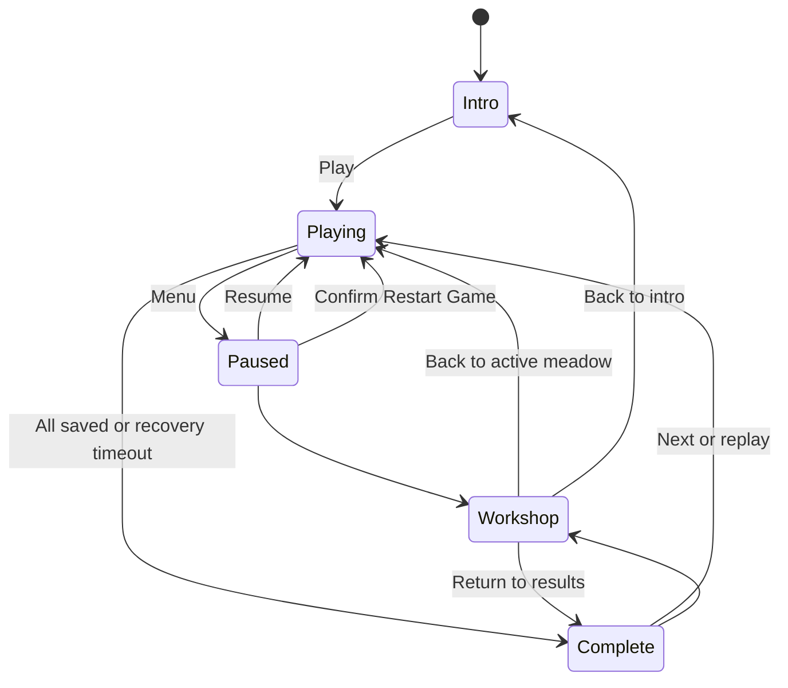
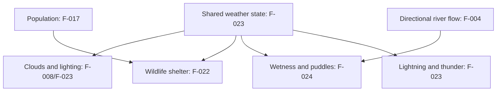

# Flock product requirements

Snapshot: 14 October 2026; integrated P0/P1 source batch on `flock_3D_chatgpt-work` (source checkpoints and evidence in [validation](validation/P0-P1.md)). Audience: implementers, reviewers and players checking intended behavior. Public campaign levels are **1–100**; source indexes are **0–99**.

This document separates the implemented baseline from requested changes. **Implemented baseline** means present in the inspected source, not proven on a phone. **Pending request** means recorded user intent whose acceptance criteria are still open. **Proposed / unresolved** means an implementation choice that must not be presented as approved. F-025 is Done; F-001/F-002/F-005/F-009/F-010/F-016/F-018 are source-implemented / Review; F-014 is Done by user confirmation on 14 October 2026. All P2 items remain Open. [ISSUES.md](ISSUES.md) owns priority, acceptance criteria and execution records. [QUALITY.md](QUALITY.md) owns historical test/review evidence and its limits. This document does not implement or deploy anything.

## Product and approved engine

Flock: Little Robot, Big Pastures is a cheerful, true-3D robotic herding game for portrait phones, playable with one thumb. The player steers Pip, a robotic sheepdog, behind a flock to guide it along countryside trails to a pen, fenced field or barn. Rewards buy skills and companions; companions support the player rather than delivering the flock unattended. Preserve the rounded, colorful, handmade countryside and visible robotic character details. The requested visual direction was bright, organic, clay/stop-motion countryside inspired by Aardman; characters and assets remain original.

The original engine request was ThreeRust. Investigation found no publicly documented reusable runtime SDK suitable for this repository; the user approved **Three.js** as the fallback. The implemented stack is Three.js/WebGL, JavaScript modules and Vite, with procedural geometry/textures and generated audio. Do not describe this as ThreeRust, `three-rs` or `threers`. See [README.md](../README.md) and [package.json](../package.json).

The current product is a standalone static development build with local browser saves. Accounts, online multiplayer and cloud saves are outside the implemented baseline. Local development and explicit `build:dev` distributions include isolated QA tools; normal production builds exclude them.

## Implemented baseline to preserve

### Play and state

- Drag the meadow or movement control to steer; WASD/arrows support desktop. Tap Woof, double-tap the meadow or press Space to bark. Bark applies a short herding burst; the current controller uses a 650 ms burst and 2,100 ms cooldown. Preserve single-thumb access when adding interactions.
- Pip's proximity pushes animals away; grouping behavior respects barriers. Physical bodies cannot cross fences, bridge rails, rivers outside decks, trees or the map perimeter. Pip's signal may cross low wooden fences/rails, but barns, water and trees shield it. Companion attendance, movement and delivery use clear ground paths.
- Delivery requires Pip near the destination, an unheld animal fully inside the shared rotated rectangular enclosure footprint and clear ground attendance. Saved animals stop moving. First valid arrival starts a 30–60 second recovery countdown; all delivered ends early, otherwise timeout freezes a partial result. HUD and results show score / possible score. Pause, menus, workshop and QA editing do not advance simulation time or admissions.
- Pause/menu/workshop suspend gameplay and audio. Workshop and results support replay/continuation. Restart meadow resets the current scenario; confirmed **Restart Game** clears campaign progress, bolts and purchases and starts level 1. Cancelling preserves progress.
- Music begins after user interaction and shares a mute control with wildlife/weather ambience. Pending audio activation must not undo pause; delayed music scheduling must stay bounded.

Code: [main.js](../src/main.js) (`begin`, `bark`, `menu`, `confirmRestart`, `complete`, `frame`), [simulation.js](../src/simulation.js) (`stepSimulation`), [audio.js](../src/audio.js). Regressions: UI, simulation, audio and herding-journey tests under [tests/](../tests/).

This diagram summarizes current player states. Workshop return follows its originating gameplay state: opening it through a paused gameplay menu and closing it resumes play; an intro visit returns to intro, and results return to results. The controller also opens the workshop directly from play. Restart confirmation/cancellation is omitted here. The recovery countdown starts only on the first valid attended arrival; travel beforehand has no deadline.

### Campaign, map size and routes

The recorded user baseline asks for a small sheep-to-pen tutorial, increasing flock size and journey distance, procedural fields/rivers/bridges/roads/gates, and progression points unlocking skills and autonomous helpers. Later direction preserves compact single-path levels 1–5, asks for **1–2 routes at levels 6–15** and **1–3 routes from level 16**, expands vertical roaming bounds by **3–4× from level 6**, and continues increasing the playable expanse. Drone starts at 10; the more expensive Buddy starts at 20; other skills appear across the first fifteen levels. These are intent constraints.

The table below records current generator rules, not newly proposed balance targets. Exact starting count 5, +3 animals per level and cap 65 are implementation-derived, not additional user-specified numbers. The current late generator chooses two or three routes within the requested one-to-three range; it does not generate single-route late levels. Deterministic default seed is `index * 7919 + 42`; custom seeds are supported by `createLevel`. Index is clamped to 0–99.

| Aspect | Current implementation |
|---|---|
| Animal count | `min(5 + 3 * index, 65)`: levels 1–5 have 5, 8, 11, 14, 17; level 21 onward has 65. Journey distance continues growing. |
| Species | Sheep initially; from level 4 every fourth animal (ID divisible by 4) is a cow. |
| Compact levels 1–5 | Canonical bounds: travel axis −32 to `30 + 3 * index`, cross axis −24 to +24. At level 1 this is 62 × 48 world units; at level 5, 74 × 48. |
| Expanded levels 6–100 | Canonical travel bounds −40 to `63 + 3 * index`; half cross extent `84 + 14 * floor(index / 15)`. Level 6 is 118 × 168 before rotation/final bounds adjustment. The generator additionally expands final Z bounds to cover ±half cross extent. |
| Destination distance | Canonical destination axis `15 + 3 * index` for levels 1–5, `48 + 3 * index` thereafter; spawn is −20 early, −26 later. These are world-coordinate distances, not completion times. |
| Route count | Levels 1–5: one. Levels 6–15: one or two (zero-based odd indexes get two). Level 16 onward: two or three (indexes divisible by 3 get three). |
| Direction | First level fixed; other early levels use two opposing orientations; later levels rotate across four compass directions according to seed. |
| Water/gates | Level 1 has no river; other early levels one. Later levels one until level 15, two from level 16. Gate **openings** begin at level 3; operable closed gates are pending F-006. |
| Destinations | Repeat pen, field, barn by index modulo 3. Target radius is a sizing input `4.7 + 0.2 * sqrt(animal count)`; shared rectangular half-extents are radius + 1.4, with a 7-unit entrance. Highlight, map, walls and full-body admission derive from the footprint. |
| Roads and bridges | Usable roads are 4.1 units early, except level 2 at 9.4, and 4.8 later; decorative shoulders are excluded. Deck width is exactly 1.25 × usable road width. Decks and straight road approaches align perpendicular to the sampled river segment. Length remains river width + 5 for dry landings. |

Examples: level 8 is index 7, has 26 robots and two routes; level 17 is index 16 and is the first level eligible for the **requested**, currently absent bolting behavior. The special wide level-2 crossing repaired a demonstrated simulated retrieval stall; preserve that regression when changing bridge rules.

Maps provide alternate trails, winding roads, real bridge/gate openings, destination staging room, continuous rivers beyond boundaries and decorative hills outside playable ground. Alternate routes are generated by level rules, not purchased or independently unlocked. See [world.js](../src/world.js) (`createLevel`, `canOccupy`, `terrainHeight`, `navigationTarget`, `openingSteer`) and world/journey tests. Geometry-route reachability is not proof that every human can deliver every flock.

### Progress, economy and helpers

The initial profile has zero bolts, no upgrades, no completed levels and only level 1 available. Any positive delivery at completion unlocks the next meadow (capped at level 100). Possible score is `80 + 25 * index`; earned score is `floor(possibleScore * saved / total)`. A run pays only `max(0, score - previousLifetimeBestEarnedBolts)`. Equal/worse replays pay zero; later improvement pays only the delta even after spending/reloading. Zero deliveries neither pay nor unlock. Profile version 2 stores an authoritative `bestEarnedBolts` ledger; legacy completed levels migrate to fully earned entitlements without crediting spendable points again. Purchased tiers remain saved, but only tiers unlocked for the meadow being played apply. Invalid profile fields are sanitized; legacy boolean purchases migrate to tier 1. Browser storage failure retains the session and shows feedback. Key: `flock-foundry-v1`; do not clear or rename it for F-025.

| Skill | Tier unlock levels | Tier costs (bolts) | Current tier effects |
|---|---|---|---|
| Turbo paws | 2 / 6 / 11 | 80 / 120 / 200 | +1.8 / +2.7 / +3.5 m/s |
| Friendly signal | 7 / 10 / 15 | 120 / 180 / 260 | +2 / +3 / +4 m range |
| Scout drone | 10 / 14 / 18 | 200 / 360 / 540 | Support strength 0.7 / 0.93 / 1.17 |
| Buddy dog | 20 / 24 / 28 | 600 / 850 / 1200 | Support strength 1 / 1.3 / 1.58 |
| Happy bark | 4 / 8 / 13 | 100 / 160 / 240 | +0.25 / +0.45 / +0.65 strength |
| Flock harmony | 12 / 14 / 15 | 160 / 220 / 320 | +12% / +23% / +35% regrouping |

Drone unlock is exactly level **10**; Buddy is exactly **20** and costs more. Helpers attend the largest connected herd, hold it when Pip leaves, and do not fetch isolated stragglers or autonomously finish. Recover stragglers and return to lead delivery. Ground Buddy must navigate around solid barriers. See [progression.js](../src/progression.js), profile functions in [simulation.js](../src/simulation.js), progression/companion tests.

### Art, wildlife and weather

Current sheep/cows have articulated, instanced stop-motion leg poses. Ground uses deterministic tileable color/bump textures, with decorative grass, flowers and reeds. Puffy model clouds drift with soft ground shadows. Butterflies, birds and simple squirrels avoid nearby robots, including saved flock animals and helpers. There are no rabbits or weather-driven shelter system yet. Small decorative bushes already mark field edges/tree roots; the broader requested F-019 bush environment remains Open.

`weatherForLevel` in [nature.js](../src/nature.js) uses sun for levels 1–5, then cycles sun/wind/rain/sun/snow, disallowing snow through level 8. Non-sun intensity is currently 0.3; weather is fixed per level and does not affect movement or rewards. Current counts are five clouds, five birds, three squirrels, and eight butterflies (four in rain, zero in snow), subject to safe placement. These fixed counts do not satisfy F-017's random area-scaled populations. Animated rainfall is not accumulated wetness, storms or puddles.

## Requested change traceability

Status: F-025 is **Done**; F-001/F-002/F-005/F-009/F-010/F-016/F-018 are **Review** (source implementation, pending independent/applicable rendered or device checks); F-014 is **Done**. Other rows remain **Open**. Existing systems must not be confused with completed visual acceptance. Detailed reproduction evidence, dependencies and decisions are in the corresponding sections of [ISSUES.md](ISSUES.md).

| ID | Priority | Required outcome and exact constraints | Current gap / main code touchpoints |
|---|---|---|---|
| F-025 | **P0, first** | Canonical public game at **https://novydhillon.github.io/Flock/dev2/**; deploy `dev2/` on `gh-pages`, preserve unrelated files and saved profiles; explicitly migrate old URL. | Done: verified canonical migration at Pages `baca95c7ba618d736730194b433254bf5058dd66`; legacy redirect preserves query/fragment. P1 development release verified at Pages `9346f26`. |
| F-001 | P1 | Continuous textured path corners without black triangles, gaps, spikes or flicker; check reported levels 4/8. | Review: `surfaces.js` unions stroke pieces into disjoint upward triangles with world UVs. Pixel/flicker checks remain. |
| F-002 | P1 | Bark above grass/path/ground and bridge decks, normally occluded by fences/rails. | Review: `barkSurface` splits at deck/plank edges, lifts above each surface, retains depth testing and bounded pause-aware lifetime. |
| F-003 | P2 | Detailed recognizable squirrel; coordinated scurry/bound/alert motion, stable idle/blocked heading, no spinning. | Simple art and desired-direction heading exist. `nature.js`, `models.js`; actual motion review required. |
| F-004 | P2 | Subtle animated running-water texture following local river direction, seamless banks/bends, pause-safe. | Rivers exist; requested flow treatment pending. `render.js`, `world.js`. |
| F-005 | P1 | Crossings perpendicular to local river tangent; bridge width **1.25 × crossing path width**; minimal safe dry-ground extension. | Review: local sampled tangent, straight approaches and 1.25 × usable path width; level-2 road/deck widen together. Visual checks remain. |
| F-006 | P2 | Gates requiring player opening at **level 20+**; visible/collidable state and single-thumb interaction. Levels 1–19 retain accessible openings. | Existing gates are openings, no open/close state. `world.js`, `simulation.js`, `main.js`, renderer. |
| F-007 | P2 | Stone walls replace fences on selected levels with consistent collision and usable entrances. | Fence baseline exists; wall variants pending. `world.js`, `models.js`, `render.js`. |
| F-008 | P2 | Soft textured clouds, potentially overlapping blurred blobs, **10–25%** semi-transparency, drifting/shadowed and readable. | Model clouds currently use .5 material opacity. Opacity interpretation needs confirmation. `nature.js`. |
| F-009 | P1 | First valid arrival starts **30–60 s** countdown by complexity; finish at zero or all delivered; partial score shown as **score / possible score**. | Review: first-arrival countdown, proportional floor score, positive partial unlock and best-improvement ledger implemented; verify human pacing. |
| F-010 | P1 | Highlight, delivery region, minimap and rotated pen/field/barn enclosure share the same shape. | Review: shared rotated footprint drives enclosure, highlight, minimap and full-body admission; rendered comparison remains. |
| F-011 | P2 | Pip tail light normally blue, flashes red on bark then restores reliably. | Dedicated tail feedback absent. `models.js`, `render.js`, shared bark event. |
| F-012 | P2 | From **level 8**, up to **15%** eligible animals have **33%** chance to wander away while not actively herded. From **level 17**, up to **10%** chance to bolt for **1–3 s**. | New cohort/probability behavior absent; ordinary tiny idle motion is not this feature. `simulation.js`, `world.js`. |
| F-013 | P2 | Investigate level-5 pacing with humans, retrieval/chokepoint evidence and unchanged ordinary-input regressions. | Simulated level-5 time spike known; no confirmed human difficulty verdict. World/journey balance. |
| F-014 | P1 | Real-phone controls, portrait readability, gestures, modals, sound and restart verified with device/revision evidence. | Done: user confirmed real-phone QA on 14 October 2026; device/browser details not supplied. |
| F-015 | P3 | Measure mobile GPU and repeated transition stability on normal, large/split herds and weather scenes. | Submission/resource checks exist; phone frame times unmeasured. Set device targets before verdict. |
| F-016 | P1 | Under cover, fade roof and wall nearest camera when occluding Pip/flock; restore stably; retain collision. | Review: full segmented barn roof/walls with camera-ray material fades, coverage hysteresis, pause and cleanup; pixels remain unverified. |
| F-017 | P2 | Add detailed hopping rabbits; random rabbit/squirrel populations scale with usable level area. | Rabbits absent, squirrels fixed count. `nature.js`, `models.js`; seeded bounded generation. |
| F-018 | P1 | Dev-only QA menu: level **0–100**, add/remove bolts, pause and reposition individual animals using touch/mouse. Available in deployed dev build; absent in release. | Review: isolated dev-only menu; 0 = tutorial shortcut, 1–100 = public campaign. Paused coordinate edits, bounded override, currency, reset and JSON export; production exclusion tested. Animal selection and coordinate positioning are temporarily hidden in the QA panel. |
| F-019 | P2 | Organic varied bushes without blocked routes/spawns or hidden critical play areas. | Open: small decorative root/field bushes exist; requested broader organic varied environment and collision policy remain pending. |
| F-020 | P2 | Visibly larger trees while maintaining proportion, actor visibility and route clearance. | Existing trees retain current dimensions. Target scale unresolved. World/model/render bounds. |
| F-021 | P2 | Richer tree/bush foliage and bark detail/textures, cheerful organic appearance with mobile budget. | Current simplified tree baseline; bushes pending. `models.js`, `render.js`. |
| F-022 | P2 | Light rain/wind retain wildlife; worsening severity makes smaller species hide first, then larger; plausible return. | Fixed per-level counts lack retreat/shelter transitions. `nature.js`, shared weather state. |
| F-023 | P2 | Worsening rain/storms increase cloud cover/change lighting; lightning flashes paired with thunder. | No storm/transition/event contract. `nature.js`, `render.js`, `audio.js`. |
| F-024 | P2 | Sustained heavier rain gradually darkens grass/dirt; storms form puddles and animal footstep splashes; rivers respond coherently. | No accumulation/puddle/splash system. `nature.js`, `render.js`, `world.js`. |
| F-026 | P3 | Pause-menu Quit returns to the landing page while preserving saved progress. | Open; distinct from Restart Game. In-progress-meadow resume policy unresolved. |
| F-027 | P2 | Wildlife may cross fences and leave/reenter the game area. | Open; robotic animals/dog remain physically fenced. Wildlife obstacle/entry rules need definition with F-017. |

### Decisions still open

Resolve only the choices needed for an implementation; independent repairs can proceed. Record actual approvals in ISSUES.md. The following are **not approved defaults**:

- F-006/F-007: gate action and reclosing; wall selection/height and whether walls block herding signals.
- F-008/F-023: whether “10–25%” means opacity 0.10–0.25, how overlapping blobs compose, and any storm exception.
- F-011: whether Buddy shares Pip's tail convention on a real Buddy bark event.
- F-012: eligible-cohort integer rounding, random opportunity interval, wander distance/speed/cooldown, definition of active herding, and whether bolt chance is conditional on wandering. A 33% chance is **not** permission to roll every frame. For a five-animal flock, the treatment of 15% eligibility requires an explicit rounding policy.
- F-017/F-019/F-020: wildlife area/count ranges, caps, absence/spawn rules; bush collision policy; tree scale/range.
- F-022–F-024: shared severity model, species thresholds/hysteresis/return delay, transition timing and within-level weather policy; lightning frequency/intensity/thunder timing; wetness/drying rates, puddle thresholds/placement, river response and which actors splash. No weather movement penalty is approved.

This is a required coordination boundary, not a claim that a shared severity API has already been designed or approved.

## Implemented P1 decisions and deployment boundary

User-approved on 14 October 2026: positive partial delivery unlocks the next meadow; proportional earned score uses `floor(reward * saved / total)`; lifetime best improvement pays only the delta; QA 0 is a tutorial shortcut and public levels remain 1–100. Implemented recovery duration is `clamp(30 + ceil(max(0,total-5)/5) + 4*(routes-1) + 2*floor(spawnToGoalDistance/40), 30, 60)` seconds of simulation time. This formula is a source balance choice to review, not measured human pacing.

**F-025 is Done.** Canonical URL: **https://novydhillon.github.io/Flock/dev2/**. Pages commit `baca95c7ba618d736730194b433254bf5058dd66` deployed the preceding game at `dev2/`, with a query/fragment-preserving legacy redirect, matching hashes for all 15 game files and redirect, and unchanged 17 unrelated blobs. Existing local-storage key remains `flock-foundry-v1`; real browser continuity is still a device check.

The helper validates the build's relative asset graph and stages canonical output without committing/pushing. Normal `build` excludes QA; `build:dev` explicitly includes it. Source completion, bundle checks, Pages commit, native publication and live verification are separate milestones. The P1 development build from source `7a8519d37a8f447652f0449e16a050fc76a6d3e0` is now live at Pages `9346f26c5a145698b34e2c4504236c494023817d`; 17 game files plus redirect match expected hashes, and 18 outside-`dev2/` blobs remain unchanged. See [runbook](validation/P0-P1.md).

## Verification and handoff contract

For each implemented request, record requirement ID, source commit, level/seed, expected/observed outcome, relevant commands/results and remaining limitations in ISSUES.md. Run meaningful regression checks and production build. Retain the solved companion hold/no-autonomous-delivery, level-10/20 unlock, level-2 bridge retrieval, profile/restart and audio pause/scheduling cases.

`npm test` covers source simulation/profile/controller behavior, real Three.js geometry/matrices behind a substituted GPU interface, resource disposal and synthetic audio lifecycles. `npm run build` checks production packaging. Existing historical evidence reports **93 passing tests**, route sweeps, bounded legitimate-input flock deliveries and fresh blind reviews at **9.1/10 technical / 8.6/10 gameplay**. These are bounded historical findings from QUALITY.md, not a new assessment of this document or the pending requests.

Headless checks cannot verify rendered pixels/flicker, motion quality, real Safari gestures, portrait touch ergonomics, perceived sound balance or phone GPU frame time. Screenshots establish visible artifacts; they do not establish temporal flicker/spinning or a root cause. Real-device records must identify device/browser and source/deployment revision, with scenario evidence. Preserve F-013/F-015 as Open. F-014 was accepted by the user on 14 October 2026; separate visual issues retain their own acceptance criteria. Do not convert historical critic scores into a verified overall game score.

Next: review the P1 source batch, complete rendered/device scenarios when available, and publish/verify that batch separately. Gates/walls/wandering and all other P2 requests remain Open. Coordinate shared files and the weather contract; do not treat QA tooling as a mandatory runtime dependency of fixes. This requirements snapshot has been checked against repository source and records only; it adds no gameplay changes or new browser/device validation.
