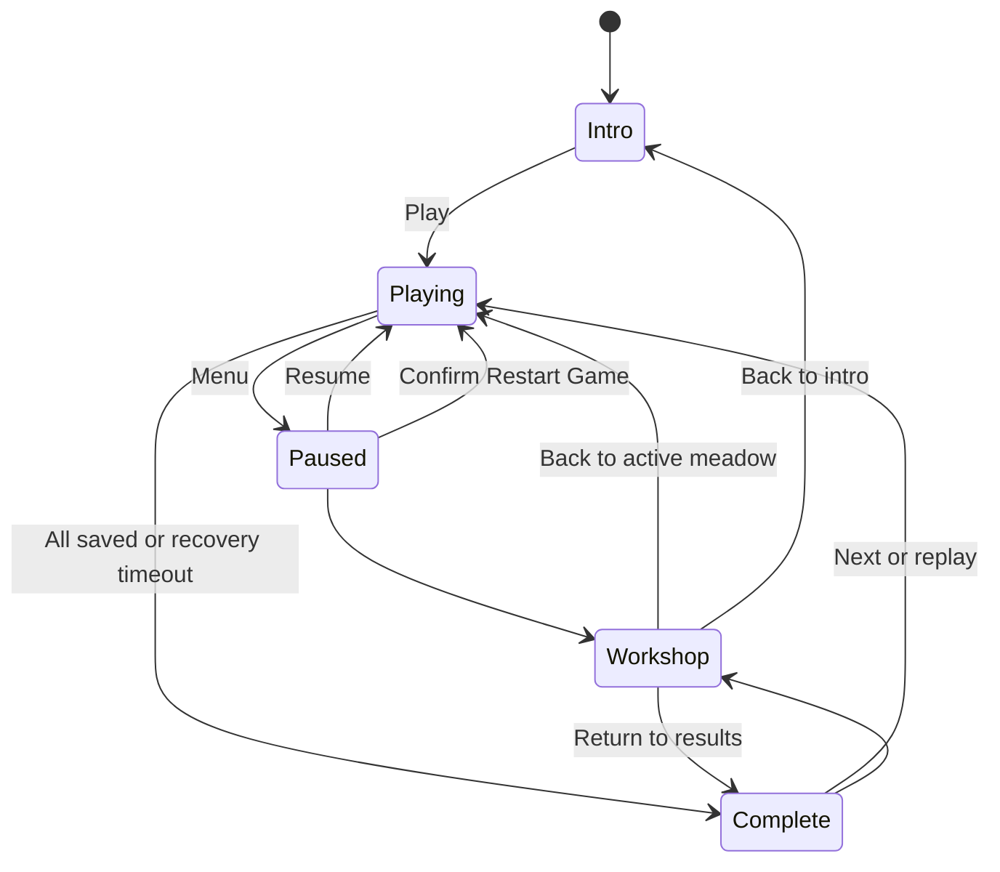
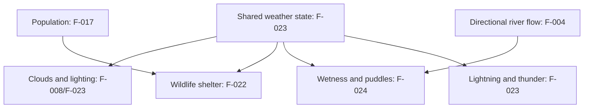

# Flock product requirements

Snapshot: 15 October 2026; integrated P2 source candidate at `b431cfe`. P0/P1 acceptance and deployment evidence remain in [validation](validation/P0-P1.md). Audience: implementers, reviewers and players checking intended behavior. Public campaign levels are **1–100**; source indexes are **0–99**.

This document separates implemented candidates from accepted behavior. **Review** means code and focused regressions exist, but the P2 feature still needs blind review and rendered/device acceptance; it is not Done. **Open** means implementation or acceptance remains incomplete. All P0/P1 issues are Done by user sign-off on 14 October 2026. F-028 goal roaming was accepted on 15 October 2026 at 00:28 America/Vancouver for the deployed build. P2 source candidates described below await review/integration acceptance; F-013 and F-015 remain Open because they require human pacing and device performance evidence. [ISSUES.md](ISSUES.md) owns priority, acceptance criteria and execution records. [QUALITY.md](QUALITY.md) owns historical test/review evidence and its limits. This document does not implement or deploy anything.

## Product and approved engine

Flock: Little Robot, Big Pastures is a cheerful, true-3D robotic herding game for portrait phones, playable with one thumb. The player steers Pip, a robotic sheepdog, behind a flock to guide it along countryside trails to a pen, fenced field or barn. Rewards buy skills and companions; companions support the player rather than delivering the flock unattended. Preserve the rounded, colorful, handmade countryside and visible robotic character details. The requested visual direction was bright, organic, clay/stop-motion countryside inspired by Aardman; characters and assets remain original.

The original engine request was ThreeRust. Investigation found no publicly documented reusable runtime SDK suitable for this repository; the user approved **Three.js** as the fallback. The implemented stack is Three.js/WebGL, JavaScript modules and Vite, with procedural geometry/textures and generated audio. Do not describe this as ThreeRust, `three-rs` or `threers`. See [README.md](../README.md) and [package.json](../package.json).

The current product is a standalone static development build with local browser saves. Accounts, online multiplayer and cloud saves are outside the implemented baseline. Local development and explicit `build:dev` distributions include isolated QA tools; normal production builds exclude them.

## Implemented baseline to preserve

### Play and state

- Drag the meadow or movement control to steer; WASD/arrows support desktop. Tap Woof, double-tap the meadow or press Space to bark. Bark applies a short herding burst; the current controller uses a 650 ms burst and 2,100 ms cooldown. Preserve single-thumb access when adding interactions.
- Pip's proximity pushes robotic flock animals away; grouping behavior respects barriers. Gameplay bodies (Pip, robotic flock and ground helpers) cannot cross fences, stone walls, closed gates, bridge rails, rivers outside decks, trees or the map perimeter. Ambient wildlife can cross fence lines and briefly roam beyond/re-enter the playfield; water and trees still constrain it. Pip's herding signal may pass low wooden fences/rails, but stone walls, barns, water and trees shield it. Companion attendance, movement and delivery use clear ground paths.
- Delivery requires Pip near the destination, an unheld animal fully inside the shared rotated rectangular enclosure footprint and clear ground attendance. Delivered animals remain saved and roam gently within the body-contracted goal footprint (F-028). First valid arrival starts a 30–60 second recovery countdown; all delivered ends early, otherwise timeout freezes a partial result. HUD and results show score / possible score. Pause, menus, workshop and QA editing do not advance simulation time or admissions.
- Pause/menu/workshop suspend gameplay and audio. Workshop and results support replay/continuation. Restart meadow resets the current scenario; confirmed **Restart Game** clears campaign progress, bolts and purchases and starts level 1. Cancelling preserves progress.
- Music begins after user interaction and shares a mute control with wildlife/weather ambience. Pending audio activation must not undo pause; delayed music scheduling must stay bounded.

Code: [main.js](../src/main.js) (`begin`, `bark`, `menu`, `confirmRestart`, `complete`, `frame`), [simulation.js](../src/simulation.js) (`stepSimulation`), [audio.js](../src/audio.js). Regressions: UI, simulation, audio and herding-journey tests under [tests/](../tests/).

This diagram summarizes current player states. Workshop return follows its originating gameplay state: opening it through a paused gameplay menu and closing it resumes play; an intro visit returns to intro, and results return to results. The controller also opens the workshop directly from play. Restart confirmation/cancellation is omitted here. The recovery countdown starts only on the first valid attended arrival; travel beforehand has no deadline.

### Campaign, map size and routes

The recorded user baseline asks for a small sheep-to-pen tutorial, increasing flock size and journey distance, procedural fields/rivers/bridges/roads/gates, and progression points unlocking skills and autonomous helpers. Later direction preserves compact single-path levels 1–5, asks for **1–2 routes at levels 6–15** and **1–3 routes from level 16**, expands vertical roaming bounds by **3–4× from level 6**, and continues increasing the playable expanse. Drone starts at 10; the more expensive Buddy starts at 20; other skills appear across the first fifteen levels. These are intent constraints.

The table below records current generator rules, not newly proposed balance targets. Exact starting count 5, +3 animals per level and cap 65 are implementation-derived, not additional user-specified numbers. The current late generator chooses two or three routes within the requested one-to-three range; it does not generate single-route late levels. Deterministic default seed is `index * 7919 + 42`; custom seeds are supported by `createLevel`. Index is clamped to 0–99.

| Aspect | Current implementation |
|---|---|
| Animal count | `min(5 + 3 * index, 65)`: levels 1–5 have 5, 8, 11, 14, 17; level 21 onward has 65. Journey distance continues growing. |
| Species | Sheep initially; from level 4 every fourth animal (ID divisible by 4) is a cow. |
| Compact levels 1–5 | Canonical bounds: travel axis −32 to `30 + 3 * index`, cross axis −24 to +24. At level 1 this is 62 × 48 world units; at level 5, 74 × 48. |
| Expanded levels 6–100 | Canonical travel bounds −40 to `63 + 3 * index`; half cross extent `84 + 14 * floor(index / 15)`. Level 6 is 118 × 168 before rotation/final bounds adjustment. The generator additionally expands final Z bounds to cover ±half cross extent. |
| Destination distance | Canonical destination axis `15 + 3 * index` for levels 1–5, `48 + 3 * index` thereafter; spawn is −20 early, −26 later. These are world-coordinate distances, not completion times. |
| Route count | Levels 1–5: one. Levels 6–15: one or two (zero-based odd indexes get two). Level 16 onward: two or three (indexes divisible by 3 get three). |
| Direction | First level fixed; other early levels use two opposing orientations; later levels rotate across four compass directions according to seed. |
| Water/gates/walls | Level 1 has no river; other early levels one. Later levels one until level 15, two from level 16. Gate openings begin at level 3; operable gates are closed at public level 20+ and can be opened by Pip nearby. Stone replaces selected interior/perimeter fence segments from public level 8 on a four-level cadence. |
| Destinations | Repeat pen, field, barn by index modulo 3. Target radius is a sizing input `4.7 + 0.2 * sqrt(animal count)`; shared rectangular half-extents are radius + 1.4, with a 7-unit entrance. Highlight, map, walls and full-body admission derive from the footprint. |
| Roads and bridges | Usable roads are 4.1 units early, except level 2 at 9.4, and 4.8 later; decorative shoulders are excluded. Deck width is exactly 1.25 × usable road width. Decks and straight road approaches align perpendicular to the sampled river segment. Length is river width + 1.5 (0.75 nominal bank overlap per end); sampled strip coverage is tested across deck width. Dry route turning planes remain independent of the shorter deck. Blocked animal steering routes toward the nearest local opening around solid rail ends. |

Examples: level 8 is index 7, has 26 robots and two routes, and is the first level using stone wall segments; level 17 is index 16 and is the first level eligible for conditional straggler bolts. The special wide level-2 crossing repaired a demonstrated simulated retrieval stall; preserve that regression when changing bridge rules.

Maps provide alternate trails, winding roads, real bridge/gate openings, destination staging room, continuous rivers beyond boundaries and decorative hills outside playable ground. Alternate routes are generated by level rules, not purchased or independently unlocked. See [world.js](../src/world.js) (`createLevel`, `canOccupy`, `terrainHeight`, `navigationTarget`, `openingSteer`) and world/journey tests. Geometry-route reachability is not proof that every human can deliver every flock.

### Progress, economy and helpers

The initial profile has zero bolts, no upgrades, no completed levels and only level 1 available. Any positive delivery at completion unlocks the next meadow (capped at level 100). Possible score is `80 + 25 * index`; earned score is `floor(possibleScore * saved / total)`. A run pays only `max(0, score - previousLifetimeBestEarnedBolts)`. Equal/worse replays pay zero; later improvement pays only the delta even after spending/reloading. For example, a best score of 32 followed by 64 adds 32 bolts. Zero deliveries neither pay nor unlock. Profile version 2 stores an authoritative `bestEarnedBolts` ledger; legacy completed levels migrate to fully earned entitlements without crediting spendable points again. Purchased tiers remain saved, but only tiers unlocked for the meadow being played apply. Invalid profile fields are sanitized; legacy boolean purchases migrate to tier 1. Browser storage failure retains the session and shows feedback. Key: `flock-foundry-v1`; do not clear or rename it for F-025. F-029 records this existing, tested rule as Done; the latest P0 missing-bolts-on-replay report was withdrawn as invalid. See [F-029 in the issue tracker](ISSUES.md#f-029--lifetime-best-score-improvement-pays-only-its-difference).

| Skill | Tier unlock levels | Tier costs (bolts) | Current tier effects |
|---|---|---|---|
| Turbo paws | 2 / 6 / 11 | 80 / 120 / 200 | +1.8 / +2.7 / +3.5 m/s |
| Friendly signal | 7 / 10 / 15 | 120 / 180 / 260 | +2 / +3 / +4 m range |
| Scout drone | 10 / 14 / 18 | 200 / 360 / 540 | Support strength 0.7 / 0.93 / 1.17 |
| Buddy dog | 20 / 24 / 28 | 600 / 850 / 1200 | Support strength 1 / 1.3 / 1.58 |
| Happy bark | 4 / 8 / 13 | 100 / 160 / 240 | +0.25 / +0.45 / +0.65 strength |
| Flock harmony | 12 / 14 / 15 | 160 / 220 / 320 | +12% / +23% / +35% regrouping |

Drone unlock is exactly level **10**; Buddy is exactly **20** and costs more. Helpers attend the largest connected herd, hold it when Pip leaves, and do not fetch isolated stragglers or autonomously finish. Recover stragglers and return to lead delivery. Ground Buddy must navigate around solid barriers. See [progression.js](../src/progression.js), profile functions in [simulation.js](../src/simulation.js), progression/companion tests.

### Art, wildlife and weather

Current sheep/cows have articulated, instanced stop-motion leg poses. Ground uses deterministic tileable color/bump textures, with decorative grass, flowers and reeds. Foliage includes larger foreground trees, textured bark and leaf surfaces, plus seeded clusters of varied, non-colliding bushes placed away from routes, water, trees, fences, spawns and destinations. Squirrels and rabbits have merged anatomical body meshes and animated paw instances; squirrel/rabbit/bird/butterfly populations scale reproducibly with usable meadow area and remain capped. Wildlife can cross fence lines and roam within a small outside margin, while trees, water, barn walls and stone walls continue to block ground fauna. Novy accepted these original P2 wildlife/vegetation features on 15 October 2026 for Pages `cc13865`; new requests are tracked separately.

In the fixed-weather source candidate, [`weather.js`](../src/weather.js) chooses a fixed seeded weather kind once per level, with no snow or timed weather transitions (F-040). Rain unlocks at public level 9, heavy rain at 16 and storms at 24; 16/24 and other-level weights are initial source tuning choices. Those three levels are guaranteed QA examples. Nature advances the shared clock only for cloud/rain animation and paired lightning events, while kind, rain, wind, severity and daylight remain fixed. `RainView` uses 96/176/256 visible downward streaks for light/heavy/storm; Visible clouds and their shadows are now disabled at Novy’s request; F-008 is Deferred. The dormant `Atmosphere` module is not used by the renderer. Storm lightning first occurs after 8–12 seconds, then at 24-second intervals; flashes peak .38 for .22 seconds, with .8–1.6-second delayed thunder. Light rain keeps wildlife active; heavy/storm severity progressively shelters species. Fixed rain starts with existing wet ground (.03/.35/.60 light/heavy/storm); heavy/storm puddles start at .40/.65 depth, then accumulation continues. Weather does not change collisions, movement speed, delivery or rewards. The mission panel labels the fixed condition. These weather changes are source-reviewed candidates pending fresh phone acceptance.

## Requested change traceability

Status: the original P0/P1 batch and F-028 remain accepted for their deployed builds. Weather F-008/F-022–F-024 has since reopened as P1 under F-040. The 11 original P2 items listed as Done were accepted by Novy; the new fixed-weather P1 candidate is **Review** pending fresh phone acceptance; F-013 and F-015 and other unimplemented work remain **Open**. Detailed evidence, dependencies and decisions are in [ISSUES.md](ISSUES.md).

| ID | Priority | Required outcome and exact constraints | Status | Current implementation candidate / remaining acceptance |
|---|---|---|---|
| F-025 | **P0, first** | Canonical public game at **https://novydhillon.github.io/Flock/dev2/**; deploy `dev2/` on `gh-pages`, preserve unrelated files and saved profiles; explicitly migrate old URL. | Done: verified canonical migration at Pages `baca95c7ba618d736730194b433254bf5058dd66`; legacy redirect preserves query/fragment. P1 development release verified at Pages `9346f26`. |
| F-001 | P1 | Continuous textured path corners without black triangles, gaps, spikes or flicker; check reported levels 4/8. | Done: user signed off 14 October 2026. `surfaces.js` unions stroke pieces into disjoint upward triangles with world UVs. |
| F-002 | P1 | Bark above grass/path/ground and bridge decks, normally occluded by fences/rails. | Done: user signed off 14 October 2026. `barkSurface` splits at deck/plank edges, lifts above each surface, retains depth testing and bounded pause-aware lifetime. |
| F-003 | P2 | Detailed recognizable squirrel; coordinated scurry/bound/alert motion, stable idle/blocked heading, no spinning. | Done: accepted 15 October 2026 at approximately 10:56 America/Vancouver for Pages `cc13865`, source `b1fdac3`. | Part-based squirrel model, locomotion/alert gait and retained heading are in `wildlife-models.js`, `wildlife.js` and `nature.js`; rendered motion/recognizability still need blind and device review. |
| F-004 | P2 | Subtle animated running-water texture following local river direction, seamless banks/bends, pause-safe. | Done: accepted 15 October 2026 at approximately 10:56 America/Vancouver for Pages `cc13865`, source `b1fdac3`. | `WaterEffects` clones river geometry and assigns local arc-length UVs from the sampled centerline, so procedural flow follows each bend rather than a whole-curve compass heading; each flow map repeats 1×1 and freezes at zero dt. |
| F-005 | P1 | Crossings perpendicular to local river tangent; bridge width **1.25 × crossing path width**; minimal safe dry-ground extension. | Done: Novy accepted the deployed bridge follow-up on 14 October 2026 (Vancouver), Pages `8a76de36bbb61ba824bc9371f85971667f786c35`. |
| F-006 | P2 | Gates requiring player opening at **level 20+**; visible/collidable state and single-thumb interaction. Levels 1–19 retain accessible openings. | Done: accepted 15 October 2026 at approximately 10:56 America/Vancouver for Pages `cc13865`, source `b1fdac3`. | `gates.js`, `gate-view.js`, `world.js`, `main.js` and renderer add operable panels from public level 20, a contextual Open gate action within 3.2 units with a clear approach, shared live collision/map state, and a sliding leaf. There is no close action. Review touch reachability and rendering. |
| F-007 | P2 | Stone walls replace fences on selected levels with consistent collision and usable entrances. | Done: accepted 15 October 2026 at approximately 10:56 America/Vancouver for Pages `cc13865`, source `b1fdac3`. | `world.js` assigns stone to selected segments from public level 8; `gate-view.js` renders masonry and `world.js` gives it a .30-unit collision radius (wood is .18). Openings remain the generated passages. |
| F-008 | P1 | Clouds temporarily removed, including their shadows, at user request on 15 October 2026. | **Deferred** | No runtime `Atmosphere` instance; dormant module/tests retained for future work. Rain, weather lighting and storm effects remain active. |
| F-009 | P1 | First valid arrival starts **30–60 s** countdown by complexity; finish at zero or all delivered; partial score shown as **score / possible score**. | Done: user signed off 14 October 2026. first-arrival countdown, proportional floor score, positive partial unlock and best-improvement ledger implemented. |
| F-010 | P1 | Highlight, delivery region, minimap and rotated pen/field/barn enclosure share the same shape. | Done: user signed off 14 October 2026. shared rotated footprint drives enclosure, highlight, minimap and full-body admission. |
| F-011 | P2 | Pip tail light normally blue, flashes red on bark then restores reliably. | Done: accepted 15 October 2026 at approximately 10:56 America/Vancouver for Pages `cc13865`, source `b1fdac3`. | `tail-light.js` colors Pip's dedicated light blue at rest and red during the bounded bark effect; restore behavior is covered by source tests. |
| F-012 | P2 | From **level 8**, up to **15%** eligible animals have **33%** chance to wander away while not actively herded. From **level 17**, up to **10%** chance to bolt for **1–3 s**. | Done: accepted 15 October 2026 at approximately 10:56 America/Vancouver for Pages `cc13865`, source `b1fdac3`. | `wandering.js` selects `floor(15% × flock)` by seeded rank and evaluates one 33% opportunity every five simulation seconds; bolts use a conditional 10% roll from public level 17 for 1–3 seconds. Saved and actively herded animals are excluded; confirm the chosen integer rounding and player-facing pacing. |
| F-013 | P2 | Investigate level-5 pacing with humans, retrieval/chokepoint evidence and unchanged ordinary-input regressions. | **Open** | Simulated level-5 time spike known; no confirmed human difficulty verdict. World/journey balance. |
| F-014 | P1 | Real-phone controls, portrait readability, gestures, modals, sound and restart verified with device/revision evidence. | Done: user confirmed real-phone QA on 14 October 2026; device/browser details not supplied. |
| F-015 | P3 | Measure mobile GPU and repeated transition stability on normal, large/split herds and weather scenes. | **Open** | Submission/resource checks exist; phone frame times unmeasured. Set device targets before verdict. |
| F-016 | P1 | Any dog/flock animal under cover fades the entire roof and full camera-facing wall side(s) to 30% transparency (opacity 0.70); restore when empty; retain collision. | Done: Novy accepted the deployed barn follow-up on 14 October 2026 (Vancouver), Pages `8a76de36bbb61ba824bc9371f85971667f786c35`. |
| F-017 | P2 | Add detailed hopping rabbits; random rabbit/squirrel populations scale with usable level area. | Done: accepted 15 October 2026 at approximately 10:56 America/Vancouver for Pages `cc13865`, source `b1fdac3`. | `wildlife.js`, `wildlife-models.js` and `nature.js` add seeded, area-scaled populations capped at 8 rabbits/7 squirrels (also capped birds/butterflies); spawn search is bounded and unsafe slots stay hidden. Visual quality and area-density balance remain open. |
| F-018 | P1 | Dev-only QA menu: level **0–100**, add/remove bolts, pause and reposition individual animals using touch/mouse. Available in deployed dev build; absent in release. | Done: user signed off 14 October 2026. isolated dev-only menu; 0 = tutorial shortcut, 1–100 = public campaign. Paused coordinate edits, bounded override, currency, reset and JSON export; production exclusion tested. Animal selection and coordinate positioning are temporarily hidden in the QA panel. |
| F-019 | P2 | Organic varied bushes without blocked routes/spawns or hidden critical play areas. | Done: accepted 15 October 2026 at approximately 10:56 America/Vancouver for Pages `cc13865`, source `b1fdac3`. | `vegetation.js` generates deterministic, non-colliding clusters (area target 3–24, 3–5 varied bushes each) away from routes, water, obstacles, fences, spawn and target; renderer adds them. |
| F-020 | P2 | Visibly larger trees while maintaining proportion, actor visibility and route clearance. | Done: accepted 15 October 2026 at approximately 10:56 America/Vancouver for Pages `cc13865`, source `b1fdac3`. | `models.js` supplies detailed tree variants; renderer scales obstacle trees to 1.45× their collision radius. This is an implementation choice, not a confirmed visual size target; review visibility, proportions and performance. |
| F-021 | P2 | Richer tree/bush foliage and bark detail/textures, cheerful organic appearance with mobile budget. | Done: accepted 15 October 2026 at approximately 10:56 America/Vancouver for Pages `cc13865`, source `b1fdac3`. | `models.js` adds procedural bark/foliage textures, sculpted leaf clusters and three bush variants, rendered via cached geometry/materials. |
| F-022 | P1 | Light rain/wind retain wildlife; worsening severity makes smaller species hide first, then larger; plausible return under fixed per-level weather. | **Review**, pending fixed-weather phone acceptance. | Fixed light/heavy/storm severity is .28/.60/.88; existing species thresholds .54/.58/.64/.76 and .12 hysteresis retain light-weather fauna and shelter progressively under heavier weather. |
| F-023 | P1 | Fixed per-level atmosphere, clouds and lighting; lightning flashes paired with thunder where applicable. Historical dynamic-ramp criteria are superseded by F-040. | **Review**, pending fixed-weather phone acceptance. | No weather ramps remain. Fixed storm levels pair deterministic bounded flashes and thunder; cloud/rain motion and lightning animate without changing weather type. |
| F-024 | P1 | Fixed-type rain accumulates wetness; heavier rain forms puddles/splashes and rivers respond coherently. | **Review**, pending fixed-weather phone acceptance. | Heavy/storm levels begin wet with standing puddles; rain continues gradual accumulation, and moving actors splash existing safe-land puddles. Pause/restart restore the correct level baseline. |
| F-028 | P2 | Delivered animals roam gently inside the rotated enclosure after arrival, including during results; full-body confinement, pause safety and immutable delivery results. | Done: user accepted deployed Pages `639a9b45608fa0ad6aaa8189dd91dd7ba24b082d` on 15 October 2026 at 00:28 America/Vancouver; F-012 escaping behavior still excludes delivered animals. |
| F-026 | P3 | Pause-menu Quit returns to the landing page while preserving saved progress. | Open; distinct from Restart Game. In-progress-meadow resume policy unresolved. |
| F-027 | P2 | Wildlife may cross fences and leave/reenter the game area. | Done: accepted 15 October 2026 at approximately 10:56 America/Vancouver for Pages `cc13865`, source `b1fdac3`. | `wildlife.js` uses a fence-permeable occupancy view and permits ambient fauna up to .45 units outside the bounds; water, trees, barn walls and stone walls remain solid. Robotic gameplay actors remain behind fences, stone walls, closed gates and map limits. |
| F-030 | P3 | Lighter, more contrasting water waves. | Open | New request; F-004 acceptance does not include this enhancement. |
| F-031 | P2 | Gates on some, not all, levels 20+; some gate levels have an ungated alternative. | Open | New request; retain accepted F-006 gate interaction. |
| F-032 | P3 | Closed red/open green world-fence button; dog touch activates. | Open | New request; coordinate with F-031 and F-006. |
| F-033 | P2 | English-farmhand-built drystone wall appearance. | Open | New appearance request; accepted F-007 functionality remains Done. |
| F-034 | P3 | Seeded 15% stone-wall chance per level, replacing fixed four-level sequence. | Open | New generation request; depends on F-033. |
| F-035 | P2 | Baseline bolt duration 3–5 seconds. | Open | Current deployed F-012 behavior remains 1–3 seconds. |
| F-036 | P3 | Unattended flock spreads across field. | Open | New behavior, separate from straggler behavior F-012 and saved roaming F-028. |
| F-037 | P2 | Eligible wander cohort increases from 15% to 20%. | Open | Current deployed F-012 remains 15%. |
| F-038 | P2 | Progressively larger multi-directional, less-linear levels over fields/rivers/tree clusters; body clearance, no stuck animals, later difficulty accounts for helpers. | Open | Preserve F-005 and accepted F-006 navigation. |
| F-039 | P2 | Past level 40 wander chance 30%, above 70 up to 50%, bolt chance 20%; duration 4–6s at 40 and 5–10s at 70. | Open | Ambiguous whether 30%/50% mean cohort fraction or opportunity-roll probability; clarification required before implementation. |
| F-040 | P1 | Remove all snow; select a fixed weather type once per level. Public level 9 starts light rain; later levels may become heavier. Exact later thresholds (including proposed level 16 heavy rain and level 24 storm) and other-level choices are unspecified and not user-approved. | **Review**, pending fixed-weather phone acceptance. | Implemented fixed kinds, no snow, public 9/16/24 QA anchors and seeded other-level selection. Later unlock numbers and weights are tunable source choices; user acceptance remains pending. |
| F-041 | P2 | Wanderers/bolters adopt their new position as the local idle/wander area rather than automatically returning to the flock. Active herding still works. | Open | Queued; current post-event flock cohesion remains. Preserve collision, gates, pressure interruption and saved-animal confinement. |

### Decisions still open

Resolve only the choices needed for an implementation; independent repairs can proceed. Record actual approvals in ISSUES.md. The following are **not approved defaults**:

- F-006/F-007 are accepted. Gate closing is not implemented or currently requested; new gate distribution, dog-touch controls and dry-stone art/probability are separate queued changes F-031–F-034.
- F-008 is Deferred at user request; F-022–F-024/F-040 remain P1 candidates in Review. Snow must be removed and weather types fixed per level; F-023 dynamic-ramp criteria are historical only. Public level 9 starts light rain. Exact later thresholds are unspecified; source-proposed level 16 heavy rain and level 24 storm are not user-approved. Other-level weather weights are source tuning choices, not explicit user-provided probabilities.
- F-011: whether Buddy shares Pip's tail convention on a real Buddy bark event.
- F-012: source currently chooses floor rounding, a seeded five-second opportunity cadence, 4–7 units of wander distance, and bolts as a conditional roll; test outcomes and human pacing remain open. A 33% chance is **not** permission to roll every frame. Small flocks can have a zero-sized eligible cohort under floor rounding.
- F-017/F-019/F-020: wildlife area/count ranges, caps, absence/spawn rules; bush collision policy; tree scale/range.
- F-022–F-024: while fixed weather is implemented, species thresholds, lightning frequency/intensity, wetness/drying rates, puddle placement, river response and actor splash rules still need acceptance. No weather movement penalty is approved.

This describes the fixed-weather source candidate. The prior published dynamic/snow behavior is superseded; release evidence is tracked separately in QUALITY.md.

## Implemented P1 decisions and deployment boundary

User-approved on 14 October 2026: positive partial delivery unlocks the next meadow; proportional earned score uses `floor(reward * saved / total)`; lifetime best improvement pays only the delta; QA 0 is a tutorial shortcut and public levels remain 1–100. Implemented recovery duration is `clamp(30 + ceil(max(0,total-5)/5) + 4*(routes-1) + 2*floor(spawnToGoalDistance/40), 30, 60)` seconds of simulation time. This formula is a source balance choice to review, not measured human pacing.

**F-025 is Done.** Canonical URL: **https://novydhillon.github.io/Flock/dev2/**. Pages commit `baca95c7ba618d736730194b433254bf5058dd66` deployed the preceding game at `dev2/`, with a query/fragment-preserving legacy redirect, matching hashes for all 15 game files and redirect, and unchanged 17 unrelated blobs. Existing local-storage key remains `flock-foundry-v1`; real browser continuity is still a device check.

The helper validates the build's relative asset graph and stages canonical output without committing/pushing. Normal `build` excludes QA; `build:dev` explicitly includes it. Source completion, bundle checks, Pages commit, native publication and live verification are separate milestones. The P1 development build from source `7a8519d37a8f447652f0449e16a050fc76a6d3e0` is now live at Pages `9346f26c5a145698b34e2c4504236c494023817d`; 17 game files plus redirect match expected hashes, and 18 outside-`dev2/` blobs remain unchanged. See [runbook](validation/P0-P1.md).

## Verification and handoff contract

For each implemented request, record requirement ID, source commit, level/seed, expected/observed outcome, relevant commands/results and remaining limitations in ISSUES.md. Run meaningful regression checks and production build. Retain the solved companion hold/no-autonomous-delivery, level-10/20 unlock, level-2 bridge retrieval, profile/restart and audio pause/scheduling cases.

`npm test` covers source simulation/profile/controller behavior, real Three.js geometry/matrices behind a substituted GPU interface, resource disposal and synthetic audio lifecycles. `npm run build` checks production packaging. Existing historical evidence reports **93 passing tests**, route sweeps, bounded legitimate-input flock deliveries and fresh blind reviews at **9.1/10 technical / 8.6/10 gameplay**. These are bounded historical findings from QUALITY.md, not a new assessment of this document or the pending requests.

Headless checks cannot verify rendered pixels/flicker, motion quality, real Safari gestures, portrait touch ergonomics, perceived sound balance or phone GPU frame time. Screenshots establish visible artifacts; they do not establish temporal flicker/spinning or a root cause. Real-device records must identify device/browser and source/deployment revision, with scenario evidence. Preserve F-013/F-015 as Open. F-014 was accepted by the user on 14 October 2026; separate visual issues retain their own acceptance criteria. Do not convert historical critic scores into a verified overall game score.

Next: obtain rendered/device acceptance for the source-reviewed P2 candidates; preserve F-013/F-015 as Open until human pacing and phone performance evidence exists. Publish/verify any accepted batch separately. This requirements snapshot records implementation candidates and source-level evidence only; it adds no gameplay changes or new browser/device validation.

## P1 acceptance

Novy signed off all remaining P1 review items (F-001, F-002, F-009, F-010 and F-018) on 14 October 2026 at 21:10 America/Vancouver, following F-005/F-016 acceptance at 21:08. All P0 and P1 issues are Done. Acceptance applies to the deployed development build at Pages `8a76de36bbb61ba824bc9371f85971667f786c35`, including the approved temporarily hidden animal-position controls. This is user acceptance; it does not expand the measured scope of source tests or close P2/P3 work.

P2 source-reviewed candidate publication: runtime source `b1fdac3`, Pages `cc13865`, live at `/Flock/dev2/`; CI/Pages succeeded and live hashes match. Requirements remain Review pending user acceptance, with F-013 Open. See [verified evidence](QUALITY.md#verified-p2-development-publication--15-october-2026).

Fixed-weather Review candidate is published at `/Flock/dev2/`: runtime source `878efee`, Pages `27b1bf5`; CI/Pages and live hashes are verified. QA public levels 9/16/24 provide fixed light/heavy/storm tests. Earlier 11 P2 approvals remain Done; F-030–F-039 remain Open. See [verified evidence](QUALITY.md#verified-fixed-weather-publication--15-october-2026).

Current cloud policy: F-008 is Deferred following the 11:22 Vancouver request on 15 October 2026. Cloud puffs and cloud shadows are absent; no removal of rain, storm lighting/thunder or wet-ground effects is requested. This supersedes earlier cloud-visibility requirements until further cloud work is requested.

F-041 was added on 15 October 2026 at 11:23 Vancouver: unattended wanderers/bolters should remain near their new location instead of returning through normal flock cohesion. This is a queued P2 behavior change, not part of cloud removal.
