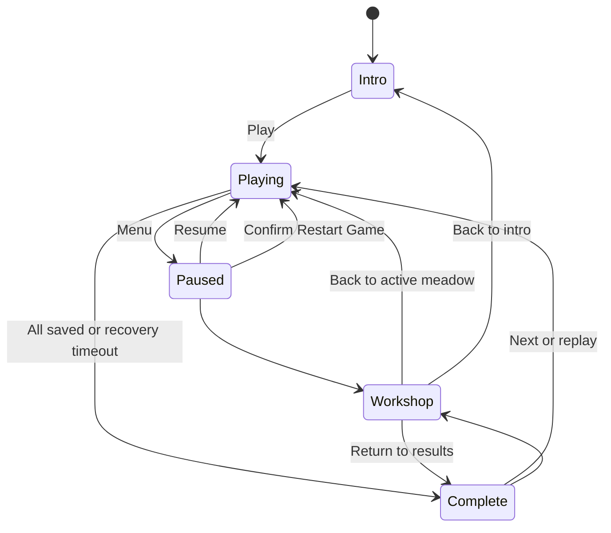
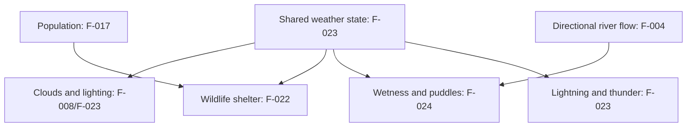

# Flock product requirements

## Continuous landing and menu soundtrack — 25 October 2026

F-AUDIO-001: music starts on the landing page when browser autoplay permits it, with normal pointer/keyboard gestures retrying restricted activation. The same soundtrack continues without restarting or releasing music voices when Let's Herd begins a meadow, menus/popups/workshop/results/QA open, levels restart/change or the player returns to landing. Gameplay ambience and livestock clocks still pause with gameplay. Preserve saved mute and the 50% louder mix; hidden/unfocused pages silence the soundtrack and resume safely on return. Browser restrictions may require the first user interaction before any audible landing music. This supersedes earlier guidance that gameplay menus pause the entire soundtrack.

## Music volume follow-up — 25 October 2026

F-AUDIO-001: increase music gain by 50% from the reviewed lo-fi mix, including proportional thunder duck/recovery. Preserve effects, ambience, livestock and dog levels, composition and playback lifecycle. Update the development build; user listening acceptance remains separate.

## Independent chill soundtrack — 25 October 2026

F-AUDIO-001 reworks the background music into a mellow, gently evolving lo-fi ambient score. Music composition and instrument synthesis belong in a dedicated JavaScript module imported by `audio.js`. Preserve the accepted livestock calls and Pip/Buddy voices, weather mix, mute, pause/resume, async activation guards and bounded resources. No sharp noise percussion or abrupt note endpoints. Listening acceptance remains a separate check. Development publication is authorized; production and merge are not.

## P1 branch acceptance — 25 October 2026

Novy approved the current development build and requested merging `p1_gameplay_polish` to main. The fourteen P1 items (F-026/F-030/F-036/F-042/F-043/F-044/F-050 and F-HERD-001/002/003/004/006/007/008) plus F-POLISH-001/002/003 are Done and archived. Their historical pending-review/listening text is superseded by this acceptance. Clouds remain Deferred; broader unimplemented bird, companion and UI plans remain Open. Acceptance authorizes main merge, not production publication or unmeasured FPS/causal proof.

## Remove sharp soundtrack clicks — 24 October 2026

F-POLISH-003 investigates the supplied screenrecording and removes the offending sharp clicking from the soundtrack, preserving mellowlo-fi chords/bass, animalcalls and wildlife visuals. Evidence/inference must be labelled accurately; listeningapproval remains separate.

## Lo-fi music and animal mix — 24 October 2026

F-POLISH-002 reduces call frequency again and livestock gain by exactly25% relative to the F-POLISH-001 mix, adds procedurally generated lo-fi chill music, and deepens Pip's bark while preserving Buddy's existing bark. Source lifecycle/saved-game contracts remain unchanged. Listening approval and deployment are separate milestones.

## Animal and water follow-up — 24 October 2026

F-POLISH-001: quieter and less frequent recorded animal calls where licensed samples are obtainable, capped sheep pitch/slightly higher cows, realistic bark; subdued varied waves; clay birds with hinged wing flight, grounded folded wings, dry landings, hopping/pecking and coherent transitions.

## P1 gameplay batch — 24 October 2026

Implement the explicit reprioritized P1 backlog F-026/F-030/F-036/F-042/F-043/F-044/F-050 and F-HERD-001/002/003/004/006/007/008 using their tracker acceptance criteria. Clouds remain deferred. Quit discards the transient meadow and returns to landing while retaining the campaign profile, upgrades and earned bolts; returning Play starts the campaign continuation meadow anew. Bark tier 3 uses two charges with the existing 2.1-second cooldown beginning after the second bark, then restores both; pause freezes burst/cooldown time. Tier 2 and tier 3 retain a +33% force increase relative to tier 1. Tuning and appearance await gameplay/listening sign-off.

## Map-generation sign-off — 24 October 2026

Novy explicitly accepted all changes from this map-generation work: F-031/F-032/F-034/F-038/F-UI-013/F-VIS-002/F-VIS-003 are Done and archived; F-VIS-001 barn acceptance was already recorded. This includes final gate-light batching correction `00bdda0`, manually deployed by Novy to dev. Historical pending-review statements below are superseded. Production merge/publication remains separate.

## Live gate-state lamp synchronization — 23 October 2026

F-032 must keep the rendered lamp domes and halos synchronized after full renderer scenery batching: red closed, green open, on both sides. IMG_8440 demonstrates that standalone gate-view state tests did not establish this integration contract. Verify real contact, live scene membership, repeated transitions and level replacement; preserve safe closing and existing illumination. Fix and dev deployment continue under the authorized gate follow-up.

## Gate illumination, grass continuity and rounded junctions — 23 October 2026

Novy accepts the barn fix (F-VIS-001) and existing path terminal fade. F-032 follow-up must make mounted indicator lights visibly illuminated from the gameplay camera, red when closed and green when open (IMG_8438/8439.jpeg). F-VIS-002 extends rounding to near-reversals and multiple roads ending together (IMG_8436.jpeg), preserving the accepted terminal fade. F-VIS-003 requires matching grass color/texture/wetness/glow inside and outside playable fields (IMG_8437.jpeg), preserving physical boundaries. Work and dev deployment are authorized on `map_generation_improvements`; new appearance acceptance remains pending. These requirements supersede the contrasting darker countryside and insufficient vertical-only indicator presentation.

## Gate panels, barn cutaway and path terminals — 23 October 2026

F-032 follow-up replaces ground gate pads with vertical switch panels attached to the fence or wall beside the opening, on both approaches. Each has a visible indicator light: red when closed, green when open, synchronized to actual gate state. Pip and an active Buddy can activate a panel by contact, without automatic gate-seeking. Preserve debounce, occupied closing refusal and collision/navigation/minimap cache updates. This supersedes earlier Pip-only ground-pad instructions.

F-VIS-001 fixes inconsistent barn-roof transparency visible in IMG_8435.jpeg. The occupied barn's entire pitched roof and camera-facing walls retain the accepted 0.7 opacity without stacked or backface bands. Preserve opaque restoration, pause, collision and resource ownership. F-VIS-002 gives road cores and shoulders rounded terminal shapes with a gradual fade into grass while preserving opaque-depth behavior, shared route geometry, water/bridges and barn floors. These are Review candidates on `map_generation_improvements`: 415 regressions and both checked builds pass; independent review is 8/10 with no material source blocker and a persistent rendered/device evidence limit, below the usual 9/10 gate. User appearance/gameplay acceptance and new dev publication remain pending.

## Map layout follow-up and F-UI-013 camera — 22 October 2026

On `map_generation_improvements`, extend F-038 with goals in either L offshoot and U/Z/other angular layouts that require the flock to go around corners. Add denser trees and groves in large starter fields from public level 60, while retaining clear routes, spawns and helper movement. Increase river-to-fence spacing and vary rivers with stronger meanders on some levels. Keep the early teaching levels intact. F-UI-013 keeps Pip near screen center in every travel direction, independent of distant flock/goal positions, while preserving intro framing and pause behavior. This follow-up is a Review source candidate; the previously published dev build remains `ed7a2cb` until an explicitly recorded replacement deployment.

## Map generation improvements — 22 October 2026

Current work on `map_generation_improvements`, based on main `f5301a4fd8cf3fc6110bb692b1f0978145a4e594`, covers F-031, F-032, F-034 and F-038. This section supersedes older statements that gate closing is unrequested or every late map must have gates. All four items are Review as source candidates; combined checked build and independent review are pending. No development publication, production merge or user acceptance is claimed.

- **F-038:** progressively larger, less-linear levels with routes in multiple directions across fields, rivers and tree clusters. Later fields and overall maps may be nonrectangular, including L shapes and other angular, nonorganic layouts. The playable boundary, fence, ground and minimap must agree. The minimap may scroll with Pip and show a local portion of a large/nonrectangular map; retain destination guidance and clip offscreen content to the map frame. Routes must fit the largest cows and helpers and preserve early teaching/crossing regressions. Evaluate later layouts with helpers; geometry alone does not establish difficulty or fun.
- **F-031:** public levels below 20 have no operable gates. At level 20 onward, seeded generation mixes gated and gate-free maps; some gated maps provide a complete body-clear route with no panel to operate. Open route gaps remain physical openings even when a gate panel is omitted.
- **F-032:** place reachable ground buttons on both sides of each operable gate. Pip touching either toggles the same panel; both show red when closed and green when open. Avoid repeated toggles while Pip remains touching a pad, refuse closing through an occupied panel and keep collision/navigation/minimap synchronized. Helpers do not activate buttons; movement works through existing touch and keyboard input without a second thumb.
- **F-034:** use an independent seeded 15% stone-wall choice per level, replacing the fixed every-fourth-level rule. Preserve the accepted dry-stone appearance, physical thickness and route openings.

Exact gate distribution, field-growth and layout-shape weights are implementation tuning choices to review; only the 15% stone-wall probability is user-specified. Saved progress, unlocks, scoring and player-attended delivery are preserved. Implemented work remains Review until Novy's sign-off.

## F-OPS-001 — Standard delivery automation

Accepted by Novy on 19 October 2026, 14:47 America/Creston. The closed tracker holds the acceptance record.

Provide shared checked builds and a manual GitHub Actions deployment for dev and production. Enforce main-only production and non-main dev, QA mode checks, preserved unrelated Pages content, concurrent publication rejection and live hash verification. Document future entry points and setup/connector limitations. Production approval remains explicit.

## F-OPS-003 — Live validation of the delivery workflow

Accepted by Novy on 19 October 2026, 14:47 America/Creston. The closed tracker holds the acceptance record.

Run the standard checked build and **Deploy Flock** for real on a fresh branch from main, publishing to `/Flock/dev/` only. Confirm the published files match the checked build and that every other Pages path is preserved. Fix any defect or warning the run exposes, rerun the deployment on the fixed revision, and record the evidence. No production publication or merge is included.

## F-HERD-005 and F-WORLD-001 — Herd bottlenecks at crossings

Accepted by Novy on 19 October 2026, 21:03 America/Creston, after testing on dev. The closed tracker holds the acceptance record.

Animals approaching a bridge deck or gate take lanes and yield rather than surging and reversing. Separation must not push an animal backward against its flock's travel near an opening. A short commit zone before the deck carries pressured animals onto it, and bounded yielding ends in a deadlock escape. The player can still deliberately turn a flock back before the commit zone. F-WORLD-001 lengthens the stretch between the last bridge and the gate as herds grow, without changing early levels.

## F-OPS-002 — Shared agent instructions

Accepted by Novy on 19 October 2026, 14:03 America/Creston. The closed tracker holds the acceptance record.

Keep one instruction file, AGENTS.md, for every coding agent (Codex, Claude Code, Gemini CLI and others) and for people. `CLAUDE.md` and `GEMINI.md` are symlinks to it at the root and beside folder guides for runtime source, tests and documentation. AGENTS.md keeps every existing rule. It adds per-tool mappings for the connector-only rule and the model tiers, a tool-neutral blind review procedure, verified commands and easily-missed invariants. Claude Code also gets a blind-critic subagent definition. Validation limits are stated honestly.

## F-TRACK-001 — Public read-only work tracker

Accepted by Novy on 18 October 2026 at 22:45 America/Creston for the deployed `/Flock/tracker/` site; push and main merge authorized. The closed tracker owns the acceptance record.

Provide a standalone modern minimalist board at `/Flock/tracker/`, explicitly requested for this tool rather than the game development destination. Read public GitHub main active/closed tracker files at one resolved main revision per refresh. Four columns: Open, In progress, In review, Closed. Preserve Deferred/Blocked labels under Open. Sort ascending numeric priority; vertical color bars P0 red, P1 orange, P2 yellow, P3 purple, P4 blue, unknown white. Clicking reveals full recorded details and working/completed branches, or an explicit missing-record message. No ticket movement or write controls. Support mobile, keyboard, loading, partial failure visibility and retry. Existing game publication and progress remain unchanged.

## F-066 grazing

Calm sheep and cows lower their complete heads close to grass when settled. Bush ground is eligible; paths and shoulders, bridge decks, water and barn interiors are excluded at both the feet and feeding point. Moving, turning or threatened animals raise their heads. Pause freezes the pose and level replacement clears it. Existing physical steering, collision, cow sizes and coats remain unchanged.

## F-057 minimap placement — 18 October 2026

Center the minimap horizontally at the safe top edge. Preserve its size, contrast, information and interaction. Below 384px width, keep it centered in the next top lane under the weather/livestock/timer and pause/help controls to prevent collisions. This supersedes earlier top-right minimap placement.

## Minimal gameplay HUD and Level-number animation — 18 October 2026

This supersedes the earlier F-056 status card and F-063 full-title introduction. Display only “Level #” at the screen center with no panel: fade in over 0.65 active seconds while expanding from 0.72 to 1.2 scale over three active seconds, then fade out from 1.8 to 3 seconds. Menus hide/freeze it; restart/new level replay it; completion hides it. Reduced-motion users retain the fade without scaling. Remove level-name text, objective, reward score, progress bar and white status panel. Top-left HUD contains weather immediately followed by delivered/total livestock x/y, with the existing active delivery timer below. Keep internal reward scoring, results, economy and saved progress. Preserve minimap, tips, controls and Buddy. Follow-up remains Review for user appearance acceptance and publishes to `/Flock/dev/`.

## F-063 — Centered level-title introduction

18 October clarification: display text directly over the game without a white/cream panel or box shadow; preserve wrapping, fixed font size, margins and fade behavior.

Move the level name and number from the top-left status panel to a temporary overlay centered vertically and horizontally. Fill the screen width except safe side margins of at least 20px. Center the title text and wrap long names onto further lines without shrinking the fixed 28px title font. Show the actual generated level title on each start/restart, hold for 2.5 active seconds, then fade for 1.25 active seconds. Pause freezes the clock and hides the overlay behind menus; resuming restores its remaining introduction. Completion hides it. Overlay input passes through to gameplay. Keep delivery, score, weather and countdown in the compact status panel. This modifies the combined UI/Buddy candidate on `UI_refinement`; publish to `/Flock/dev/` and retain Review for appearance acceptance.

## F-062 — Combined Buddy/UI integration

Keep the accepted Buddy source and the still-unaccepted UI refinement candidate integrated on `UI_refinement`. Run the combined source regression and both release/development artifact-mode checks, obtain an independent integrated review, then publish only to `/Flock/dev/` when authorized. Preserve production and existing Pages paths. F-048/F-061 remain Done by Buddy acceptance; F-055–F-060 remain Review until the user signs off. Runtime and publication evidence belong in the tracker and quality record.

## Buddy user acceptance — 18 October 2026

F-048 and F-061 are **Done** by Novy’s “Looks great. Merge to main” sign-off at 12:45 America/Creston for `/Flock/dev/`, runtime source `6b5e650` / Pages `2e1ec4c`. The accepted scope is Buddy’s reference puppy appearance, size, floating pose and smooth movement. Historical Review/pending statements below refer to earlier checkpoints. Main merge was authorized; production publication was not requested. Acceptance adds no independent native shader or phone-FPS measurement.

## F-061 - Buddy reference and movement refinement - 17 October 2026

On a new `buddy_update` branch from main, replace Buddy's orange walking model with a silver/cream robotic puppy matching IMG_8400 (picture 1): rounded head, large expressive eyes, short black-nosed muzzle, folded mechanical ears, small panelled body, four hover pods and a spring-like blue tail light. IMG_8401 (picture 2) establishes Buddy as smaller than Pip; enlarge the relative size slightly for normal-zoom legibility. Exact rendered proportions remain an implementation choice for visual review. Use Pip-like sinusoidal floating, head looking into turns, bounded inward bank and acceleration/braking pitch, without changing simulation colliders or tier unlocks/costs. Blue pod illumination belongs on terrain/bridge surfaces, not floating planes.

Fix F-048 low-speed stutter and inspect outstanding Buddy movement issues. Preserve previously accepted tier-1 rear herding, tier-2 smaller-flock/passages/barking, tier-3 retrieval, independent split flocks, body-clear obstacle navigation, smooth heading reversal and player-attended scoring. Bolters may escape ahead while Buddy catches up. F-047 second Buddy remains queued. Source regression, blind review, documentation and development publication precede user visual/gameplay sign-off; do not deploy main/root for this request. Effective 18 October, this non-main branch publishes to `/Flock/dev/`, preserving existing dev2 and legacy paths.

## User sign-off - 16 October 2026, 00:14 Vancouver

F-035/F-037/F-039/F-041/F-046/F-051/F-052 are **Done** by Novy's explicit sign-off on all items in Review. This accepts the flock/Buddy and bridge follow-ups, compact HUD/tip/bark/goal-pointer refinements and development QA gear. Older pending/Review descriptions are historical and superseded by this record. Open and Deferred requirements are unchanged; no runtime change or new independent device measurement is implied. See the [current tracker](ISSUES_CLOSED.md#user-sign-off---16-october-2026-0014-vancouver).

## User sign-off - 15 October 2026, 16:34 Vancouver

Novy explicitly signed off all pending Review items: **F-022, F-023, F-024 and F-040 are Done**. Acceptance applies to the live development build at Pages `bf26e67732434e902fdbaef10cac72d6814c33b0`, runtime source `1909c87bc1f70c4e53f4b38d64beaa2d4bb6d3aa`, including full-view/angled rain, no storm wildlife, accumulating puddles, deeper variable 3-5 second reverberant thunder after lightning, the 50% master volume increase and brighter lightning. This is user acceptance; historical headless checks and device-performance evidence retain their original limits. **At that weather sign-off checkpoint no items remained in Review.** The later flock-behavior batch F-035/F-037/F-039/F-041 is now Review. Open queued items remain Open; F-008 clouds remain Deferred. Older Review/pending wording below describes earlier checkpoints and is superseded by this sign-off. Documentation only; game bytes are unchanged.

## Weather follow-up - 15 October 2026, 12:22 Vancouver

Current requested behavior supersedes the earlier weather details below. Rain/storm appearance was positively received, with these repairs required. F-022/F-023/F-024/F-040 are **Done** by user acceptance of the repaired build on 15 October 2026 at 16:34 Vancouver; F-008 clouds remain **Deferred**. No other queued gameplay features are included.

- Rain begins beyond the top of the screen and extends past both side edges, with no cloud-height cutoff. A camera-local foreground curtain overscans all four edges through portrait/landscape, camera movement and resizing. Storm rain has a visible wind angle.
- Fixed storm levels contain no ambient wildlife for the entire level, including birds, butterflies, rabbits and squirrels. Other weather retains its existing species shelter behavior. Ambient bird audio is suppressed in storms.
- Paired lightning/thunder retains bounded timing. Thunder uses a clearer crack followed by rumble on the effects bus and briefly ducks music; mute, pause, replacement and disposal cancel it and restore the mix.
- Rainy levels start with a seeded choice of no visible puddles or 1-3 small puddles. Puddle area and opacity grow to larger, safe footprints over an estimated level duration: longest route at 2 metres/second plus the actual delivery countdown, bounded to 45-240 seconds. This is visual tuning, not measured player pacing. Wet ground may already be darkened; puddles no longer start large in heavy rain/storms.
- Only unpaused presentation time accumulates water. Restart restores the same seeded start; dry levels do not grow puddles. Splashes follow the current growing footprint. Puddles do not change movement or scoring.
- Placement favors safe sites near spawn and distributed along playable routes, with field-wide fallback if route candidates are blocked. This helps players encounter accumulation; it does not guarantee every site is always on screen. Maximum footprints remain clear of obstacles, rivers and bridge decks.

QA: public levels **9 / 16 / 24** show light rain / heavy rain / storm. Check full-view rain at portrait and landscape edges; storm absence of wildlife; thunder above music after the first 8-12 unpaused seconds; and puddle growth over the estimated duration. Source/geometry/audio tests cannot establish phone pixels, speaker timbre or GPU frame rate.

Snapshot: 15 October 2026; integrated P2 source candidate at `b431cfe`. P0/P1 acceptance and deployment evidence remain in [validation](validation/P0-P1.md). Audience: implementers, reviewers and players checking intended behavior. Public campaign levels are **1–100**; source indexes are **0–99**.

This document separates implemented candidates from accepted behavior. **Review** means code and focused regressions exist, but the P2 feature still needs blind review and rendered/device acceptance; it is not Done. **Open** means implementation or acceptance remains incomplete. All P0/P1 issues are Done by user sign-off on 14 October 2026. F-028 goal roaming was accepted on 15 October 2026 at 00:28 America/Vancouver for the deployed build. P2 source candidates described below await review/integration acceptance; F-013 and F-015 remain Open because they require human pacing and device performance evidence. [ISSUES.md](ISSUES.md) owns priority, acceptance criteria and execution records. [QUALITY.md](QUALITY.md) owns historical test/review evidence and its limits. This document does not implement or deploy anything.

## Product and approved engine

Flock: Little Robot, Big Pastures is a cheerful, true-3D robotic herding game for portrait phones, playable with one thumb. The player steers Pip, a robotic sheepdog, behind a flock to guide it along countryside trails to a pen, fenced field or barn. Rewards buy skills and companions; companions support the player rather than delivering the flock unattended. Preserve the rounded, colorful, handmade countryside and visible robotic character details. The requested visual direction was bright, organic, clay/stop-motion countryside inspired by Aardman; characters and assets remain original.

The original engine request was ThreeRust. Investigation found no publicly documented reusable runtime SDK suitable for this repository; the user approved **Three.js** as the fallback. The implemented stack is Three.js/WebGL, JavaScript modules and Vite, with procedural geometry/textures and generated audio. Do not describe this as ThreeRust, `three-rs` or `threers`. See [README.md](../README.md) and [package.json](../package.json).

The current product is a standalone static development build with local browser saves. Accounts, online multiplayer and cloud saves are outside the implemented baseline. Local development and explicit `build:dev` distributions include isolated QA tools; normal production builds exclude them.

## Implemented baseline to preserve

### Play and state

- Drag the meadow or movement control to steer; WASD/arrows support desktop. Tap Woof, double-tap the meadow or press Space to bark. Bark applies a short herding burst; the current controller uses a 650 ms burst and 2,100 ms cooldown. Preserve single-thumb access when adding interactions.
- Pip's proximity pushes robotic flock animals away; grouping behavior respects barriers. Gameplay bodies (Pip, robotic flock and ground helpers) cannot cross fences, stone walls, closed gates, bridge rails, rivers outside decks, trees or the map perimeter. Ambient wildlife can cross fence lines and briefly roam beyond/re-enter the playfield; water and trees still constrain it. Pip's herding signal may pass low wooden fences/rails, but stone walls, barns, water and trees shield it. Companion attendance, movement and delivery use clear ground paths.
- Delivery requires Pip near the destination, an unheld animal fully inside the shared rotated rectangular enclosure footprint and clear ground attendance. Delivered animals remain saved and roam gently within the body-contracted goal footprint (F-028). First valid arrival starts a 30–60 second recovery countdown; all delivered ends early, otherwise timeout freezes a partial result. HUD and results show score / possible score. Pause, menus, workshop and QA editing do not advance simulation time or admissions.
- Pause/menu/workshop suspend gameplay and audio. Workshop and results support replay/continuation. Restart meadow resets the current scenario; confirmed **Restart Game** clears campaign progress, bolts and purchases and starts level 1. Cancelling preserves progress.
- Music begins after user interaction and shares a mute control with wildlife/weather ambience. Pending audio activation must not undo pause; delayed music scheduling must stay bounded.

Code: [main.js](../src/main.js) (`begin`, `bark`, `menu`, `confirmRestart`, `complete`, `frame`), [simulation.js](../src/simulation.js) (`stepSimulation`), [audio.js](../src/audio.js). Regressions: UI, simulation, audio and herding-journey tests under [tests/](../tests/).

This diagram summarizes current player states. Workshop return follows its originating gameplay state: opening it through a paused gameplay menu and closing it resumes play; an intro visit returns to intro, and results return to results. The controller also opens the workshop directly from play. Restart confirmation/cancellation is omitted here. The recovery countdown starts only on the first valid attended arrival; travel beforehand has no deadline.

### Campaign, map size and routes

The recorded user baseline asks for a small sheep-to-pen tutorial, increasing flock size and journey distance, procedural fields/rivers/bridges/roads/gates, and progression points unlocking skills and autonomous helpers. Later direction preserves compact single-path levels 1–5, asks for **1–2 routes at levels 6–15** and **1–3 routes from level 16**, expands vertical roaming bounds by **3–4× from level 6**, and continues increasing the playable expanse. Drone starts at 10; the more expensive Buddy starts at 20; other skills appear across the first fifteen levels. These are intent constraints.

The table below records current generator rules, not newly proposed balance targets. Exact starting count 5, +3 animals per level and cap 65 are implementation-derived, not additional user-specified numbers. The current late generator chooses two or three routes within the requested one-to-three range; it does not generate single-route late levels. Deterministic default seed is `index * 7919 + 42`; custom seeds are supported by `createLevel`. Index is clamped to 0–99.

| Aspect | Current implementation |
|---|---|
| Animal count | `min(5 + 3 * index, 65)`: levels 1–5 have 5, 8, 11, 14, 17; level 21 onward has 65. Journey distance continues growing. |
| Species | Sheep initially; from level 4 every fourth animal (ID divisible by 4) is a cow. |
| Compact levels 1–5 | Canonical bounds: travel axis −32 to `30 + 3 * index`, cross axis −24 to +24. At level 1 this is 62 × 48 world units; at level 5, 74 × 48. |
| Expanded levels 6–100 | Canonical travel bounds −40 to `63 + 3 * index`; half cross extent `84 + 14 * floor(index / 15)`. Level 6 is 118 × 168 before rotation/final bounds adjustment. The generator additionally expands final Z bounds to cover ±half cross extent. |
| Destination distance | Canonical destination axis `15 + 3 * index` for levels 1–5, `48 + 3 * index` thereafter; spawn is −20 early, −26 later. These are world-coordinate distances, not completion times. |
| Route count | Levels 1–5: one. Levels 6–15: one or two (zero-based odd indexes get two). Level 16 onward: two or three (indexes divisible by 3 get three). |
| Direction | First level fixed; other early levels use two opposing orientations; later levels rotate across four compass directions according to seed. |
| Water/gates/walls | Level 1 has no river; other early levels one. Later levels one until level 15, two from level 16. Gate openings begin at level 3; operable gates are closed at public level 20+ and can be opened by Pip nearby. Stone replaces selected interior/perimeter fence segments from public level 8 on a four-level cadence. |
| Destinations | Repeat pen, field, barn by index modulo 3. Target radius is a sizing input `4.7 + 0.2 * sqrt(animal count)`; shared rectangular half-extents are radius + 1.4, with a 7-unit entrance. Highlight, map, walls and full-body admission derive from the footprint. |
| Roads and bridges | Usable roads are 4.1 units early, except level 2 at 9.4, and 4.8 later; decorative shoulders are excluded. Deck width is exactly 1.25 × usable road width. Decks and straight road approaches align perpendicular to the sampled river segment. Length is river width + 1.5 (0.75 nominal bank overlap per end); sampled strip coverage is tested across deck width. Dry route turning planes remain independent of the shorter deck. Blocked animal steering routes toward the nearest local opening around solid rail ends. |

Examples: level 8 is index 7, has 26 robots and two routes, and is the first level using stone wall segments; level 17 is index 16 and is the first level eligible for conditional straggler bolts. The special wide level-2 crossing repaired a demonstrated simulated retrieval stall; preserve that regression when changing bridge rules.

Maps provide alternate trails, winding roads, real bridge/gate openings, destination staging room, continuous rivers beyond boundaries and decorative hills outside playable ground. Alternate routes are generated by level rules, not purchased or independently unlocked. See [world.js](../src/world.js) (`createLevel`, `canOccupy`, `terrainHeight`, `navigationTarget`, `openingSteer`) and world/journey tests. Geometry-route reachability is not proof that every human can deliver every flock.

### Progress, economy and helpers

The initial profile has zero bolts, no upgrades, no completed levels and only level 1 available. Any positive delivery at completion unlocks the next meadow (capped at level 100). Possible score is `80 + 25 * index`; earned score is `floor(possibleScore * saved / total)`. A run pays only `max(0, score - previousLifetimeBestEarnedBolts)`. Equal/worse replays pay zero; later improvement pays only the delta even after spending/reloading. For example, a best score of 32 followed by 64 adds 32 bolts. Zero deliveries neither pay nor unlock. Profile version 2 stores an authoritative `bestEarnedBolts` ledger; legacy completed levels migrate to fully earned entitlements without crediting spendable points again. Purchased tiers remain saved, but only tiers unlocked for the meadow being played apply. Invalid profile fields are sanitized; legacy boolean purchases migrate to tier 1. Browser storage failure retains the session and shows feedback. Key: `flock-foundry-v1`; do not clear or rename it for F-025. F-029 records this existing, tested rule as Done; the latest P0 missing-bolts-on-replay report was withdrawn as invalid. See [F-029 in the issue tracker](ISSUES_CLOSED.md#f-029--lifetime-best-score-improvement-pays-only-its-difference).

| Skill | Tier unlock levels | Tier costs (bolts) | Current tier effects |
|---|---|---|---|
| Turbo paws | 2 / 6 / 11 | 80 / 120 / 200 | +1.8 / +2.7 / +3.5 m/s |
| Friendly signal | 7 / 10 / 15 | 120 / 180 / 260 | +2 / +3 / +4 m range |
| Scout drone | 10 / 14 / 18 | 200 / 360 / 540 | Support strength 0.7 / 0.93 / 1.17 |
| Buddy dog | 20 / 24 / 28 | 600 / 850 / 1200 | Rear herding / smaller flock, local passages and autonomous bark / also retrieves strays |
| Happy bark | 4 / 8 / 13 | 100 / 160 / 240 | +0.25 / +0.45 / +0.65 strength |
| Flock harmony | 12 / 14 / 15 | 160 / 220 / 320 | +12% / +23% / +35% regrouping |

Drone unlock is exactly level **10**; Buddy is exactly **20** and costs more. The drone attends the largest connected herd and holds it when Pip leaves. Buddy tier 1 herds from the rear in measured flock travel direction; tier 2 stays with the smaller split flock and helps through nearby bridges and goal entrances, and barks autonomously; tier 3 returns wandering/bolting or locally settled animals to the closest flock group while retaining autonomous bark. Buddy must navigate solid ground and needs local, clear rear pressure. Helpers cannot admit unattended deliveries; Pip still participates at the destination. See [progression.js](../src/progression.js), profile functions in [simulation.js](../src/simulation.js), progression/companion tests.

### Art, wildlife and weather

Current sheep/cows have articulated, instanced stop-motion leg poses. Ground uses deterministic tileable color/bump textures, with decorative grass, flowers and reeds. Foliage includes larger foreground trees, textured bark and leaf surfaces, plus seeded clusters of varied, non-colliding bushes placed away from routes, water, trees, fences, spawns and destinations. Squirrels and rabbits have merged anatomical body meshes and animated paw instances; squirrel/rabbit/bird/butterfly populations scale reproducibly with usable meadow area and remain capped. Wildlife can cross fence lines and roam within a small outside margin, while trees, water, barn walls and stone walls continue to block ground fauna. Novy accepted these original P2 wildlife/vegetation features on 15 October 2026 for Pages `cc13865`; new requests are tracked separately.

In the fixed-weather source candidate, [`weather.js`](../src/weather.js) chooses a fixed seeded weather kind once per level, with no snow or timed weather transitions (F-040). Rain unlocks at public level 9, heavy rain at 16 and storms at 24; 16/24 and other-level weights are initial source tuning choices. Those three levels are guaranteed QA examples. Nature advances the shared clock only for cloud/rain animation and paired lightning events, while kind, rain, wind, severity and daylight remain fixed. `RainView` uses 96/176/256 visible downward streaks for light/heavy/storm; Visible clouds and their shadows are now disabled at Novy’s request; F-008 is Deferred. The dormant `Atmosphere` module is not used by the renderer. Storm lightning first occurs after 8–12 seconds, then at 24-second intervals; flashes peak .38 for .22 seconds, with .8–1.6-second delayed thunder. Light rain keeps wildlife active; heavy/storm severity progressively shelters species. Fixed rain starts with existing wet ground (.03/.35/.60 light/heavy/storm); heavy/storm puddles start at .40/.65 depth, then accumulation continues. Weather does not change collisions, movement speed, delivery or rewards. The mission panel labels the fixed condition. These weather changes are source-reviewed candidates pending fresh phone acceptance.

## Requested change traceability

Status: the original P0/P1 batch and F-028 remain accepted for their deployed builds. Weather F-008/F-022–F-024 has since reopened as P1 under F-040. The 11 original P2 items listed as Done were accepted by Novy; the new fixed-weather P1 candidate is **Review** pending fresh phone acceptance; F-013 and F-015 and other unimplemented work remain **Open**. Detailed evidence, dependencies and decisions are in [ISSUES.md](ISSUES.md).

| ID | Priority | Required outcome and exact constraints | Status | Current implementation candidate / remaining acceptance |
|---|---|---|---|
| F-025 | **P0, first** | Canonical public game at **https://novydhillon.github.io/Flock/dev2/**; deploy `dev2/` on `gh-pages`, preserve unrelated files and saved profiles; explicitly migrate old URL. | Done: verified canonical migration at Pages `baca95c7ba618d736730194b433254bf5058dd66`; legacy redirect preserves query/fragment. P1 development release verified at Pages `9346f26`. |
| F-001 | P1 | Continuous textured path corners without black triangles, gaps, spikes or flicker; check reported levels 4/8. | Done: user signed off 14 October 2026. `surfaces.js` unions stroke pieces into disjoint upward triangles with world UVs. |
| F-002 | P1 | Bark above grass/path/ground and bridge decks, normally occluded by fences/rails. | Done: user signed off 14 October 2026. `barkSurface` splits at deck/plank edges, lifts above each surface, retains depth testing and bounded pause-aware lifetime. |
| F-003 | P2 | Detailed recognizable squirrel; coordinated scurry/bound/alert motion, stable idle/blocked heading, no spinning. | Done: accepted 15 October 2026 at approximately 10:56 America/Vancouver for Pages `cc13865`, source `b1fdac3`. | Part-based squirrel model, locomotion/alert gait and retained heading are in `wildlife-models.js`, `wildlife.js` and `nature.js`; rendered motion/recognizability still need blind and device review. |
| F-004 | P2 | Subtle animated running-water texture following local river direction, seamless banks/bends, pause-safe. | Done: accepted 15 October 2026 at approximately 10:56 America/Vancouver for Pages `cc13865`, source `b1fdac3`. | `WaterEffects` clones river geometry and assigns local arc-length UVs from the sampled centerline, so procedural flow follows each bend rather than a whole-curve compass heading; each flow map repeats 1×1 and freezes at zero dt. |
| F-005 | P1 | Crossings perpendicular to local river tangent; bridge width **1.25 × crossing path width**; minimal safe dry-ground extension. | Done: Novy accepted the deployed bridge follow-up on 14 October 2026 (Vancouver), Pages `8a76de36bbb61ba824bc9371f85971667f786c35`. |
| F-006 | P2 | Gates requiring player opening at **level 20+**; visible/collidable state and single-thumb interaction. Levels 1–19 retain accessible openings. | Done: accepted 15 October 2026 at approximately 10:56 America/Vancouver for Pages `cc13865`, source `b1fdac3`. | `gates.js`, `gate-view.js`, `world.js`, `main.js` and renderer add operable panels from public level 20, a contextual Open gate action within 3.2 units with a clear approach, shared live collision/map state, and a sliding leaf. There is no close action. Review touch reachability and rendering. |
| F-007 | P2 | Stone walls replace fences on selected levels with consistent collision and usable entrances. | Done: accepted 15 October 2026 at approximately 10:56 America/Vancouver for Pages `cc13865`, source `b1fdac3`. | `world.js` assigns stone to selected segments from public level 8; `gate-view.js` renders masonry and `world.js` gives it a .30-unit collision radius (wood is .18). Openings remain the generated passages. |
| F-008 | P1 | Clouds temporarily removed, including their shadows, at user request on 15 October 2026. | **Deferred** | No runtime `Atmosphere` instance; dormant module/tests retained for future work. Rain, weather lighting and storm effects remain active. |
| F-009 | P1 | First valid arrival starts **30–60 s** countdown by complexity; finish at zero or all delivered; partial score shown as **score / possible score**. | Done: user signed off 14 October 2026. first-arrival countdown, proportional floor score, positive partial unlock and best-improvement ledger implemented. |
| F-010 | P1 | Highlight, delivery region, minimap and rotated pen/field/barn enclosure share the same shape. | Done: user signed off 14 October 2026. shared rotated footprint drives enclosure, highlight, minimap and full-body admission. |
| F-011 | P2 | Pip tail light normally blue, flashes red on bark then restores reliably. | Done: accepted 15 October 2026 at approximately 10:56 America/Vancouver for Pages `cc13865`, source `b1fdac3`. | `tail-light.js` colors Pip's dedicated light blue at rest and red during the bounded bark effect; restore behavior is covered by source tests. |
| F-012 | P2 | From **level 8**, up to **15%** eligible animals have **33%** chance to wander away while not actively herded. From **level 17**, up to **10%** chance to bolt for **1–3 s**. | Done: accepted 15 October 2026 at approximately 10:56 America/Vancouver for Pages `cc13865`, source `b1fdac3`. | `wandering.js` selects `floor(15% × flock)` by seeded rank and evaluates one 33% opportunity every five simulation seconds; bolts use a conditional 10% roll from public level 17 for 1–3 seconds. Saved and actively herded animals are excluded; confirm the chosen integer rounding and player-facing pacing. |
| F-013 | P2 | Investigate level-5 pacing with humans, retrieval/chokepoint evidence and unchanged ordinary-input regressions. | **Open** | Simulated level-5 time spike known; no confirmed human difficulty verdict. World/journey balance. |
| F-014 | P1 | Real-phone controls, portrait readability, gestures, modals, sound and restart verified with device/revision evidence. | Done: user confirmed real-phone QA on 14 October 2026; device/browser details not supplied. |
| F-015 | P3 | Measure mobile GPU and repeated transition stability on normal, large/split herds and weather scenes. | **Open** | Submission/resource checks exist; phone frame times unmeasured. Set device targets before verdict. |
| F-016 | P1 | Any dog/flock animal under cover fades the entire roof and full camera-facing wall side(s) to 30% transparency (opacity 0.70); restore when empty; retain collision. | Done: Novy accepted the deployed barn follow-up on 14 October 2026 (Vancouver), Pages `8a76de36bbb61ba824bc9371f85971667f786c35`. |
| F-017 | P2 | Add detailed hopping rabbits; random rabbit/squirrel populations scale with usable level area. | Done: accepted 15 October 2026 at approximately 10:56 America/Vancouver for Pages `cc13865`, source `b1fdac3`. | `wildlife.js`, `wildlife-models.js` and `nature.js` add seeded, area-scaled populations capped at 8 rabbits/7 squirrels (also capped birds/butterflies); spawn search is bounded and unsafe slots stay hidden. Visual quality and area-density balance remain open. |
| F-018 | P1 | Dev-only QA menu: level **0–100**, add/remove bolts, pause and reposition individual animals using touch/mouse. Available in deployed dev build; absent in release. | Done: user signed off 14 October 2026. isolated dev-only menu; 0 = tutorial shortcut, 1–100 = public campaign. Paused coordinate edits, bounded override, currency, reset and JSON export; production exclusion tested. Animal selection and coordinate positioning are temporarily hidden in the QA panel. |
| F-019 | P2 | Organic varied bushes without blocked routes/spawns or hidden critical play areas. | Done: accepted 15 October 2026 at approximately 10:56 America/Vancouver for Pages `cc13865`, source `b1fdac3`. | `vegetation.js` generates deterministic, non-colliding clusters (area target 3–24, 3–5 varied bushes each) away from routes, water, obstacles, fences, spawn and target; renderer adds them. |
| F-020 | P2 | Visibly larger trees while maintaining proportion, actor visibility and route clearance. | Done: accepted 15 October 2026 at approximately 10:56 America/Vancouver for Pages `cc13865`, source `b1fdac3`. | `models.js` supplies detailed tree variants; renderer scales obstacle trees to 1.45× their collision radius. This is an implementation choice, not a confirmed visual size target; review visibility, proportions and performance. |
| F-021 | P2 | Richer tree/bush foliage and bark detail/textures, cheerful organic appearance with mobile budget. | Done: accepted 15 October 2026 at approximately 10:56 America/Vancouver for Pages `cc13865`, source `b1fdac3`. | `models.js` adds procedural bark/foliage textures, sculpted leaf clusters and three bush variants, rendered via cached geometry/materials. |
| F-022 | P1 | Light rain/wind retain wildlife; heavy rain shelters smaller species; fixed storm levels contain no ambient wildlife. | **Done**, user accepted 15 October 2026 at 16:34 Vancouver. | Fixed light/heavy/storm severity is .28/.60/.88; existing thresholds retain light-weather fauna and shelter smaller species in heavy rain; storm population is zero. |
| F-023 | P1 | Fixed per-level atmosphere, clouds and lighting; lightning flashes paired with thunder where applicable. Historical dynamic-ramp criteria are superseded by F-040. | **Done**, user accepted 15 October 2026 at 16:34 Vancouver. | No weather ramps remain. Fixed storm levels pair deterministic bounded flashes and thunder; cloud/rain motion and lightning animate without changing weather type. |
| F-024 | P1 | Fixed-type rain accumulates wetness; heavier rain forms puddles/splashes and rivers respond coherently. | **Done**, user accepted 15 October 2026 at 16:34 Vancouver. | All rainy levels seed no puddles or 1-3 small puddles, then grow area/opacity over estimated level duration; moving actors splash the actual growing footprint. Pause/restart restore the correct level baseline. |
| F-028 | P2 | Delivered animals roam gently inside the rotated enclosure after arrival, including during results; full-body confinement, pause safety and immutable delivery results. | Done: user accepted deployed Pages `639a9b45608fa0ad6aaa8189dd91dd7ba24b082d` on 15 October 2026 at 00:28 America/Vancouver; F-012 escaping behavior still excludes delivered animals. |
| F-026 | P3 | Pause-menu Quit returns to the landing page while preserving saved progress. | Open; distinct from Restart Game. In-progress-meadow resume policy unresolved. |
| F-027 | P2 | Wildlife may cross fences and leave/reenter the game area. | Done: accepted 15 October 2026 at approximately 10:56 America/Vancouver for Pages `cc13865`, source `b1fdac3`. | `wildlife.js` uses a fence-permeable occupancy view and permits ambient fauna up to .45 units outside the bounds; water, trees, barn walls and stone walls remain solid. Robotic gameplay actors remain behind fences, stone walls, closed gates and map limits. |
| F-030 | P3 | Lighter, more contrasting water waves. | Open | New request; F-004 acceptance does not include this enhancement. |
| F-031 | P2 | Gates on some, not all, levels 20+; some gate levels have an ungated alternative. | Review | New request; retain accepted F-006 gate interaction. |
| F-032 | P3 | Open/close buttons on both sides of each gate; closed red/open green; dog touch activates. | Review | New request; coordinate with F-031 and F-006. |
| F-033 | P2 | Photo-referenced claymation English dry-stone walls: irregular weathered hand-laid stones, no mortar, uneven coping, restrained moss/lichen staining. | Done: Novy signed off 16 October 2026 at 14:00 America/Vancouver, Pages `29f48f3`, source `1941302`. | Three shared sculpted shapes, matte warm-grey per-instance color, tapered courses; physical strip/openings unchanged. User acceptance recorded; no independent phone FPS measurement. F-007 remains Done. |
| F-034 | P3 | Seeded 15% stone-wall chance per level, replacing fixed four-level sequence. | Review | New generation request; depends on F-033. |
| F-035 | P2 | Baseline bolts 3-5s; public40-69 4-6s,70+5-10s. | **Done** | Seeded durations, pause/restart and interruption checks implemented. |
| F-036 | P3 | Unattended flock spreads across field. | Open | New behavior, separate from straggler behavior F-012 and saved roaming F-028. |
| F-037 | P2 | Per-level cap floor(20% of current undelivered animals), no cross-level memory. | **Done** | Seeded ranking refreshes after delivery; saved/herded animals excluded from excursions. |
| F-038 | P2 | Progressively larger multi-directional, less-linear levels over fields/rivers/tree clusters; body clearance, no stuck animals, later difficulty accounts for helpers. | Review | Preserve F-005 and accepted F-006 navigation. |
| F-039 | P2 | Independent 5-8s checks; 33% early,20% at41-70,25% at71+ wander odds; conditional bolt10% early,20% at41+. | **Done** | New user clarification supersedes former30%/50% ambiguity. See current revision table. |
| F-040 | P1 | Remove all snow; select a fixed weather type once per level. Public level 9 starts light rain; later levels may become heavier. Public levels 16 and 24 are guaranteed heavy-rain/storm QA fixtures. Their use as permanent unlock thresholds and the seeded selection weights remain provisional tuning choices. | **Done**, user accepted 15 October 2026 at 16:34 Vancouver. | Implemented fixed kinds, no snow, public 9/16/24 QA anchors and seeded other-level selection. Later unlock numbers and weights remain tunable source choices; the current weather build was accepted on 15 October 2026 at 16:34 Vancouver. |
| F-041 | P2 | Wanderers/bolters settle locally until actively herded. | **Done** | Cohesion/alignment suppressed; calm roaming within3m, collision/player/helper/delivery regressions implemented. |
| F-054 | P2 | Replace the segmented-looking trunk/forks seen in phone references IMG8395 and IMG8396 with a true single contiguous, smooth trunk-and-branch surface; preserve the organic tree direction, size rules and varied crown. | **Review**; implementation, deployment and new visual sign-off pending on `pip_update` / `dev2`. The user selected `gpt-6-astra` at high effort for implementation and final mesh/visual review. | One connected smooth surface must pass through welded forks: no detached rings, chunk steps, seams, caps or visibly separate branch pieces. Preserve the bent trunk, curved limbs, Leonardo fork exponent 2, seeded yaw variation, multi-cluster overlapping foliage, and linearly interpolated 30%/10% trunk-thickness reductions. The first fork is around trunk mid-height; subsequent forks are staggered upward. Prior reviews are source-only and did not establish phone pixels. |

### Decisions still open

Resolve only the choices needed for an implementation; independent repairs can proceed. Record actual approvals in ISSUES.md. The following are **not approved defaults**:

- F-006/F-007 are accepted. Gate closing is not implemented or currently requested; new gate distribution, dog-touch controls and dry-stone art/probability are separate queued changes F-031–F-034.
- F-008 is Deferred at user request; F-022–F-024/F-040 remain P1 candidates in Review. Snow must be removed and weather types fixed per level; F-023 dynamic-ramp criteria are historical only. Public level 9 starts light rain. Public levels 16/24 are guaranteed QA fixtures for heavy rain/storm. Permanent unlock thresholds and other-level weather weights remain source tuning choices rather than explicit user-provided probabilities.
- F-011: whether Buddy shares Pip's tail convention on a real Buddy bark event.
- F-012: source currently chooses floor rounding, a seeded five-second opportunity cadence, 4–7 units of wander distance, and bolts as a conditional roll; test outcomes and human pacing remain open. A 33% chance is **not** permission to roll every frame. Small flocks can have a zero-sized eligible cohort under floor rounding.
- F-017/F-019/F-020: wildlife area/count ranges, caps, absence/spawn rules; bush collision policy; tree scale/range.
- F-022–F-024: while fixed weather is implemented, species thresholds, lightning frequency/intensity, wetness/drying rates, puddle placement, river response and actor splash rules still need acceptance. No weather movement penalty is approved.

This describes the fixed-weather source candidate. The prior published dynamic/snow behavior is superseded; release evidence is tracked separately in QUALITY.md.

## Implemented P1 decisions and deployment boundary

User-approved on 14 October 2026: positive partial delivery unlocks the next meadow; proportional earned score uses `floor(reward * saved / total)`; lifetime best improvement pays only the delta; QA 0 is a tutorial shortcut and public levels remain 1–100. Implemented recovery duration is `clamp(30 + ceil(max(0,total-5)/5) + 4*(routes-1) + 2*floor(spawnToGoalDistance/40), 30, 60)` seconds of simulation time. This formula is a source balance choice to review, not measured human pacing.

**F-025 is Done.** Canonical URL: **https://novydhillon.github.io/Flock/dev2/**. Pages commit `baca95c7ba618d736730194b433254bf5058dd66` deployed the preceding game at `dev2/`, with a query/fragment-preserving legacy redirect, matching hashes for all 15 game files and redirect, and unchanged 17 unrelated blobs. Existing local-storage key remains `flock-foundry-v1`; real browser continuity is still a device check.

The helper validates the build's relative asset graph and stages canonical output without committing/pushing. Normal `build` excludes QA; `build:dev` explicitly includes it. Source completion, bundle checks, Pages commit, native publication and live verification are separate milestones. The P1 development build from source `7a8519d37a8f447652f0449e16a050fc76a6d3e0` is now live at Pages `9346f26c5a145698b34e2c4504236c494023817d`; 17 game files plus redirect match expected hashes, and 18 outside-`dev2/` blobs remain unchanged. See [runbook](validation/P0-P1.md).

## Verification and handoff contract

For each implemented request, record requirement ID, source commit, level/seed, expected/observed outcome, relevant commands/results and remaining limitations in ISSUES.md. Run meaningful regression checks and production build. Retain the solved companion hold/no-autonomous-delivery, level-10/20 unlock, level-2 bridge retrieval, profile/restart and audio pause/scheduling cases.

`npm test` covers source simulation/profile/controller behavior, real Three.js geometry/matrices behind a substituted GPU interface, resource disposal and synthetic audio lifecycles. `npm run build` checks production packaging. Existing historical evidence reports **93 passing tests**, route sweeps, bounded legitimate-input flock deliveries and fresh blind reviews at **9.1/10 technical / 8.6/10 gameplay**. These are bounded historical findings from QUALITY.md, not a new assessment of this document or the pending requests.

Headless checks cannot verify rendered pixels/flicker, motion quality, real Safari gestures, portrait touch ergonomics, perceived sound balance or phone GPU frame time. Screenshots establish visible artifacts; they do not establish temporal flicker/spinning or a root cause. Real-device records must identify device/browser and source/deployment revision, with scenario evidence. Preserve F-013/F-015 as Open. F-014 was accepted by the user on 14 October 2026; separate visual issues retain their own acceptance criteria. Do not convert historical critic scores into a verified overall game score.

Next: obtain rendered/device acceptance for the source-reviewed P2 candidates; preserve F-013/F-015 as Open until human pacing and phone performance evidence exists. Publish/verify any accepted batch separately. This requirements snapshot records implementation candidates and source-level evidence only; it adds no gameplay changes or new browser/device validation.

## P1 acceptance

Novy signed off all remaining P1 review items (F-001, F-002, F-009, F-010 and F-018) on 14 October 2026 at 21:10 America/Vancouver, following F-005/F-016 acceptance at 21:08. All P0 and P1 issues are Done. Acceptance applies to the deployed development build at Pages `8a76de36bbb61ba824bc9371f85971667f786c35`, including the approved temporarily hidden animal-position controls. This is user acceptance; it does not expand the measured scope of source tests or close P2/P3 work.

P2 source-reviewed candidate publication: runtime source `b1fdac3`, Pages `cc13865`, live at `/Flock/dev2/`; CI/Pages succeeded and live hashes match. Requirements remain Review pending user acceptance, with F-013 Open. See [verified evidence](QUALITY.md#verified-p2-development-publication--15-october-2026).

Fixed-weather Review candidate is published at `/Flock/dev2/`: runtime source `878efee`, Pages `27b1bf5`; CI/Pages and live hashes are verified. QA public levels 9/16/24 provide fixed light/heavy/storm tests. Earlier 11 P2 approvals remain Done; F-030–F-039 remain Open. See [verified evidence](QUALITY.md#verified-fixed-weather-publication--15-october-2026).

Current cloud policy: F-008 is Deferred following the 11:22 Vancouver request on 15 October 2026. Cloud puffs and cloud shadows are absent; no removal of rain, storm lighting/thunder or wet-ground effects is requested. This supersedes earlier cloud-visibility requirements until further cloud work is requested.

F-041 was added on 15 October 2026 at 11:23 Vancouver: unattended wanderers/bolters should remain near their new location instead of returning through normal flock cohesion. This is a queued P2 behavior change, not part of cloud removal.

## Queued requests migrated from GitHub Issues - 15 October 2026

The authoritative tracker is [ISSUES.md](ISSUES.md), not GitHub Issues. These requests remain Open; this migration implements no game changes.

- F-042 (P3): investigate and fix apparently missing back legs on small wild animals, both idle and moving.
- F-043 (P3): make the bark sound recognizably like a barking dog.
- F-044 (P3): randomized occasional individual sheep bleats and cow moos that together sound like a flock/herd. Wandering calls are more frequent at baseline volume; herding calls are less frequent and 25% louder. Bolting immediately triggers a call, then uses herding frequency and volume.
- F-045 (P4): add raindrop impacts/splashes to rivers, streams and other water surfaces during heavy rain or stronger, including thunderstorms.

P4 is lower-priority optional polish. Full acceptance criteria and original issue links are retained in the tracker.

## Flock wandering and bolting revision - 15 October 2026

F-035/F-037/F-039/F-041 are implemented and in **Review** pending new gameplay acceptance. Earlier weather sign-offs remain Done. Each level/restart owns fresh animal schedules and a seeded cohort capped at floor(20% of current undelivered animals). Saved animals are excluded and retain confined goal roaming. Individual opportunity intervals are seeded random 5-8 simulation seconds, not synchronized five-second or per-frame rolls; zero-time calls freeze state and gaps cannot replay a backlog.

| Public levels | Wander chance per eligible check | Conditional bolt chance | Bolt duration |
|---|---|---|---|
| 1-7 | None | None | None |
| 8-16 | 33% | None | None |
| 17-39 | 33% | 10% | 3-5 seconds |
| 40 | 33% | 10% | 4-6 seconds |
| 41-69 | 20% | 20% | 4-6 seconds |
| 70 | 20% | 20% | 5-10 seconds |
| 71-100 | 25% | 20% | 5-10 seconds |

The user clarification replaces the earlier 30%/50% late-level odds. Earlier levels retain their accepted 33% opportunity odds; the 20% cohort cap remains per-level at all levels. Duration changes are step bands at 40 and 70. An active wander lasts up to 2.5 seconds or reaching its short target; bolt targets are farther than possible travel during the rolled duration. Active clear Pip pressure or helper herding interrupts either. If delivery reduces cohort eligibility, an excluded active excursion ends locally to preserve the cap.

During an excursion and after local settling, ordinary cohesion/alignment do not pull the animal back. At excursion end, the reached position becomes its home; it calmly roams within 3m, with actual body collision. Settled animals do not repeatedly escape until active herding clears their home. Companion hold remains authoritative; active helper assist restores normal herding. Delivery clears transient excursion/home/scheduling fields before goal roaming.

Regression checks cover seeded odds/boundaries, random schedules/frame-rate independence, changing undelivered counts, local settling under nearby herd attraction, collisions, player/helper interruption, pause, restart and goal confinement. The unchanged full-flock journey controller remains the delivery regression. These are source/headless checks, not measured player pacing. Earlier fixed-five-second/15%/1-3 second descriptions below are historical and superseded.

## QA flock behavior debug - 15 October 2026, 17:37 Vancouver

Open QA and enable the single **Flock debug** checkbox, then resume test play. A numeric countdown with tenths appears immediately above Woof at bottom right: seconds until the soonest check among eligible undelivered animals that are not already wandering/bolting or locally settled. It shows a dash when there is no eligible pending check (including early levels or before schedules initialize). Checks that occur under player/helper pressure can still be suppressed normally.

Chosen wanderers have a clear yellow tint; chosen bolters a clear red tint. Each tint remains until that animal's next scheduled check, including after settling or active herding; delivered animals are untinted. Selection history lives only in the QA renderer, leaving simulation state untouched. The toggle is off by default and survives level jumps for the current page; reloading resets it to off; it is not saved to normal progress. Menu/pause/results hide the countdown, and paused simulation leaves scheduled time frozen. Disabling debug clears all instance tint slots, including currently culled slots; replacing a level rebuilds instance state. No simulation/scheduling/profile state is modified. This feature is included only in the QA development build; release artifacts exclude its toggle, countdown, CSS and code.

## QA workshop level gates - 15 October 2026

In an isolated QA session, workshop unlocks and purchases use the public level currently being tested, including after backward jumps. Each next tier still requires its normal bolt cost and unlock level. Owned upgrades and test bolts carry between jumps; higher tiers stay inactive below their normal activation level. QA purchases never save to the normal campaign. Normal play continues to use earned campaign progress for purchases.

## Buddy dog revision - 15 October 2026

F-046 implements the requested tiered behavior: rear herding along actual group movement at tier 1, smaller-group support from tier 2, and retrieval to the closest flock group plus autonomous barking from tier 3. Existing purchase/activation levels 20/24/28 and prices 600/850/1200 are unchanged. This supersedes earlier blanket descriptions that all companions hold the largest flock and never retrieve. Drone behavior remains as before. No goal steering or unattended scoring is added. Source implementation is **Review** pending user gameplay acceptance; see [behavior and tuning](systems/GAMEPLAY.md#buddy-dog-tiers-15-october-2026).

User clarification (15 October 2026, 18:53 Vancouver): a bolter may get away and gain distance; Buddy should pursue and catch up by running. Retrieval does not require immediate interception or prevent the initial escape. No teleport, recall, artificial bolter slowdown or guarantee of catching every bolt before expiry is intended.

## Queued second Buddy progression - F-047 (P4)

After meadow 40, offer a second Buddy dog with independently saved leveling. Price its purchase and upgrades for later-game bolt earnings and make its maximum tier attainable by meadow 70. Exact costs remain to be tuned. This is queued only; see [F-047 in the tracker](ISSUES.md#f-047---second-buddy-dog-with-independent-progression-p4).

## Buddy follow-up requirements - 15 October 2026, 19:11 Vancouver

F-046 remains Review for repaired behavior: Buddy must navigate around trees, turn gradually without rapid opposite-facing flicker inside a flock, and guide nearby sheep through bridges and goal entrances from **Buddy tier 2**. Independent flocks and isolated individuals must not automatically attract back together. Cohesion may stabilize a connected flock but must not reunite separated groups. Existing tier-3 retrieval, ground collisions, active-player delivery, purchase gates and costs remain in force. The second Buddy (F-047) is still queued and is not implemented here. Headless regression evidence is recorded separately from user play acceptance.

## Forward-flow and bridge-completion request - 15 October 2026, 22:33-22:39 Vancouver

Leading animals should keep moving with their flock instead of returning to its centre, with back/side animals near the dogs carrying pushing pressure forward. Interpret the user's "load the flock cohesion" as lowering cohesion: use a 30% reduction from the previous baseline while retaining proportional upgrade effects. Separate groups remain independent. Direct player steering, physical collision and attended scoring remain authoritative.

Animals that start walking on a bridge should proceed to its opposite bank; this applies to sheep and cows at every meadow level and requires no Buddy purchase. Keep body-clear travel and pause/reset semantics. Buddy's own autonomous bark moves from tier 3 to **tier 2**, with unchanged price/unlock progression, effects and cooldown. Individual stray retrieval remains tier 3. These changes remain Review for user gameplay acceptance.

## Buddy low-speed movement fix - F-048 (P2)

Fix Buddy dog stuttering when moving slowly. Low-speed movement, stopping and resuming should be smooth while preserving herding behavior and collision handling. Implemented on `buddy_update` with regression coverage; source review and development publication are recorded separately, and user gameplay acceptance remains pending. See [F-048 in the tracker](ISSUES_CLOSED.md#f-048---buddy-stutters-when-moving-slowly-p2).

## Queued QA menu focus fix - F-049 (P4)

Open the QA menu without automatically focusing, selecting or expanding the level dropdown. Keep the list collapsed until the player deliberately activates it. Initial focus should go to the menu container or a suitable non-dropdown control. Preserve the current level value. Open, queued only. See [F-049 in the tracker](ISSUES.md#f-049---keep-the-qa-level-dropdown-unfocused-on-menu-opening-p4).

## Queued bark upgrade tiers - F-050 (P2)

Bark level 2 increases bark strength by 33%, and the workshop displays that percentage. Bark level 3 allows two barks before the cooldown. Open, queued only. See [F-050 in the tracker](ISSUES_CLOSED.md#f-050---bark-strength-and-two-bark-upgrade-tiers-p1).

### F-051 - Compact gameplay HUD

Keep the mission/score card and minimap side by side, including portrait screens. After the last introductory tip, wait its full 14-second cycle then hide it and expose a question-mark toggle immediately after pause. Dismissal also exposes the toggle; each meadow resets tips. Reopened tips are manually controlled. Use a circular Woof control with title, symbol and double-tap text inside. Replace the destination label/distance with a goal-facing triangle outside Pip’s selection ring.

F-051 evidence: implementation commit `1e000ce` on `flock_3D_chatgpt-work`; controller/markup/styles are in `src/main.js`, `index.html`, `src/style.css`; the goal triangle is in `src/render.js`. `tests/ui.test.js` exercises tip expiry, reopening, hiding and meadow reset. `npm test` passes 275 tests; `npm run build` plus the release mode check passes with zero QA assets, and `npm run build:dev` plus the development mode check passes with two QA assets. Generated documentation checks pass. These are source/DOM/build checks; there is no dedicated pointer render regression or native phone evidence for halo placement or portrait usability.

F-051 follow-up: every tutorial tip must remain visible for its full display interval. Early animal delivery must not skip tip 02 or shorten its interval. The automatic sequence advances at most once per frame; reopening/dismissing help and final-tip expiry retain their existing behavior. Source regression includes delivery before the second tip.

F-051 reopened-help refinement: pressing ? to unhide help resets the applicable tip list to 01 and starts a repeating 14-second cycle. After the final tip it returns to 01 until toggled/dismissed; pause freezes this timer. The initial automatic sequence still finishes and hides, exposing ?. New meadows reset help state.

### F-052 - QA gear launcher

The development-only QA launcher uses a gear icon centered at the bottom of the screen, with at least a 44px touch target and bottom safe-area clearance. Its accessible name identifies QA and an active test session. Release builds continue excluding QA.

### F-053 - Pip reference model and hover rings

**Accepted:** Novy signed off the current Pip presentation, including the floating-motion follow-up, on 17 October 2026 at 20:56 America/Creston. F-053 is Done for dev2 runtime `f0cb0c2` / Pages `c4e275b`; earlier pending acceptance wording is historical.

On branch `pip_update`, replace player Pip with the reference-inspired angular silver robot dog: metal panels, expressive eyes, plate ears, black nose, blue tail light and four leg pods. No blue thruster flames. Each pod has three blue rings descending and fading in a repeating cycle. The top ring stays attached to Pip; the bottom ring trails his movement and the middle ring lies between. Preserve gameplay collision, control, bark and goal pointer behavior; Buddy retains its existing appearance.

### F-053 follow-up - Smaller Pip and grounded thruster glow

Movement requirements: gentle sinusoidal hover during idle and travel; head anticipates turn direction; body banks into turns according to tightness with a 20-degree cap. Pitch backward under forward acceleration and forward under braking, with each direction capped at 10 degrees and scaled to acceleration/deceleration. At constant speed for roughly two seconds, or after stopping, settle level. Keep simulation, collision and Buddy unchanged; animate the visual rig independently of ground halo/pointer and keep pod rings/glow aligned. Pause must freeze motion, heading wrap must not create spikes, and restart/level jump/teleport must not retain stale inertia. Use the existing worktree, test/documentation, blind-review and dev2 release workflow.

17 October tuning: reduce the current 0.85 glow strength by another 30%, to 0.595. Keep diffuse radius, color, falloff, ground opacity and Pip unchanged. No blind review is required for this adjustment.

Latest glow tuning: interpret 50% more transparent as halving the illumination contribution, leaving ground opacity unchanged. Make the footprint more diffuse with a wider radius and smooth feathering; keep illumination bound to receiving surfaces.

Latest size request supersedes the unfinished 33% reduction: reduce Pip's current published 1.35 linear scale by 25%, to 1.0125. Include pods and rings, but preserve the selection halo and goal pointer's world-space size. Retain the pending lighter silver finish. Add four soft blue ground glows, one directly below each pod, following terrain/bridge height and heading without following body bob or trailing rings. The 19:16 clarification requires the glow to color the ground surface itself, without hovering transparent sheets. Preserve collision, herding and Buddy. Use an isolated worktree; visual acceptance remains pending.

### F-054 - Oak-like handmade tree appearance

Update tree visuals to use continuously tapered, slightly bent warm-brown clay trunks and longer branches that curve at staggered heights. Replace the flat stump-cap / thin central-stem silhouette: the trunk continues and tapers through each fork. Use Leonardo branching exponent 2 at forks, so parent radius² equals the sum of child radii², counting the continuing trunk as a child ([PLOS ONE reference](https://journals.plos.org/plosone/article?id=10.1371/journal.pone.0093535)). Give every tree seeded rotation variation. Use varied overlapping foliage and several clusters around the center rather than one large ball; larger trees carry more foliage. Reduce trunk thickness by 30% at the smallest supported rendered tree size and 10% at the largest supported rendered tree size, with linear interpolation between those endpoints. Vary crown mesh sizes by radial distance from the trunk centerline, larger near the axis and smaller farther away. Retain the small pressed oval leaf texture and handmade trunk details such as exposed roots, grooves and knots. Preserve tree placement, collision footprints, route clearance and actor visibility. Assess texture/shadow cost and mobile performance as applicable. The reduction percentages and linear interpolation are user requirements. Implementation uses the full renderer scale range 1.015–3.1, including background trees, as the endpoints; gameplay tree colliders remain 0.7–1.4. Other numeric dimensions are implementation choices. The earlier `bf5bb48` publication is historical first-pass evidence; the follow-up remains Review until its `dev2/` visual sign-off.

## F-064 cow art — 18 October 2026

On `art_update_cow` from main, replace the cow appearance with a rounded clay Holstein following IMG_8387: irregular black/cream coat, expressive eyes, broad pink muzzle with nostrils, dark ears, small curved ivory horns, cloven hooves and tail. Use 1.5× sheep linear body size; preserve sheep and existing instanced gait/rendering contracts. Publish only to `/Flock/dev/`; user visual acceptance is a separate Review milestone.

## UI refinement — 17 October 2026

User approval covers F-055–F-060 on `UI_refinement`, using IMG_8398/IMG_8399 as visual references. Hide branding/music/wallet during gameplay, put sound and wallet/workshop access in Pause, compact the mission panel while enlarging delivery/score values, omit the first-arrival explanation and show a prominent timer only after it starts. Simplify weather into an accessible icon; keep a compact adjacent minimap without its caption; shorten finite/manual tips; simplify joystick/bark decoration while showing cooldown progress; briefly introduce and fade a smaller destination sign. Preserve economy/saved progress, input, active-time/pause/reset behavior, goal markings and development-only QA. The QA gear is excluded from this redesign. Follow root AGENTS.md for parallel implementation, model selection and blind review; retain Review statuses until explicit user acceptance. See the tracker for per-item criteria and validation/publication evidence.

Traceability: F-055 gameplay chrome/settings; F-056 status/countdown; F-057 minimap/tips; F-058 controls/cooldown; F-059 destination introduction; F-060 standing development rules.

18 October tip clarification: retain a visible numbered badge (01, 02, 03) beside each concise tip, matching the supplied reference. Keep existing automatic/manual sequencing and dismissal unchanged. Publish this branch to `/Flock/dev/`, not dev2.

18 October 2026 F-056/F-057 follow-up: increase minimap contrast and displayed size, and make level information more compact. Keep score/countdown readable, preserve map content and inputs, and retain separate source review, dev2 publication and user sign-off.

## F-064 cow proportions and herd size variation — 18 October 2026

Requested follow-up on `art_update_cow`: lengthen the cow torso 25% along its forward/back axis, moving attached anatomy to suit. Then assign each cow one of four uniform sizes: 100%, 108⅓%, 116⅔%, 125% of that revised base cow. These are linear scale factors, not volume percentages. Assign using a separate seeded random stream at herd creation; preserve layout, sheep and stable sizes during animation/pause/restart. Each choice has equal probability; small herds need not contain all four. Share the same baked mesh/materials, scaling both body and articulated hip transforms per instance and conservative culling bounds. Physical clearance/separation, bridge traversal, delivery and QA placement must honor the selected cow size. Status: In progress; final appearance sign-off remains Review.

Approach: adjust the procedural cow anatomy and scale existing instanced poses; avoid four duplicate geometry sets. Geometry/rendering and generation/physical sizing use disjoint agent ownership. Follow established independent source review and full build/check process before dev publication.

## F-064 varied cow coats and horn placement — 18 October 2026

On `art_update_cow`, vary the black/cream patch layout between herd cows while retaining the organic Holstein clay appearance. Patterns must remain stable for each animal across animation, camera culling, pause and level restart, and vary independently from the four existing body sizes. Move both horns slightly toward the front of the head (+0.05 local forward Z); preserve body proportions, size range, sheep and physical gameplay. Keep geometry/material resource use bounded and avoid duplicating every cow body/limb batch just for coat variation. Source implementation and fresh blind review precede development publication; user rendered acceptance remains Review.

## F-064 production acceptance — 18 October 2026

Novy approved the current cow update at 17:30 America/Creston and authorized merging `art_update_cow` into main and production-root deployment. F-064 is Done by user acceptance, superseding prior Review/hold wording for this cow work. Accepted dev runtime `b3fb4f5` / Pages `90ee1f5`; current source docs `e05bf79`. Production source must preserve accepted UI/Buddy behavior and exclude QA. Runtime identity and publication verification follow separately; user acceptance adds no independent device FPS measurement.

## Herd pivot presentation (F-065)

Branch `herd_turning_visual`, owner Codex. Review: cap visible turning at 180°/s for sheep and 120°/s for cows, following the shortest angular path. Keep walking legs active during stationary turns and freeze presentation on pause. Initialize facing from the level; retain simulation-owned movement, collisions and heading targets. User visual sign-off and development publication pending.

## Planned bird behavior expansion — 18 October 2026

Requested; not implemented. See [bird feature plan and acceptance criteria](ISSUES.md#bird-behavior-feature-plan--18-october-2026-americacreston), F-BIRD-001–014 (P2, Open).

- Expand existing birds to fly, land on the ground and peck, perch in trees and chirp, and perch on fences/other supported structures to chirp or sit quietly.
- Ground birds fly away from nearby Pip/Buddy and quickly approaching livestock. Grazing or slowly moving livestock alone do not startle them; tune proximity, closing-speed thresholds and relanding hysteresis during implementation.
- Each level has a 10% chance of one nest in one eligible tree, interpreted as a single per-level roll, with zero nests when no eligible tree exists. Use separate seeded randomness and stable restart placement. Nests are decorative for this scope.
- Preserve current bird population caps initially, existing weather sheltering and storm exclusion, gameplay behavior and progress. Pause/resume, cleanup, animation, audio, safe landing anchors and mobile performance require validation before acceptance.

- Additional requested scope: small foraging groups of two or three with staggered takeoff responses; short ground hops and perched head tilts/preening/feather ruffling; reactions to actual Pip/Buddy bark events; occasional nest visits; two or three recognizable bird varieties with different colors/calls; and gradual return to forage after threats leave. Keep bird counts bounded, use shared animation foundations, preserve weather shelter and make birds ambient wildlife without feeding chores or rewards. See F-BIRD-009–014 for dependencies and acceptance criteria.

## Planned herd life and readability enhancements — 18 October 2026

Requested for tracking, not implemented. F-HERD-001–008 in [the issue tracker](ISSUES.md) are P2 and Open: bounded individual temperaments, movement anticipation, resting gestures, gentle preferred-neighbor relationships, gate/bridge yielding, gradual relaxation, sheep/cow character differences and entrance-clearing arrival behavior. Prioritize yielding, anticipation and arrival behavior. Preserve accepted physical navigation, weak cohesion/forward flow, turn caps, local settling and delivered-animal containment; integrate the separate grass/bush-only grazing request without allowing grazing on paths, bridges or inside barns. Threat response remains immediate and progression/scoring unchanged. See each tracker item's dependencies and shared validation/user-acceptance gate before implementation.

## Planned Pip and Buddy improvements — 18 October 2026

F-COMP-001, F-COMP-002, F-COMP-003 and F-COMP-007 are implemented in Review on `buddy_behaviour` from main for the 19 October 2026 Buddy behaviour batch. F-COMP-004, F-COMP-005, F-COMP-006 and F-COMP-008 remain Open. The P2 scope in [the issue tracker](ISSUES.md) covers: Buddy gives Pip working space, selects useful herding positions, recovers from blocked progress, shows clear attention, animates actual barks/recovery, has a distinct personality from Pip, waits in a useful standby location and shares a brief nonblocking final-delivery celebration. Prioritize working space, positioning and obstacle recovery. Preserve direct Pip control, accepted Buddy tier roles and low-speed movement, physical navigation, current hover/lean/glow, immediate bark effects/cooldowns, scoring and saved progress. See individual dependencies, pose priorities and shared runtime review/user-acceptance requirements in the tracker.

## Planned gameplay, loading and landing UI improvements — 18 October 2026

Requested for tracking, not implemented. F-UI-001–012 in [the tracker](ISSUES.md) are P2 and Open: bark-ready feedback, distinguishable livestock minimap markers, clearer workshop benefits/previews, loading vignette, honest loading stages, smooth ready-scene reveal, loading-error Retry, progress-aware Start/Continue, a living landing meadow, moving full-game reset into settings/menu, a clear meadow selector with remembered browsing position, and refreshed sheep/cow/Pip/Buddy copy. Prioritize Continue, reset placement, loading recovery and workshop clarity. Explicitly excluded from this new batch: contextual gate controls, cleaner results and control preferences. Preserve accepted minimal gameplay chrome, existing gameplay/progression and production QA exclusion. See the tracker for individual acceptance criteria, dependencies and review/device-validation requirements.

## Pip app identity (F-067)

Use a closeup of the current silver Pip head for browser favicons and iOS Home Screen artwork. Use a solid grass-green artwork background (`#779c4d`), superseding the initial transparency request on 18 October 2026. Supply SVG plus 16/32/48/96/120/152/167/180/192/512-pixel PNGs; link Apple touch sizes explicitly and provide a relative-scope manifest. Preserve game progression and runtime behavior. Native iOS may composite transparent artwork; verify final Home Screen appearance on device.

## Buddy containment refinement — 19 October 2026

F-COMP-009: Novy requests that Buddy contain the selected flock in its current area when Pip is far away or separated by a river/fence, patrolling around it instead of driving any travel direction. Resume ordinary support when Pip returns nearby with a clear connection, preserving physical crossing safety and existing tiers. Livestock staying relatively in place should settle into the accepted surface-aware grazing pose after about seven seconds. This extends the Buddy behaviour review on `buddy_behaviour`; the initial dev publication predates it. See current F-COMP-009 publication evidence in QUALITY.md.

## Natural containment correction — 19 October 2026

F-COMP-010 addresses Novy's phone report: contained herd members synchronize facing and freeze while a robot dog circles. Replace rigid individual pinning and endless uniform circling with bounded individual settling/shuffling/orientation and purposeful calm Buddy edge checks/rest. Keep the flock locally contained with no net travel drive and preserve seven-second surface-aware grazing. Investigate Pip/input motion separately, retaining direct player control.

## F-OPS-004 — Connector deployment fallback

Prefer the standard Deploy Flock workflow where connector dispatch is available. Missing/unsupported dispatch permits connector-only atomic gh-pages publication of the approved checked build through the existing planner, with byte-preserving blobs, existing-tree preservation, expected-head non-force update, exact native Pages success and live SHA-256 checks. Keep production approval/main-only and non-main dev-only rules. Failed workflow checks cannot trigger this fallback.

## Buddy behaviour acceptance — 22 October 2026

Novy accepted F-COMP-001/002/003/007/009/010 with “Looks good. Merge to main and close the tickets” after reviewing the dev build. These six requirements are Done on `buddy_behaviour`, with complete requirements, acceptance criteria, historical implementation/publication evidence and closure records in [Closed issues](ISSUES_CLOSED.md#buddy-user-acceptance--22-october-2026). Accepted runtime `17f648d16a33a4114f529b398dc67ece78b8a5bc`, Pages `45110fa71db2922ed1cd6efe62d2f75984b8e886`. This supersedes the older Review/pending acceptance descriptions for these six items elsewhere in this document; F-COMP-004/005/006/008 remain Open and F-OPS-004 is unchanged. Main source merge is authorized; production publication is not requested. Acceptance is user gameplay sign-off, not an independent native-phone FPS/audio/touch measurement.

