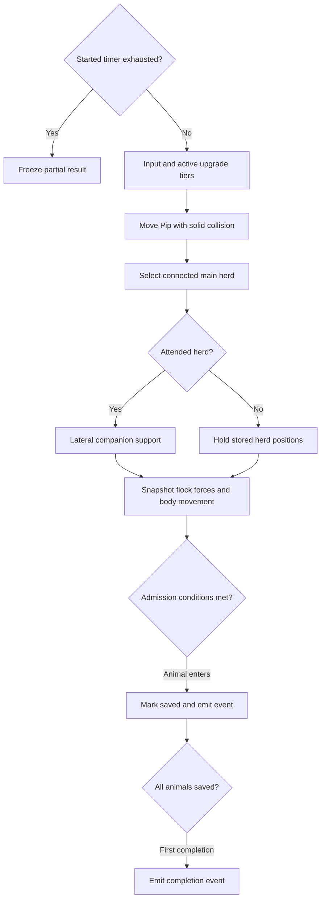
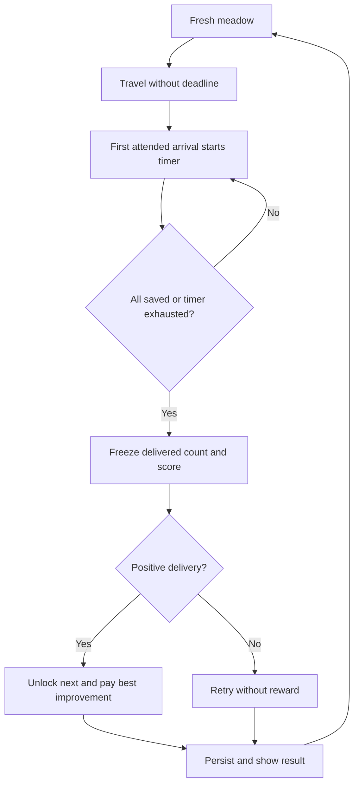

# Gameplay and progression

This describes current source behavior, not the queued design in the [issue tracker](../ISSUES.md). Geometry and navigation contracts are in [WORLD.md](WORLD.md). Entry points: [simulation.js](../../src/simulation.js), [progression.js](../../src/progression.js), and browser orchestration in [main.js](../../src/main.js).

## State and interfaces

The simulation is renderer-independent ES modules, directly importable in Node. `stepSimulation(level, dog, input = {}, dt = 1 / 60, upgrades = {})` mutates the level, animals, and supplied dog; it also assigns `level.dog = dog`. The browser initially copies the generated dog so callers should use that assignment rather than expect the original object identity to persist.

| Value | Contract |
|---|---|
| `level.index` | Zero-based campaign index, 0–99. UI level number is `index + 1`. |
| Positions/input | Ground plane `{x, z}` in world units; input `y` is accepted only as a fallback for missing `z`. Renderer height is separate. |
| Heading | Radians, forward vector `{x: sin(heading), z: cos(heading)}`. |
| Animal | `{id, type: 'sheep' \| 'cow', x, z, vx, vz, saved}`; stepping adds heading, alert and optional pressure timestamp. |
| Input | `{x, z, bark}`; direction normalized and magnitude capped at 1, so diagonals do not run faster. |
| Result | `{saved, total, score, possibleScore, completed, justCompleted, reward, remaining, countdownStarted, events, helpers, dogCollision}`. |
| Events | `{type:'animalSaved', id, animalType}` `{type:'countdownStarted', duration}` on first valid arrival, and one `{type:'levelCompleted', index, reward, reason}` per fresh level instance. |

`stepSimulation` defaults to 1/60 second and clamps supplied `dt` to `[0, 0.1]`. **This is not a fixed-step browser loop.** `main.js` calls once per animation frame using elapsed frame time capped at 0.05 seconds, with no accumulator or catch-up. Tests often choose fixed 1/60 or 0.1 steps. `level.time` and browser completion `elapsed` advance only during play, using these capped deltas; elapsed is not full wall-clock time after a long stall. Bark lasts 650 ms with a 2100 ms cooldown measured by `performance.now()`, independently of simulation time.

Pip moves at `7.8 + speedBoost` units/second, with radius 0.62. Movement collision reports `blockedX`/`blockedZ`; see the [world clearance distinction](WORLD.md#clearance-is-not-one-query). Sheep radius/speed limit are 0.55/4.2, cows 0.78/3.3. These are kinematic bodies, not a rigid-body engine.

## One simulation step



Each active animal computes forces from a snapshot, so earlier animals' updated positions do not directly affect later ones' force inputs. Separation acts under 2 units; cohesion/alignment use visible neighbors under 18 units. Ground visibility is cached by animal pair and 0.2-unit position cells. Cohesion starts beyond 2.6 units from neighbor center; alignment retains 45% of average neighbor velocity. Unpressured animals also receive small deterministic sinusoidal wandering. From public level 8, a seeded cohort of `floor(15% × flock size)` unsaved animals gets one 33% wander roll every five simulation seconds while not being actively herded; each wander heads 4–7 units away from the flock for at most 2.5 seconds. Pip's clear pressure and an assisting companion herd suppress opportunities; a helper in hold mode does not create goal progress. Starting at public level 17, a successful wander has a conditional 10% bolt roll, which raises the speed cap for a seeded 1–3 seconds. Movement still uses normal solid-body collision. Pausing stops the simulation clock, and restarting creates fresh seeded state. Saved animals never enter this cohort: they leave the active flock and gently mill inside the goal footprint, including while the completion screen is visible. Their movement uses each body's physical radius, stays clear of the entrance, and does not change delivery counts, score, or result.

Representative ordinary-input journeys were rerun after adding stragglers and still deliver the full flocks at public levels 2, 3, 6, 10, and 16. The existing controller previously completed public levels 1–5 in 18.2, 17.2, 28.7, 38.7, and 208.0 simulated seconds. Those are policy simulation times, not human attempts or evidence that the level-5 pacing concern is resolved; F-013 remains open pending human playtesting.

Pip's base pressure radius is `7.6 + signalBoost`, plus 3.3 while barking. Within it, a clear **player signal** produces flee pressure; bark multiplies urgency by `1.65 + barkBoost`. Animals flee Pip's position, not the destination. Under pressure, `openingSteer` can assist at a nearby physical opening when forward travel is blocked. The planner uses the animal’s actual collision radius (.55 sheep, .78 cow), including its initial clearance check. For bridges it uses collision-valid local waypoints to go around short rail ends and curved banks before entering the deck, including blocked animals aligned with the opening. Gates retain lateral correction. This is local obstacle assistance, not destination steering; without incoming movement pressure it returns zero. Velocity smoothing, speed caps, solid body movement, and limited angled escape attempts then resolve movement. Companion support and admission use **ground** paths; do not replace those with the more permissive player signal.

## Companions support the player

Owned companion tiers apply only after their current meadow's unlock gates. The largest connected component is selected using links of at most 6.5 units with a clear ground path (radius 0.15). Ties prefer members from the previous selection, then lowest animal ID. Recompute on active-membership changes or after more than 0.25 simulation seconds. A singleton is not a supported herd: helpers go to standby, and isolated stragglers receive no support.

Attendance uses the closest ground-visible member of the selected herd, not its centroid. Visibility search is limited to 18 units, so losing a clear path yields infinite attendance distance even if Pip is physically close.

| Existing mode | Hold decision |
|---|---|
| Initial/standby | Hold when nearest visible member is farther than 14. |
| Hold | Stay holding at distance 12 or greater; return to assist below 12. |
| Assist | Hold beyond 18; stay assisting at 18 or below. |

Hold entry captures the herd centroid and each member's position. Membership change with less than half overlap also recaptures positions. Holding suppresses inherited alignment/cohesion momentum and steers members back toward stored positions. Direct pressure of at least 0.03 overrides holding for that animal. It is a bounded positional behavior, not an immutable freeze.

In assist, companions tidy lateral flanks relative to Pip→centroid. The force vectors have their mean removed, preventing net propulsion toward a destination. The drone flies over the centroid; Buddy navigates solid ground alongside Pip, or alongside the herd while holding. Buddy's body has no blanket flee signal. Neither companion chooses a goal or autonomously delivers the flock.

Tests: [companions.test.js](../../tests/companions.test.js) covers selection, hysteresis, fifteen-minute hold, straggler retrieval, blocked signals, zero goal dependence and unattended admission. [herding-journey.test.js](../../tests/herding-journey.test.js) uses legitimate dog input to complete five representative crossing journeys; its bounded policy does not prove all seeds/routes solvable.

## Admission, rewards, and profile lifecycle

Admission requires positive simulation time, Pip within `target.radius + 12` of target center, an animal not held by companions, its **entire circular body** inside the shared rectangular target footprint, and Pip→animal clear ground path (radius .15). `containsTarget` contracts both local half-extents by the physical body radius; walls remain physical barriers. Saved animals no longer join flock forces or admission checks; they roam gently within the goal's rotated footprint while delivery continues or the completion screen is visible.

The first valid arrival emits `countdownStarted` and sets `level.delivery = {started:true,duration,remaining}`. There is no travel deadline before it. Duration is `clamp(30 + ceil(max(0,total-5)/5) + 4*(max(1,routeCount)-1) + 2*floor(spawnToGoalDistance/40),30,60)` seconds. The first-arrival step receives the full duration; later positive steps subtract capped simulation `dt` before movement. When time reaches zero admission closes before movement, freezing `level.result = {saved,total,score,possibleScore,reason:'timeout'}`. All arrivals finish immediately with reason `all-arrived`. Completed levels do not advance full gameplay again. `stepSavedRoaming(level,dt)` moves only saved animals behind visible results, using a separate `savedRoamTime` initialized from `level.time`; it never advances delivery, elapsed time, Pip or undelivered animals. Empty flocks do not complete.

Score is `floor(level.reward * saved / total)`, with possible score `80 + 25*index`. A simulation result's one-shot `reward` is the run score; it is **not** the actual wallet delta. `applyLevelReward` validates the profile and pays `max(0,score - bestEarnedBolts[index])`, updates the lifetime ledger, and unlocks the next meadow on any positive delivery. Equal/worse replays and repeated application pay zero. For example, improving a best score from 32 to 64 pays 32 bolts; spending points or reloading does not reduce lifetime entitlement. Zero saved gives no bolts/unlock. Index 99 remains the last unlocked index; the browser next button cycles to the first meadow after a positive result there. This existing behavior is recorded as Done in [F-029](../ISSUES.md#f-029--lifetime-best-score-improvement-pays-only-its-difference); the 15 October 2026 P0 missing-bolts replay report was withdrawn as invalid.



`defaultProfile()` returns `{version:2, points:0, upgrades:{}, completedLevels:[], bestScores:{}, bestEarnedBolts:{}, highestLevel:0, music:true}`. `validateProfile` bounds points to whole numbers 0–1e9 and validates owned tiers. `bestEarnedBolts` is canonical: valid numeric positive ledger entries use canonical index keys 0–99 and are floored/capped at each level's maximum reward. It rebuilds `bestScores` and sorted completed indexes from that ledger; stale caches cannot inflate entitlements. Highest unlocked index is reconciled and capped at 99; only explicit `music:false` disables music. Pre-ledger version 1/unversioned completed levels migrate to full earned entitlement without adding spendable points or changing ownership. Version-2 completion caches cannot trigger that migration. Profile saves contain no in-progress world positions.

`loadProfile(storage?, key = 'flock-foundry-v1')` and `saveProfile(profile, storage?, key?)` use a storage object with `getItem`/`setItem` (default `localStorage`). Invalid JSON or inaccessible storage loads defaults; saving failure returns false. The browser retains its in-memory profile and displays a toast on save failure. The same key survives normal restarts and deployment path changes on the same origin.

`begin(index)` regenerates a meadow, resets elapsed/input/tips/bark state, and keeps profile progress. “Restart this meadow” calls it with the current index. Confirmed “Restart Game” replaces the profile with defaults while retaining music, persists it, resets reward/tap state, and begins index 0. Cancel does not reset progress. Pause/workshop modes stop stepping; the renderer can still update visual effects in intro/completion.

## Upgrade contract

The six three-tier catalog entries and exact costs/gates live in [progression.js](../../src/progression.js). Use its exports rather than duplicate a pricing table in callers:

| Export | Purpose |
|---|---|
| `upgradeLevel`, `validateUpgrades` | Accept positive integer tiers (cap at 3); migrate legacy `true` to tier 1; drop unknown/malformed entries. |
| `upgradeCost`, `nextUnlockLevel` | Price/gate of next tier; `null` for unknown or maxed upgrade. |
| `upgradeAvailability` | Workshop status with `unknown`, `owned`, `locked`, `points`, or `null` reason. |
| `purchaseUpgrade` | Atomically purchase one tier; failed purchase preserves points. |
| `activeUpgrades`, `upgradeEffects` | Clamp owned tiers to gates of the current one-based meadow number. |

Purchase eligibility follows unlocked campaign progress (`highestLevel` and completions). Activation follows the meadow being played. Thus an owned later tier stays in the save when replaying an early meadow but its effect is inactive there. Effects are absolute arrays by tier, not cumulative additions of each previous tier. See [progression tests](../../tests/progression.test.js) and [simulation tests](../../tests/simulation.test.js).

Run from repository root with Node 22+; no DOM or WebGL is needed:

```sh
node --input-type=module <<'JS'
import assert from 'node:assert/strict';
import {
  createLevel, stepSimulation, defaultProfile, applyLevelReward,
  purchaseUpgrade, saveProfile, loadProfile,
} from './src/simulation.js';
import { activeUpgrades } from './src/progression.js';
const level = createLevel(0);
// Synthetic admission fixture, as opposed to a player input policy.
level.animals.forEach(a => Object.assign(a, {x:level.target.x, z:level.target.z}));
const result = stepSimulation(level, {...level.target}, {}, 1/60);
assert.equal(result.justCompleted, true);
const profile = defaultProfile();
assert.equal(applyLevelReward(profile, level), 80);
assert.equal(applyLevelReward(profile, level), 0);
assert.equal(purchaseUpgrade(profile, 'speed').ok, true);
assert.deepEqual(activeUpgrades(profile.upgrades, 1), {});
assert.deepEqual(activeUpgrades(profile.upgrades, 2), {speed:1});
let json;
const storage = {getItem: () => json, setItem: (_key, value) => {json=value;}};
assert.equal(saveProfile(profile, storage), true);
assert.deepEqual(loadProfile(storage), profile);
console.log('completion, reward, tier gates and storage round trip passed');
JS
```

## Development QA and remaining work

`qa.js` is dynamically imported only when Vite defines `__FLOCK_QA__` for development or explicit `qa` mode. Production builds eliminate the entry point and mutation module. First QA entry replaces the in-memory profile with defaults, begins the tutorial and marks an isolated session; persistence is suppressed until reload. Opening the dialog pauses input, gameplay, countdowns and audio and makes background controls inert. Resume plays an active edited test world; for a completed meadow it restores results without re-awarding bolts. Reset starts a fresh test profile/tutorial. Reload returns to the normal saved profile.

QA 0 maps to tutorial index 0; QA 1–100 map to public levels/indexes 0–99 without unlock restrictions. Bolt edits accept nonnegative safe integers, reject overflow and clamp removals at zero. Animal coordinate edits require paused QA mode, finite coordinates inside the meadow bounds and body-clear occupancy, unless explicit invalid-placement override bypasses occupancy. They zero velocity and preserve delivered state. A select identifies species/ID and delivery state; coordinate inputs support mouse/touch forms. Export downloads JSON containing seed, level, elapsed time, profile, dog and animal/world state; import is not provided. No window mutation API is installed.

The [tracker](../ISSUES.md) puts gates and wanderers in Review as P2 candidates; F-013 pacing and unimplemented P3 work remain Open; F-028 delivered-animal roaming is Done by user acceptance on 15 October 2026 at 00:28 America/Vancouver for its deployed build. All P1 gameplay items are Done by user sign-off on 14 October 2026; headless checks do not establish real-phone feel, rendered visuals or listening quality. See [runbook](../validation/P0-P1.md) for release and manual checks.

Queued F-041 (P2), 15 October 2026: after spontaneous wander/bolt travel, keep the unattended animal in a local area at its new position instead of pulling it back through herd cohesion/alignment. Current code still rejoins ordinary flock forces after expiry; this change is not implemented in the cloud-removal batch. Future work must preserve pressure interruption, collision and delivered-animal confinement.
