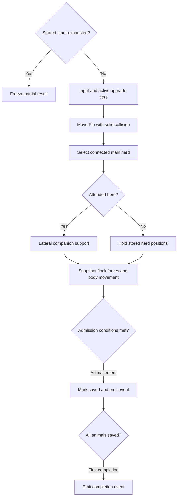
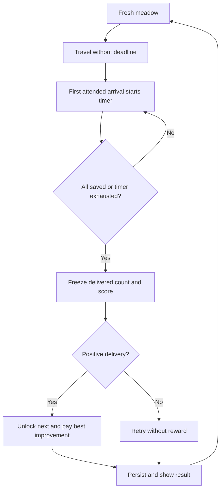

# Gameplay and progression

This describes current source behavior, not the queued design in the [issue tracker](../ISSUES.md). Geometry and navigation contracts are in [WORLD.md](WORLD.md). Entry points: [simulation.js](../../src/simulation.js), [progression.js](../../src/progression.js), and browser orchestration in [main.js](../../src/main.js).

## State and interfaces

The simulation is renderer-independent ES modules, directly importable in Node. `stepSimulation(level, dog, input = {}, dt = 1 / 60, upgrades = {})` mutates the level, animals, and supplied dog; it also assigns `level.dog = dog`. The browser initially copies the generated dog so callers should use that assignment rather than expect the original object identity to persist.

| Value | Contract |
|---|---|
| `level.index` | Zero-based campaign index, 0–99. UI level number is `index + 1`. |
| Positions/input | Ground plane `{x, z}` in world units; input `y` is accepted only as a fallback for missing `z`. Renderer height is separate. |
| Heading | Radians, forward vector `{x: sin(heading), z: cos(heading)}`. |
| Animal | `{id, type: 'sheep' \| 'cow', x, z, vx, vz, saved}`; stepping adds heading, alert and optional pressure timestamp. |
| Input | `{x, z, bark}`; direction normalized and magnitude capped at 1, so diagonals do not run faster. |
| Result | `{saved, total, score, possibleScore, completed, justCompleted, reward, remaining, countdownStarted, events, helpers, dogCollision}`. |
| Events | `{type:'animalSaved', id, animalType}` `{type:'countdownStarted', duration}` on first valid arrival, and one `{type:'levelCompleted', index, reward, reason}` per fresh level instance. |

`stepSimulation` defaults to 1/60 second and clamps supplied `dt` to `[0, 0.1]`. **This is not a fixed-step browser loop.** `main.js` calls once per animation frame using elapsed frame time capped at 0.05 seconds, with no accumulator or catch-up. Tests often choose fixed 1/60 or 0.1 steps. `level.time` and browser completion `elapsed` advance only during play, using these capped deltas; elapsed is not full wall-clock time after a long stall. Bark lasts 650 ms with a 2100 ms cooldown measured by `performance.now()`, independently of simulation time.

Pip moves at `7.8 + speedBoost` units/second, with radius 0.62. Movement collision reports `blockedX`/`blockedZ`; see the [world clearance distinction](WORLD.md#clearance-is-not-one-query). Sheep radius/speed limit are 0.55/4.2, cows 0.78/3.3. These are kinematic bodies, not a rigid-body engine.

## One simulation step



Each active animal computes forces from a snapshot, so earlier animals' updated positions do not directly affect later ones' force inputs. Separation acts under 2 units; cohesion/alignment use visible neighbors under 18 units only within the same connected flock component. Components use clear links at most 6.5 units, so separate groups and isolated individuals do not attract or align with one another. Pip may physically guide groups back into contact. Ground visibility is cached by animal pair and 0.2-unit position cells. Cohesion starts beyond 2.6 units from neighbor center and now uses 70% of its former strength; alignment retains 45% of average neighbor velocity. Unpressured animals also receive small deterministic sinusoidal wandering. From public level 8, a seeded cohort of `floor(15% × flock size)` unsaved animals gets one 33% wander roll every five simulation seconds while not being actively herded; each wander heads 4–7 units away from the flock for at most 2.5 seconds. Pip's clear pressure and an assisting companion herd suppress opportunities; a helper in hold mode does not create goal progress. Starting at public level 17, a successful wander has a conditional 10% bolt roll, which raises the speed cap for a seeded 1–3 seconds. Movement still uses normal solid-body collision. Pausing stops the simulation clock, and restarting creates fresh seeded state. Saved animals never enter this cohort: they leave the active flock and gently mill inside the goal footprint, including while the completion screen is visible. Their movement uses each body's physical radius, stays clear of the entrance, and does not change delivery counts, score, or result.

Representative ordinary-input journeys were rerun after adding stragglers and still deliver the full flocks at public levels 2, 3, 6, 10, and 16. The existing controller previously completed public levels 1–5 in 18.2, 17.2, 28.7, 38.7, and 208.0 simulated seconds. Those are policy simulation times, not human attempts or evidence that the level-5 pacing concern is resolved; F-013 remains open pending human playtesting.

Pip's base pressure radius is `7.6 + signalBoost`, plus 3.3 while barking. Within it, a clear **player signal** produces flee pressure; bark multiplies urgency by `1.65 + barkBoost`. Animals flee Pip's position, not the destination. Under pressure, `openingSteer` can assist at a nearby physical opening when forward travel is blocked. The planner uses the animal’s actual collision radius (.55 sheep, .78 cow), including its initial clearance check. For bridges it uses collision-valid local waypoints to go around short rail ends and curved banks before entering the deck, including blocked animals aligned with the opening. Gates retain lateral correction. This is local obstacle assistance, not destination steering; without incoming movement pressure it returns zero. Velocity smoothing, speed caps, solid body movement, and limited angled escape attempts then resolve movement. Companion support and admission use **ground** paths; do not replace those with the more permissive player signal.

## Companions support the player

Owned companion tiers apply only after their current meadow's unlock gates. Buddy now has separate behavior described below. For the drone, the largest connected component is selected using links of at most 6.5 units with a clear ground path (radius 0.15). Ties prefer members from the previous selection, then lowest animal ID. Recompute on active-membership changes or after more than 0.25 simulation seconds. A singleton is not a supported herd: the drone goes to standby and does not retrieve isolated stragglers.

Attendance uses the closest ground-visible member of the selected herd, not its centroid. Visibility search is limited to 18 units, so losing a clear path yields infinite attendance distance even if Pip is physically close.

| Existing mode | Hold decision |
|---|---|
| Initial/standby | Hold when nearest visible member is farther than 14. |
| Hold | Stay holding at distance 12 or greater; return to assist below 12. |
| Assist | Hold beyond 18; stay assisting at 18 or below. |

Hold entry captures the herd centroid and each member's position. Membership change with less than half overlap also recaptures positions. Holding suppresses inherited alignment/cohesion momentum and steers members back toward stored positions. Direct pressure of at least 0.03 overrides holding for that animal. It is a bounded positional behavior, not an immutable freeze.

In assist, the drone tidies lateral flanks relative to Pip→centroid. Its force vectors have their mean removed, preventing net propulsion. It flies over the centroid. The drone does not choose the goal. From tier 2 Buddy can guide a nearby flock through a bridge or goal entrance; neither helper admits unattended deliveries. Buddy's local pressure can override drone hold for the affected animal.

### Buddy dog tiers (15 October 2026)

Buddy uses its own level-local state in `buddy.js`. Connected groups require at least two unsaved animals, links at most 6.5m and a clear ground path. Active excursions, settled strays and the current retrieval target are excluded from Buddy's ordinary groups. Membership refreshes on changes or every .25 simulation seconds; equal-size ties favor the previous selection, then lowest animal ID.

- Tier 1 (public level 20): work behind the rearmost flock member along the largest group's measured average velocity. A .28m/s threshold rejects idle jitter. Remember the last direction while stopped, but apply no invented forward drive. Direction smoothing handles turns and full reversals.
- Tier 2 (public level 24): select the smallest connected flock group, retain it on size ties, and help it along the main flock's direction of travel. Near a bridge, guide the group through its actual opening to the far bank. Near the goal with Pip attending nearby, steer through the real entrance. Retain that local passage until its remaining tail, including a final singleton, gets through. Rejoin normal flock support after the passage or a physical merge.
- Tier 3 (public level 28): prioritize bolters, then the nearest wanderer or locally settled stray. Retain that target after pressure clears its excursion/home state; choose the closest current flock group by centroid distance, and stop retrieval within 4.5m of a ground-visible member. A group of at least two must remain to receive the stray.

Buddy navigates with a .6m body radius and circles to the rear before exerting pressure. Influence is limited to animals within 8m, behind-to-forward alignment greater than .6 and clear ground visibility. Forward steps require the animal's actual body clearance. Retrieval uses navigation waypoints toward the receiving group and ordinary opening steering/collision. Bolters may escape ahead while Buddy runs to catch up; a short interception lead helps Buddy circle into position. No teleport, forced recall or artificial bolter slowdown is used, and catching every bolt before expiry is not guaranteed. Lower tiers do not chase or remotely cancel excursions.

Tiers 2 and 3 bark autonomously only when in a useful rear position, with a 3.2s simulation-time cooldown and .65s strength burst. `buddyBark` events drive audio and a ground ring at Buddy's position. Dedicated tail lights flash independently of Pip; the ring lifecycle restores the tail even after results stop gameplay. Buddy does not consume Pip's bark cooldown. Pause/zero dt freeze decisions, pressure and cooldowns; level replacement resets all transient state. Saved animals are excluded.

See [Buddy regression tests](../../tests/buddy.test.js) for rear positioning, reversals, size ties/merges, tier gates, three retrieval states, nearest-group selection, real bridge traversal with a holding drone, blocked signals, cooldown, pause and target invalidation. Controller/renderer tests check event routing, separate bark origins and tail lifecycle. These are headless checks; live feel and device presentation remain for user review.

Tests: [companions.test.js](../../tests/companions.test.js) covers selection, hysteresis, fifteen-minute hold, straggler retrieval, blocked signals, zero goal dependence and unattended admission. [herding-journey.test.js](../../tests/herding-journey.test.js) uses legitimate dog input to complete five representative crossing journeys; its bounded policy does not prove all seeds/routes solvable.

## Admission, rewards, and profile lifecycle

Admission requires positive simulation time, Pip within `target.radius + 12` of target center, an animal not held by companions, its **entire circular body** inside the shared rectangular target footprint, and Pip→animal clear ground path (radius .15). `containsTarget` contracts both local half-extents by the physical body radius; walls remain physical barriers. Saved animals no longer join flock forces or admission checks; they roam gently within the goal's rotated footprint while delivery continues or the completion screen is visible.

The first valid arrival emits `countdownStarted` and sets `level.delivery = {started:true,duration,remaining}`. There is no travel deadline before it. Duration is `clamp(30 + ceil(max(0,total-5)/5) + 4*(max(1,routeCount)-1) + 2*floor(spawnToGoalDistance/40),30,60)` seconds. The first-arrival step receives the full duration; later positive steps subtract capped simulation `dt` before movement. When time reaches zero admission closes before movement, freezing `level.result = {saved,total,score,possibleScore,reason:'timeout'}`. All arrivals finish immediately with reason `all-arrived`. Completed levels do not advance full gameplay again. `stepSavedRoaming(level,dt)` moves only saved animals behind visible results, using a separate `savedRoamTime` initialized from `level.time`; it never advances delivery, elapsed time, Pip or undelivered animals. Empty flocks do not complete.

Score is `floor(level.reward * saved / total)`, with possible score `80 + 25*index`. A simulation result's one-shot `reward` is the run score; it is **not** the actual wallet delta. `applyLevelReward` validates the profile and pays `max(0,score - bestEarnedBolts[index])`, updates the lifetime ledger, and unlocks the next meadow on any positive delivery. Equal/worse replays and repeated application pay zero. For example, improving a best score from 32 to 64 pays 32 bolts; spending points or reloading does not reduce lifetime entitlement. Zero saved gives no bolts/unlock. Index 99 remains the last unlocked index; the browser next button cycles to the first meadow after a positive result there. This existing behavior is recorded as Done in [F-029](../ISSUES_CLOSED.md#f-029--lifetime-best-score-improvement-pays-only-its-difference); the 15 October 2026 P0 missing-bolts replay report was withdrawn as invalid.



`defaultProfile()` returns `{version:2, points:0, upgrades:{}, completedLevels:[], bestScores:{}, bestEarnedBolts:{}, highestLevel:0, music:true}`. `validateProfile` bounds points to whole numbers 0–1e9 and validates owned tiers. `bestEarnedBolts` is canonical: valid numeric positive ledger entries use canonical index keys 0–99 and are floored/capped at each level's maximum reward. It rebuilds `bestScores` and sorted completed indexes from that ledger; stale caches cannot inflate entitlements. Highest unlocked index is reconciled and capped at 99; only explicit `music:false` disables music. Pre-ledger version 1/unversioned completed levels migrate to full earned entitlement without adding spendable points or changing ownership. Version-2 completion caches cannot trigger that migration. Profile saves contain no in-progress world positions.

`loadProfile(storage?, key = 'flock-foundry-v1')` and `saveProfile(profile, storage?, key?)` use a storage object with `getItem`/`setItem` (default `localStorage`). Invalid JSON or inaccessible storage loads defaults; saving failure returns false. The browser retains its in-memory profile and displays a toast on save failure. The same key survives normal restarts and deployment path changes on the same origin.

`begin(index)` regenerates a meadow, resets elapsed/input/tips/bark state, and keeps profile progress. “Restart this meadow” calls it with the current index. Confirmed “Restart Game” replaces the profile with defaults while retaining music, persists it, resets reward/tap state, and begins index 0. Cancel does not reset progress. Pause/workshop modes stop stepping; the renderer can still update visual effects in intro/completion.

## Upgrade contract

The six three-tier catalog entries and exact costs/gates live in [progression.js](../../src/progression.js). Use its exports rather than duplicate a pricing table in callers:

| Export | Purpose |
|---|---|
| `upgradeLevel`, `validateUpgrades` | Accept positive integer tiers (cap at 3); migrate legacy `true` to tier 1; drop unknown/malformed entries. |
| `upgradeCost`, `nextUnlockLevel` | Price/gate of next tier; `null` for unknown or maxed upgrade. |
| `upgradeAvailability` | Workshop status with `unknown`, `owned`, `locked`, `points`, or `null` reason. |
| `purchaseUpgrade` | Atomically purchase one tier; failed purchase preserves points. |
| `activeUpgrades`, `upgradeEffects` | Clamp owned tiers to gates of the current one-based meadow number. |

Purchase eligibility follows unlocked campaign progress (`highestLevel` and completions). Activation follows the meadow being played. Thus an owned later tier stays in the save when replaying an early meadow but its effect is inactive there. Effects are absolute arrays by tier, not cumulative additions of each previous tier. See [progression tests](../../tests/progression.test.js) and [simulation tests](../../tests/simulation.test.js).

Run from repository root with Node 22+; no DOM or WebGL is needed:

```sh
node --input-type=module <<'JS'
import assert from 'node:assert/strict';
import {
  createLevel, stepSimulation, defaultProfile, applyLevelReward,
  purchaseUpgrade, saveProfile, loadProfile,
} from './src/simulation.js';
import { activeUpgrades } from './src/progression.js';
const level = createLevel(0);
// Synthetic admission fixture, as opposed to a player input policy.
level.animals.forEach(a => Object.assign(a, {x:level.target.x, z:level.target.z}));
const result = stepSimulation(level, {...level.target}, {}, 1/60);
assert.equal(result.justCompleted, true);
const profile = defaultProfile();
assert.equal(applyLevelReward(profile, level), 80);
assert.equal(applyLevelReward(profile, level), 0);
assert.equal(purchaseUpgrade(profile, 'speed').ok, true);
assert.deepEqual(activeUpgrades(profile.upgrades, 1), {});
assert.deepEqual(activeUpgrades(profile.upgrades, 2), {speed:1});
let json;
const storage = {getItem: () => json, setItem: (_key, value) => {json=value;}};
assert.equal(saveProfile(profile, storage), true);
assert.deepEqual(loadProfile(storage), profile);
console.log('completion, reward, tier gates and storage round trip passed');
JS
```

## Development QA and remaining work

`qa.js` is dynamically imported only when Vite defines `__FLOCK_QA__` for development or explicit `qa` mode. Production builds eliminate the entry point and mutation module. First QA entry replaces the in-memory profile with defaults, begins the tutorial and marks an isolated session; persistence is suppressed until reload. Opening the dialog pauses input, gameplay, countdowns and audio and makes background controls inert. Resume plays an active edited test world; for a completed meadow it restores results without re-awarding bolts. Reset starts a fresh test profile/tutorial. Reload returns to the normal saved profile.

QA 0 maps to tutorial index 0; QA 1–100 map to public levels/indexes 0–99 without unlock restrictions. Bolt edits accept nonnegative safe integers, reject overflow and clamp removals at zero. Animal coordinate edits require paused QA mode, finite coordinates inside the meadow bounds and body-clear occupancy, unless explicit invalid-placement override bypasses occupancy. They zero velocity and preserve delivered state. A select identifies species/ID and delivery state; coordinate inputs support mouse/touch forms. Export downloads JSON containing seed, level, elapsed time, profile, dog and animal/world state; import is not provided. No window mutation API is installed.

The [tracker](../ISSUES.md) puts gates and wanderers in Review as P2 candidates; F-013 pacing and unimplemented P3 work remain Open; F-028 delivered-animal roaming is Done by user acceptance on 15 October 2026 at 00:28 America/Vancouver for its deployed build. All P1 gameplay items are Done by user sign-off on 14 October 2026; headless checks do not establish real-phone feel, rendered visuals or listening quality. See [runbook](../validation/P0-P1.md) for release and manual checks.

Queued F-041 (P2), 15 October 2026: after spontaneous wander/bolt travel, keep the unattended animal in a local area at its new position instead of pulling it back through herd cohesion/alignment. Current code still rejoins ordinary flock forces after expiry; this change is not implemented in the cloud-removal batch. Future work must preserve pressure interruption, collision and delivered-animal confinement.

## Flock wandering and bolting revision - 15 October 2026

F-035/F-037/F-039/F-041 are implemented and in **Review** pending new gameplay acceptance. Earlier weather sign-offs remain Done. Each level/restart owns fresh animal schedules and a seeded cohort capped at floor(20% of current undelivered animals). Saved animals are excluded and retain confined goal roaming. Individual opportunity intervals are seeded random 5-8 simulation seconds, not synchronized five-second or per-frame rolls; zero-time calls freeze state and gaps cannot replay a backlog.

| Public levels | Wander chance per eligible check | Conditional bolt chance | Bolt duration |
|---|---|---|---|
| 1-7 | None | None | None |
| 8-16 | 33% | None | None |
| 17-39 | 33% | 10% | 3-5 seconds |
| 40 | 33% | 10% | 4-6 seconds |
| 41-69 | 20% | 20% | 4-6 seconds |
| 70 | 20% | 20% | 5-10 seconds |
| 71-100 | 25% | 20% | 5-10 seconds |

The user clarification replaces the earlier 30%/50% late-level odds. Earlier levels retain their accepted 33% opportunity odds; the 20% cohort cap remains per-level at all levels. Duration changes are step bands at 40 and 70. An active wander lasts up to 2.5 seconds or reaching its short target; bolt targets are farther than possible travel during the rolled duration. Active clear Pip pressure or helper herding interrupts either. If delivery reduces cohort eligibility, an excluded active excursion ends locally to preserve the cap.

During an excursion and after local settling, ordinary cohesion/alignment do not pull the animal back. At excursion end, the reached position becomes its home; it calmly roams within 3m, with actual body collision. Settled animals do not repeatedly escape until active herding clears their home. Companion hold remains authoritative; active helper assist restores normal herding. Delivery clears transient excursion/home/scheduling fields before goal roaming.

Regression checks cover seeded odds/boundaries, random schedules/frame-rate independence, changing undelivered counts, local settling under nearby herd attraction, collisions, player/helper interruption, pause, restart and goal confinement. The unchanged full-flock journey controller remains the delivery regression. These are source/headless checks, not measured player pacing. Earlier fixed-five-second/15%/1-3 second descriptions below are historical and superseded.


### Buddy navigation and flock-split follow-up - 15 October 2026

The first F-046 build could stall at a tree, flicker its facing inside the flock, and lacked tier-2 local passage guidance. The current follow-up adds `buddy-navigation.js`: a cached visibility graph around circular tree footprints, composed with existing bridge/goal navigation. Every graph edge and movement uses actual ground/body clearance (.6m Buddy, .55m sheep, .78m cows). Tree-only detours bypass road projections that otherwise return a blocked point or the helper's own feet. Detours expire after two simulation seconds or a significant goal change and are rebuilt if an edge is blocked.

Buddy retains its circling side until reaching the rear. Travel/work direction turns at most 1.8 radians per second; movement and visible facing turn at most 2.8 radians per second. It slows while turning and stops within a small waypoint tolerance. The renderer consumes simulation heading, so tiny opposite displacements do not snap the mesh around. Pause freezes heading and movement. Level replacement clears navigation state; delivered animals clear transient route caches.

Tier-2 bridge help uses the current travel direction to choose the crossing side and aims for a point four metres beyond the deck, with each sheep/cow following physical navigation waypoints. Goal help uses `destinationApproach` and the actual entrance; it begins only with Pip near the goal or clearly attending the local flock. Pressure remains local (8m), ground-visible and from a useful rear position. Passage membership retains the remaining tail after others cross or are saved; this permits local help for the last sheep without enabling ordinary lower-tier stray retrieval. Autonomous bark starts at tier 2; tier-3 retrieval remains available and bolters may still escape ahead before pursuit catches up.

Cohesion/alignment retain their old range inside a connected group but do not cross a split between groups. Separation still acts on all nearby bodies. Groups naturally reconnect only if player/helper movement brings them back into physical flock-link range; there is no distant regrouping force. Saved confinement, player-attended admission and upgrade prices/gates remain unchanged.

If the ideal work position itself overlaps a tree, bank or rail, bounded nearby samples choose usable standing ground before path planning. This prevents a correct detour from still ending at an impossible rear position.


### Forward flock pressure and bridge completion - 15 October 2026, 22:33-22:39 Vancouver

The user clarified that animals near the dogs at the back/side are pushing the animals ahead. Ordinary cohesion now uses **70%** of its previous strength, including the same proportional Flock harmony upgrade. Each connected component measures its ordinary members' average movement and actual Pip/Buddy pressure. Its travel direction survives a stop or physical split through member overlap; it never comes from the goal. Wandering/locally settled animals retain their separate behavior.

An animal more than .6m ahead of its component centroid along that travel direction is a leader. Cohesion can gather it laterally but cannot pull it backward toward the centroid. Outside direct Pip/Buddy range, forward flow fills only the leader's missing forward speed; it is not an extra push on top of direct dog pressure. Transmitted pressure enables ordinary opening steering. Direct dog pressure can still turn a leader around, solid collision still blocks movement, and disconnected flocks receive no shared drive.

`bridge-crossing.js` gives each animal local traversal intent after it walks onto a valid deck with at least .12m/s of along-bridge motion. It records the movement sign and a body-clear lane, suppresses spontaneous excursions, and navigates toward usable ground beyond the far end. Sheep/cow walking caps are 3.2/2.7m/s for this local phase. Cohesion and dogs cannot reverse the animal mid-deck; physical obstructions still stop it. Completion requires the full body beyond the deck on usable ground. A holding drone updates its positional anchor to that reached bank rather than pulling the animal back. Idle animals and walkers beside a river do not auto-launch. Pause freezes intent/movement, fresh levels clear it, and saved animals clear traversal state before confined goal roaming. This is not unattended admission or goal selection.

Autonomous Buddy bark now starts at **tier 2 (public level 24)**. The same 3.2s simulation-time cooldown, .65s burst, local useful rear position, sound/ring/red tail and independent Pip cooldown apply at tiers 2 and 3. Tier 1 stays silent; retrieving wandering/bolting individuals still requires tier 3 at public level 28. Prices and save schema stay unchanged.


### Buddy working space, positioning and recovery — 19 October 2026

The `buddy_behaviour` candidate covers F-COMP-001/002/003/007. Buddy measures the selected group's own travel rather than borrowing the largest group's heading. Member-overlap history preserves turns and stops; existing tier selection, passage commitment and physical stray retrieval still apply. A tunable 3m comfortable gap shifts work/orbit positions laterally around Pip with retained side choice. Body-clear alternatives take priority; cramped passages keep their task and a constrained gate fallback is bounded to avoid permanently waiting for room. Pip is never steered.

With no valid group, Buddy picks a stable reachable point 3.5–5.5m from Pip, preferring positions clear of bridge throats, gates and the destination approach. A suitable existing spot within 2–7m can remain parked. Candidate endpoints and the full bounded chain of navigation edges use physical clearance, including tree detours and multi-waypoint bridge returns; if none is available, Buddy waits safely. Standby does not pressure delivered animals and valid tier work resumes on the next simulation update.

Recovery observes collision-limited movement or sustained lack of progress toward a stable work point. After 1.5s blocked or 6s futile progress it tries a short clear back/side exit, with at most three attempts before a 2s quiet retry. Every move still goes through the ordinary .6m collision body. Arrival, temporary yielding and inactive work do not accumulate stuck history; task/level changes clear caches and recovery. Existing bounded turn/acceleration behavior remains.

Source tests and blind review are recorded in QUALITY.md. Phone motion, narrow-passage feel and actual device FPS require user/device review; no deployment or acceptance follows from source tests.

### Buddy containment and seven-second grazing — 19 October 2026

F-COMP-009 extends `buddy_behaviour`: if Pip is more than 18m from the nearest member of Buddy's selected group, or no structural ground connection to any selected member is clear, Buddy contains that group instead of giving it a travel direction. A contained group returns to normal support only when Pip is within 14m with a clear structural connection. Attendance ignores tree-only occlusion but respects river banks, rails, fences and closed gates. An open gate or usable bridge on the direct connection does not itself imply separation. Existing tier selection and ordinary tier-3 retrieval remain; a stray can return to the locally held receiving flock.

Containment retains the group's holding area and member positions, with a body-clear perimeter patrol, gradual movement and no repeated bark pressure. Buddy must first visit a selected connected member within 12m on clear ground. Calm then propagates through that connected flock and persists while Buddy remains locally on its structurally connected perimeter, including interior members the orbit does not approach. Acquisition/reacquisition snapshots current physical positions instead of pulling a late-arriving group toward stale locations. Local holding dampens inherited velocity/alignment/forward carry and applies small separation around retained positions. Pip pressure overrides it. An animal already committed to a bridge finishes crossing; its new dry-bank location replaces its own old holding target before settling. No teleportation, collision bypass or unattended scoring is added.

Grazing now waits about seven seconds of calm movement within a fixed .75m local envelope. Significant drift, active pressure, turning, wandering or bridge commitment restarts settling; head lowering requires speed below .1m/s. Paused updates freeze the timer, and fresh poses start fresh. The whole existing mouth/hoof surface checks still exclude paths, bridge decks, barn floors and water; grass and bushes remain edible.


### Natural containment correction — 19 October 2026

F-COMP-010 supersedes rigid individual pinning and continuous containment orbiting. Each locally acquired animal has a small personal resting patch, deterministic individual facing and staggered brief browsing steps followed by long quiet spells. Sheep and all cow sizes can face differently instead of retaining a shared inherited travel heading. Non-browsable patches permit capped individual resting turns without enabling grazing on paths, bridges or barn floors. Grass/bush grazing still requires approximately seven calm seconds and the existing mouth/hoof surface checks. Flock homes remain bounded, with no shared preferred travel direction.

Buddy retains a check destination, walks there at a calm speed, then pauses for 4–7 seconds facing the flock. Later checks alternate sides and can target a drifting edge rather than wind continuously around the flock. A blocked sector eventually falls back to watching instead of perpetual wall pacing. Before physical flock acquisition, Buddy approaches its current nearest edge at ordinary working speed and does not watch from a distant stale checkpoint. Ordinary navigation, collision, Pip attendance/pressure, tier roles, stray retrieval and safe bridge completion remain.

Pip remains player-controlled. Input now handles lost pointer capture as cancellation: clear drag movement and do not count it as a tap or bark. Tests establish that idle Pip stays fixed while Buddy works. This is a concrete stale-input fix; it does not establish that capture loss caused the reported phone circling.
