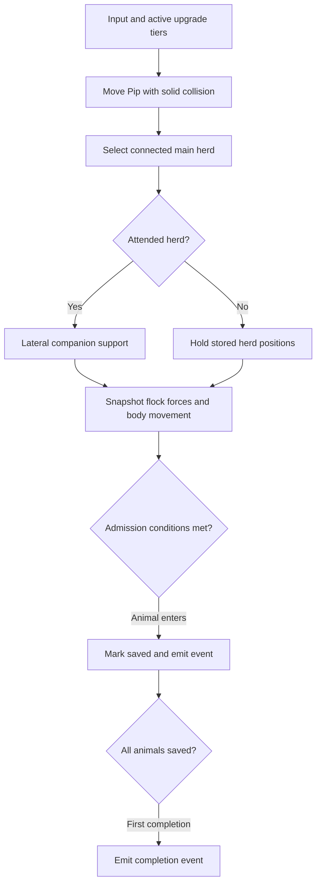
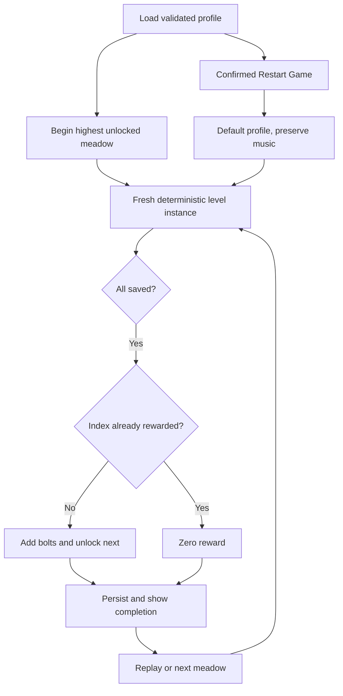

# Gameplay and progression

This describes current source behavior, not the queued design in the [issue tracker](../ISSUES.md). Geometry and navigation contracts are in [WORLD.md](WORLD.md). Entry points: [simulation.js](../../src/simulation.js), [progression.js](../../src/progression.js), and browser orchestration in [main.js](../../src/main.js).

## State and interfaces

The simulation is renderer-independent ES modules, directly importable in Node. `stepSimulation(level, dog, input = {}, dt = 1 / 60, upgrades = {})` mutates the level, animals, and supplied dog; it also assigns `level.dog = dog`. The browser initially copies the generated dog so callers should use that assignment rather than expect the original object identity to persist.

| Value | Contract |
|---|---|
| `level.index` | Zero-based campaign index, 0–99. UI level number is `index + 1`. |
| Positions/input | Ground plane `{x, z}` in world units; input `y` is accepted only as a fallback for missing `z`. Renderer height is separate. |
| Heading | Radians, forward vector `{x: sin(heading), z: cos(heading)}`. |
| Animal | `{id, type: 'sheep' \| 'cow', x, z, vx, vz, saved}`; stepping adds heading, alert and optional pressure timestamp. |
| Input | `{x, z, bark}`; direction normalized and magnitude capped at 1, so diagonals do not run faster. |
| Result | `{saved, total, completed, justCompleted, reward, events, helpers, dogCollision}`. |
| Events | `{type:'animalSaved', id, animalType}` and one `{type:'levelCompleted', index, reward}` per fresh level instance. |

`stepSimulation` defaults to 1/60 second and clamps supplied `dt` to `[0, 0.1]`. **This is not a fixed-step browser loop.** `main.js` calls once per animation frame using elapsed frame time capped at 0.05 seconds, with no accumulator or catch-up. Tests often choose fixed 1/60 or 0.1 steps. `level.time` and browser completion `elapsed` advance only during play, using these capped deltas; elapsed is not full wall-clock time after a long stall. Bark lasts 650 ms with a 2100 ms cooldown measured by `performance.now()`, independently of simulation time.

Pip moves at `7.8 + speedBoost` units/second, with radius 0.62. Movement collision reports `blockedX`/`blockedZ`; see the [world clearance distinction](WORLD.md#clearance-is-not-one-query). Sheep radius/speed limit are 0.55/4.2, cows 0.78/3.3. These are kinematic bodies, not a rigid-body engine.

## One simulation step



Each active animal computes forces from a snapshot, so earlier animals' updated positions do not directly affect later ones' force inputs. Separation acts under 2 units; cohesion/alignment use visible neighbors under 18 units. Ground visibility is cached by animal pair and 0.2-unit position cells. Cohesion starts beyond 2.6 units from neighbor center; alignment retains 45% of average neighbor velocity. Unpressured animals also receive small deterministic sinusoidal wandering. Saved animals leave the active flock.

Pip's base pressure radius is `7.6 + signalBoost`, plus 3.3 while barking. Within it, a clear **player signal** produces flee pressure; bark multiplies urgency by `1.65 + barkBoost`. Animals flee Pip's position, not the destination. Under pressure, `openingSteer` can nudge sideways toward a nearby crossing/gate when forward travel is blocked. Velocity smoothing, speed caps, solid body movement, and limited angled escape attempts then resolve movement. Companion support and admission use **ground** paths; do not replace those with the more permissive player signal.

## Companions support the player

Owned companion tiers apply only after their current meadow's unlock gates. The largest connected component is selected using links of at most 6.5 units with a clear ground path (radius 0.15). Ties prefer members from the previous selection, then lowest animal ID. Recompute on active-membership changes or after more than 0.25 simulation seconds. A singleton is not a supported herd: helpers go to standby, and isolated stragglers receive no support.

Attendance uses the closest ground-visible member of the selected herd, not its centroid. Visibility search is limited to 18 units, so losing a clear path yields infinite attendance distance even if Pip is physically close.

| Existing mode | Hold decision |
|---|---|
| Initial/standby | Hold when nearest visible member is farther than 14. |
| Hold | Stay holding at distance 12 or greater; return to assist below 12. |
| Assist | Hold beyond 18; stay assisting at 18 or below. |

Hold entry captures the herd centroid and each member's position. Membership change with less than half overlap also recaptures positions. Holding suppresses inherited alignment/cohesion momentum and steers members back toward stored positions. Direct pressure of at least 0.03 overrides holding for that animal. It is a bounded positional behavior, not an immutable freeze.

In assist, companions tidy lateral flanks relative to Pip→centroid. The force vectors have their mean removed, preventing net propulsion toward a destination. The drone flies over the centroid; Buddy navigates solid ground alongside Pip, or alongside the herd while holding. Buddy's body has no blanket flee signal. Neither companion chooses a goal or autonomously delivers the flock.

Tests: [companions.test.js](../../tests/companions.test.js) covers selection, hysteresis, fifteen-minute hold, straggler retrieval, blocked signals, zero goal dependence and unattended admission. [herding-journey.test.js](../../tests/herding-journey.test.js) uses legitimate dog input to complete five representative crossing journeys; its bounded policy does not prove all seeds/routes solvable.

## Admission, rewards, and profile lifecycle

Admission is currently a circle check, even for rectangular-looking enclosures. An animal is saved when all are true: Pip is within `target.radius + 12` of target center; the animal is not holding; its center is within `target.radius - physicalRadius * 0.5`; and Pip→animal has a clear ground path (radius 0.15). There is no countdown or partial-delivery payout. Completion requires a nonempty flock with every animal saved.

`justCompleted`/result `reward` prevent repeating the completion event on one level instance. Persistent reward deduplication is separate: `applyLevelReward(profile, level)` requires `level.completed` and an index absent from `completedLevels`, then adds `level.reward` bolts and unlocks the next meadow. Replaying a fresh instance can complete again but cannot award the same index twice. Completing index 99 keeps `highestLevel` at 99; the browser's next button returns to index 0.



`defaultProfile()` returns `{version:1, points:0, upgrades:{}, completedLevels:[], highestLevel:0, music:true}`. `validateProfile` rebuilds this schema: points become bounded whole numbers 0–1e9; upgrade entries are validated; completed indexes are deduplicated/sorted and restricted to 0–99; highest unlocked index is reconciled with completions and capped at 99; only explicit `music:false` disables music. It does not save level positions or an in-progress run.

`loadProfile(storage?, key = 'flock-foundry-v1')` and `saveProfile(profile, storage?, key?)` use a storage object with `getItem`/`setItem` (default `localStorage`). Invalid JSON or inaccessible storage loads defaults; saving failure returns false. The browser retains its in-memory profile and displays a toast on save failure. The same key survives normal restarts and deployment path changes on the same origin.

`begin(index)` regenerates a meadow, resets elapsed/input/tips/bark state, and keeps profile progress. “Restart this meadow” calls it with the current index. Confirmed “Restart Game” replaces the profile with defaults while retaining music, persists it, resets reward/tap state, and begins index 0. Cancel does not reset progress. Pause/workshop modes stop stepping; the renderer can still update visual effects in intro/completion.

## Upgrade contract

The six three-tier catalog entries and exact costs/gates live in [progression.js](../../src/progression.js). Use its exports rather than duplicate a pricing table in callers:

| Export | Purpose |
|---|---|
| `upgradeLevel`, `validateUpgrades` | Accept positive integer tiers (cap at 3); migrate legacy `true` to tier 1; drop unknown/malformed entries. |
| `upgradeCost`, `nextUnlockLevel` | Price/gate of next tier; `null` for unknown or maxed upgrade. |
| `upgradeAvailability` | Workshop status with `unknown`, `owned`, `locked`, `points`, or `null` reason. |
| `purchaseUpgrade` | Atomically purchase one tier; failed purchase preserves points. |
| `activeUpgrades`, `upgradeEffects` | Clamp owned tiers to gates of the current one-based meadow number. |

Purchase eligibility follows unlocked campaign progress (`highestLevel` and completions). Activation follows the meadow being played. Thus an owned later tier stays in the save when replaying an early meadow but its effect is inactive there. Effects are absolute arrays by tier, not cumulative additions of each previous tier. See [progression tests](../../tests/progression.test.js) and [simulation tests](../../tests/simulation.test.js).

Run from repository root with Node 22+; no DOM or WebGL is needed:

```sh
node --input-type=module <<'JS'
import assert from 'node:assert/strict';
import {
  createLevel, stepSimulation, defaultProfile, applyLevelReward,
  purchaseUpgrade, saveProfile, loadProfile,
} from './src/simulation.js';
import { activeUpgrades } from './src/progression.js';
const level = createLevel(0);
// Synthetic admission fixture, as opposed to a player input policy.
level.animals.forEach(a => Object.assign(a, {x:level.target.x, z:level.target.z}));
const result = stepSimulation(level, {...level.target}, {}, 1/60);
assert.equal(result.justCompleted, true);
const profile = defaultProfile();
assert.equal(applyLevelReward(profile, level), 80);
assert.equal(applyLevelReward(profile, level), 0);
assert.equal(purchaseUpgrade(profile, 'speed').ok, true);
assert.deepEqual(activeUpgrades(profile.upgrades, 1), {});
assert.deepEqual(activeUpgrades(profile.upgrades, 2), {speed:1});
let json;
const storage = {getItem: () => json, setItem: (_key, value) => {json=value;}};
assert.equal(saveProfile(profile, storage), true);
assert.deepEqual(loadProfile(storage), profile);
console.log('completion, reward, tier gates and storage round trip passed');
JS
```

## Current versus proposed

The [tracker](../ISSUES.md) owns future requirements and acceptance criteria: enclosure geometry/admission, arrival countdown/scoring, opening gates, wanderers, balancing and dev tooling are queued changes, not contracts implemented by this document. Source tests establish headless behavior; they do not establish real-phone feel, graphics or audio validation. Deployment URL correction is also pending in the tracker; source documentation does not establish a new live release.
