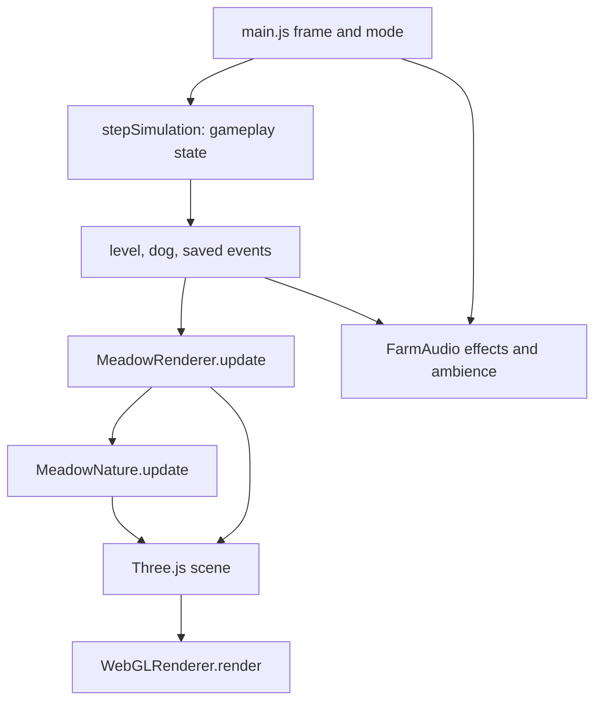
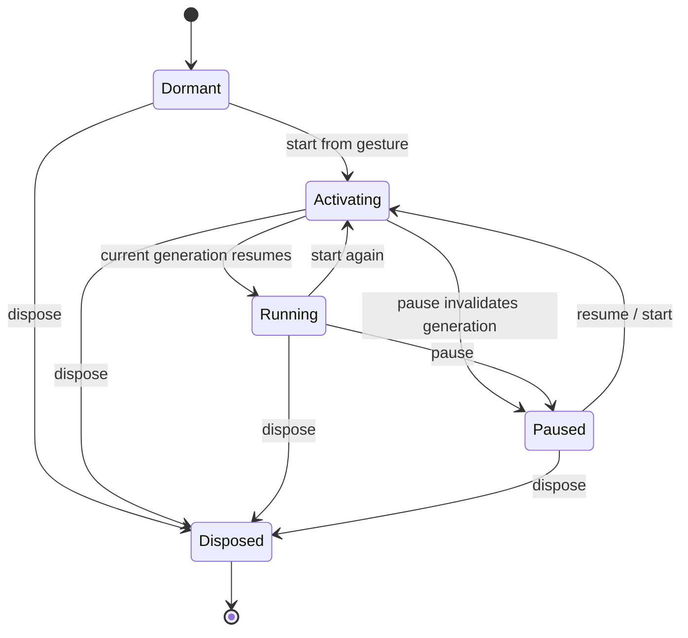

# Presentation: renderer, nature and audio

This describes the implementation at the documentation baseline, not a promise that the open art requests are complete. The application uses Three.js 0.180.0 and generated geometry/textures; there is no ThreeRust runtime, downloaded model pipeline or recorded soundtrack. Source behavior and headless tests are inspectable; real browser rendering, phone performance and perceived sound balance remain unverified here. See [quality scope](../QUALITY.md) and the [open issue tracker](../ISSUES.md).

## Boundaries and frame data flow

[main.js](../../src/main.js) owns the animation loop, application mode and the `FarmAudio` instance. Simulation owns positions and gameplay decisions. [render.js](../../src/render.js) reads the level and separate player-dog state to build scene transforms, then renders; [nature.js](../../src/nature.js) maintains its own decorative wildlife/cloud state. Wildlife never pushes the herd or awards progress.



The frame interval is capped at `.05` seconds. Simulation and event sounds run only in `playing`. The renderer receives positive `dt` in `playing`, `intro` and `complete`; other modes pass zero. Ambience updates only in `playing`. Thus completion/intro can animate visual scenery without advancing gameplay; a modal freezes renderer time but the frame loop still redraws. Backgrounding during play opens the menu, which pauses audio and resets input. There is no main-loop call to `FarmAudio.dispose()` on page teardown.

The integration has this shape (abridged from `main.js`; mode handling is essential):

```js
const dt = Math.min((now - last) / 1000, .05);
if (mode === 'playing') {
  const result = stepSimulation(level, dog, input, dt, profile.upgrades);
  for (const event of result.events)
    if (event.type === 'animalSaved') audio.play('saved');
}
renderer.update(level, dog,
  ['playing', 'intro', 'complete'].includes(mode) ? dt : 0,
  mode === 'intro');
if (mode === 'playing')
  audio.updateAmbience(dt, {
    weather: level.weather || renderer.nature?.weather?.type || 'sun'
  });
```

| Interface | Consumer / responsibility |
| --- | --- |
| `new MeadowRenderer(canvas)` | Creates WebGL renderer, camera, shared materials, scene groups and nature root. Requires browser Canvas/WebGL globals. |
| `setLevel(level)` | Replaces level-owned presentation resources; builds terrain, structures, scenery and species batches. |
| `update(level, dog, dt, preview=false)` | Camera follow, poses, nature, particles, per-instance culling, final draw. Animal array order must match the last `setLevel`. |
| `resize()` | Reads viewport size and aspect; projection changes on the next update. |
| `bark()` / `celebrate(x,z)` | Presentation effects triggered by application actions/events. |
| `drawMap(canvas, level, dog)` | Separate Canvas 2D map derived from world coordinates, not a scene render. Main updates it at roughly 10 Hz. |
| `MeadowNature.setLevel/update/dispose` | Owns cosmetic weather/fauna state and all its per-level GPU resources. |
| `FarmAudio.start/resume/pause/setMuted/play/updateAmbience/dispose` | Owns Web Audio lifecycle, music timer, procedural sources and cleanup. |

## Scene construction and materials

`MeadowRenderer` configures antialiasing, pixel ratio capped at `1.6`, sRGB output, ACES filmic tone mapping and exposure `1.05`. A hemisphere light and moving directional sun light the scene. The sun has a 1024-square PCF soft shadow map and an orthographic shadow volume of ±30 units. Background and fog share a pale blue color; fog spans 95–195 world units. These are configuration values, not measured quality/performance guarantees.

`setLevel` builds a plane larger than the bounds, decorative hills, road/river ribbons, bridge meshes, target marker, fences, structures, obstacle trees and bounded decorative details. Roads and rivers use the sampled centerlines supplied by the world. Road shoulders may wander cosmetically; river width follows the physical half-width. Fence/gate/target segments come from world collision geometry. `surfaces.js` builds ribbons by unioning convex stroke pieces into disjoint trapezoids, then upward triangles with world-coordinate UVs. Bevel center fans bound sharp joins. The union removes stacked coplanar pieces at turns, reversals and self-crossings. Headless topology checks support the repair; Novy accepted the path repair on 14 October 2026.

[models.js](../../src/models.js) supplies Pip, flock species, helpers, vegetation and structures. Its primitive geometry cache is keyed by constructor/arguments, and its material cache persists across levels. `bakeModel` clones transformed component geometry, merges it by material, disposes temporary clones and returns fewer meshes. Model clones share the baked geometry/materials. `createAnimal` bakes the body separately from four articulated legs: each leg retains `limbIndex` and a hip `pivot`, with shared material meshes in hip coordinates.

Material textures are generated locally. Models use deterministic 128-square clay/wood Canvas textures. The renderer creates deterministic 512-square grass/path color and bump maps; color textures are sRGB and repeat over the ground. Nature uses generated `DataTexture` alpha maps for cloud shadows and precipitation. Grass/path material roughness, water material properties and static lighting do not currently accumulate rain or change with weather severity.

## Batching, poses and visibility

Static scenery and flock animals have separate submission paths:

| Path | Construction | Per-frame submission |
| --- | --- | --- |
| Static scenery | `batchScenery()` groups eligible terrain pieces by **geometry identity + material identity**. It skips world-owned geometry and transparent materials; groups smaller than two remain meshes. Tufts/reeds are explicitly instanced. | `trackScenery()` retains immutable source matrices and transformed bounding spheres. `cullScenery()` compacts visible matrices into the front of each instance buffer and updates `count` and upload range. |
| Sheep/cows | One logical `Object3D` pose per animal; separate `InstancedMesh` for every baked body/limb material piece of each species. Original animal indices are stored in the species batch. | A conservative species radius includes limb pivot envelopes. The same compacted `visibleIndices` order feeds every body/leg mesh; gait uses original indices, so disappearing/reappearing animals retain their phase and pose. |
| Pip/helpers | Normal articulated scene groups; helper meshes are keyed by helper type. | Pip and ground helper legs/tails animate; drone propellers rotate and it bobs above ground. The map is designed for one helper per type. |
| Nature | Cloud/body/wing/shadow `InstancedMesh` objects plus optional precipitation `Points`. | Rewrites instance transforms; disables automatic frustum culling. Nature does not use the renderer's custom instance compaction. |

The renderer creates its own camera frustum before both scenery and animal culling. Automatic aggregate `InstancedMesh` frustum culling is disabled for these batches. Scenery spheres receive two extra world units; flock bounds receive three, retaining edge silhouettes and nearby sun shadows. Only the compacted prefix is uploaded. This reduces submitted instances, while CPU work still scans the stored instances/animals each frame. Only batched fence parts cast shadows in the static batching path; other eligible batched scenery does not inherit arbitrary original shadow flags.

Flock locomotion uses a stop-motion pose clock, `Math.floor(time * 12) / 12`. Root bob/roll and leg swings depend on speed. The limb matrix order is important:

```js
// Same transform contract used by createAnimal and updateAnimalBatches.
const limbWorld = animalWorld.clone()
  .multiply(new THREE.Matrix4().makeTranslation(...pivot))
  .multiply(new THREE.Matrix4().makeRotationX(gait));
```

World-height samples place Pip, flock and ground helpers on bridges/terrain. Saved animals remain rendered; their heading uses a fixed index-based pose. The rectangular goal marker pulses; `goal-view.js` derives its surface/outline and barn floor from `targetFootprint` world vertices. The map projects those same corners rather than drawing a circular goal dot. Celebration allocates 36 short-lived confetti meshes, updated and disposed in the main renderer update.

Bark uses `barkSurface(level,origin,scale,geometry)`: it splits expanding ring pieces at deck and individual plank boundaries before assigning surface heights, keeping triangles above land and raised planks even across deck edges. Depth testing remains enabled and depth writes disabled so fences/rails retain normal occlusion. `updateBarks(dt)` freezes at zero `dt`, finishes after .6 seconds, reuses dynamic geometry buffers, and disposes expired effects; a hard cap of four and level replacement bound resources.

## Covered structure visibility

`StructureCutaway` in `cutaway.js` clones each section material so fades cannot affect shared scenery. Whenever Pip, a helper dog, or any flock animal (including saved animals) is covered by the barn footprint, it fades the complete roof and the camera-facing wall; a diagonal view fades both adjacent walls. Target-local side selection uses orthographic camera direction and supports rotated barns, with a .18-unit membership hysteresis and exponential blend. The faded opacity is .70 (30% transparent). Faded panels disable depth writes and shadow casting; opacity/transparency/shadow settings restore when clear. A zero-time update freezes membership/fades. Collision and admission never read this visual state. Tests inspect camera-side selection/material state and disposal; they do not prove real transparent draw ordering.

## Camera and map

The camera is orthographic and tilted from `(center.x,36,center.z+29)` toward `(center.x,0,center.z-2)`. Normal view height is 39 in portrait aspect below `.8`, otherwise 36; preview height is 50 or 44. Preview follows the spawn. Gameplay follows a weighted dog/unsaved-flock center (or goal when all are saved), with leading space, smoothing, and clamps that retain Pip when a helper moves the flock far away. The sun follows the same center. These clamps are covered by projected-position tests, not physical-device readability checks.

The map draws roads, continuous rivers/bridges, world fence segments, goal, every flock animal, Pip and helpers. It scales x and z independently into the map rectangle, so it is a navigation overview rather than a camera projection or a guaranteed equal-scale plan.

## Resource ownership and level changes

Before replacement, `setLevel` traverses terrain and actors, disposes `InstancedMesh` instance resources, and disposes geometries/materials explicitly tagged `ownedGeometry`/`ownedMaterial`. Label textures are disposed via `ownedLabel`. It clears groups and batch/helper/particle state, then builds the next world. Cached model geometry/materials and shared fence geometry deliberately survive. Distinct resources are deduplicated with sets before disposal.

Nature has an independent `resources` set. `clear()` disposes instance resources, removes children, disposes owned geometry/materials/textures, and resets state; `setLevel()` calls it first. `dispose()` additionally removes the nature root from the scene. The renderer has no comprehensive public `dispose()` method for its shared renderer/material/model resources. Bark effects are updated within renderer time and cleared/disposed on level replacement. Structure cutaway restores original materials and shadow flags and disposes its per-panel clones before terrain replacement.

## Nature: implemented behavior and requested work

`weatherForLevel(level)` accepts a string or `{type}` override, normalizes unknown types to sun, and disallows snow at indexes 0–7. Default public levels 1–5 are sunny; from level 6 the five-step cycle is sun, wind, rain, sun, snow. Its intensity is fixed at `0` for sun and `.3` otherwise. It does not transition weather during a level or consume a requested intensity field.

| Current implementation | Open requested behavior |
| --- | --- |
| Five clouds, four sphere blobs each, Lambert material opacity `.5`; matching soft textured plane shadows drift with wind. | F-008 requests soft textured clouds at 10–25% opacity. F-023 requests changing cloud coverage/lighting and bounded lightning/thunder events. |
| Up to eight butterflies (four in rain, zero in snow), five birds and three squirrels. Fixed requested counts, with unsafe spawn slots hidden. | F-017 requests recognizable hopping rabbits and random populations scaled to meadow size. Rabbits are absent. |
| Fauna are simple sphere bodies/wings; squirrel tail uses the `squirrelWing` batch. Idle movement follows a home-centered orbit, with heading from desired movement. | F-003 requests detailed squirrels with readable scurry/bound, alert, blocked and turning motion. Current implementation does not establish visual acceptance. |
| Rain has 128 particles; snow has 72. `Points` follow the dog, fall, and wrap in a bounded local volume. Wind changes drift speed. | F-022 requests severity-dependent species retreat/return. Current counts vary by weather type only; there is no shelter/severity state machine. |
| Weather affects decorative motion/particles and audio selection. | F-024 requests accumulated wetness, puddles/splashes and rain-responsive rivers. No such surface state exists. |
| Barn has a full segmented pitched roof, short independent wall/trim sections and `StructureCutaway`; roof and camera-facing wall(s) fade together at .70 opacity while Pip, a helper dog, or any flock animal is covered. | F-016 source is implemented; actual draw-order/readability verification remains. |

Spawn search is deterministic from the level seed, tries at most 180 candidates per animal, prefers locations beside routes, and requires traversable ground, distance over `5.5` from route centerlines and over `9` from initial threats. Runtime threats include Pip, all flock animals (including saved ones), and helpers. Birds flee within 10 units, other fauna within eight; squirrels use `canOccupy` and axis fallback, while flying species may cross water/fences. Fauna stay within a two-unit map margin. `MeadowNature.update` clamps its own interval to `.1` seconds; explicit pause returns before any motion or transform updates.

The nature layer creates eight instanced batches (cloud, shadow and body/wing for each of three species), plus optional precipitation. Zero-count batches can exist, including butterflies during snow. Tests bound its drawable objects to at most 11; that is a structural limit, not a measured GPU draw/frame-time result.

## Synthesized audio lifecycle

[audio.js](../../src/audio.js) has no fetched samples. `start()` is intended for a user gesture; it lazily creates one AudioContext and three gain buses (music `.42`, effects `.6`, ambience `.38`) into a master gain (`.65`, or zero when muted). It awaits `context.resume()` and returns a success boolean; unsupported/restricted audio fails silently so gameplay can continue.

Each activation increments `activationGeneration`. After asynchronous resume, activation succeeds only if its generation and context remain current and the instance is not disposed. `pause()`, a later start/resume, or `dispose()` invalidates pending completions. Main also rechecks mode after awaiting audio start, preserving a modal opened while activation was pending.



Mute is independent of this state diagram: it changes master gain, stops ambience immediately, and prevents `play()`/ambience source creation. It does **not** stop the music scheduler; music can continue advancing behind zero master gain. Pause stops the scheduler, stops/disconnects ambience, and fades the music bus toward `.0001`; it leaves the AudioContext running and permits UI effects. Already scheduled music sources are not individually canceled by pause. Resume restarts scheduling at the current sequence step with a fresh initial delay.

Music runs at tempo 106 over 128 eighth-note steps: eight bars with C/F/C/G/Am/F/G/C roots and generated bass, pluck and melody voices. `_note` creates an oscillator/envelope, schedules its stop, and disconnects both on end; marimba adds a quieter upper partial. Effects select short note phrases or the two synthesized bark sweeps.

Scheduling is bounded in two ways: there is at most one 100 ms interval, and each callback schedules at most eight steps within a `.25` second lookahead. If late, it advances the modulo-128 sequence mathematically past overdue steps instead of creating old oscillators. Invalid tempos return without scheduling. Per-frame ambience creates no interval and never creates an AudioContext.

Birds use two or three short sine sweeps with variation; each lasts `.17` seconds. Their countdown subtracts at most `.25` seconds per ambience update, so a large frame gap cannot replay a backlog. Normal gaps are 4–10 seconds; rain uses 10–20 seconds and suppresses chirps at intensity ≥`.7`. Bird chirps are independent of visual bird instances/positions. Weather loops one shared two-second generated noise buffer through a low-pass filter; gains scale by clamped intensity (rain `.032`, snow `.012`, wind `.024` before bus/master gain). Weather changes stop/disconnect the previous chain.

Main passes `level.weather` when present, otherwise the nature weather **type**, not its complete configuration. Audio defaults missing intensity to `.3` and accepts/clamps explicit intensity, whereas nature currently fixes intensity by type. A future shared weather transition contract must resolve this difference rather than assuming both consumers already share severity.

`dispose()` is idempotent and final: it invalidates activation, clears the interval, releases ambience synchronously, stops/disconnects tracked sources, closes the context and drops node/buffer references. Subsequent `start()` returns false.

## Verification and known defects

These targeted checks run without a browser from the repository root:

```sh
node --test tests/render.test.js tests/nature.test.js tests/audio.test.js
```

[render.test.js](../../tests/render.test.js) constructs actual Three.js geometry/matrices with Canvas and WebGL substitutes. It checks finite poses/cameras, portrait Pip retention, world-resource disposal without disposing shared animal/fence geometry, bounded scenery submissions, conservative instance/shadow retention, bounded route-adjacent detail, animal compaction and articulated pose restoration. Counts are geometry/submission evidence; they do not establish FPS, correct pixels or artifact-free transparency.

[nature.test.js](../../tests/nature.test.js) checks deterministic weather bounds/snow gating, safe spawning, fleeing from saved animals/helpers, squirrel occupancy, matching cloud-shadow positions, pause freezing and one-time resource disposal. [audio.test.js](../../tests/audio.test.js) uses fake contexts/parameters/timers to check competing pending activation, pause/dispose races, bounded overdue scheduling, one reusable context/timer/noise buffer, chirp limits, mute/pause effects and cleanup. Those substitutes do not verify browser autoplay behavior, audible timbre or listening balance.

F-001/F-002/F-010/F-016 are Done by Novy’s user acceptance on 14 October 2026. F-003 squirrel appearance/motion remains Open. The runbook retains regression scenarios for levels 4/8 path bends, bridge bark, rotated targets, covered structures, transparent overlap, pause/restart and phone audio. See [P0/P1 runbook](../validation/P0-P1.md); headless geometry/ray tests do not close temporal flicker or transparency acceptance.

### Decorative grass and bark composition

Decorative instanced grass blades are an opacity-one transparent pass with depth testing enabled and depth writes disabled. They render over the opaque meadow normally. Bark renders afterward (`renderOrder=1`) while keeping depth testing; opaque fences and bridge rails still supply depth and hide the lower ring. This specifically prevents blade tips from cutting holes in the bark without raising it above rails or disabling scene depth globally. A real Three.js blade/ring/fence ray-and-queue regression supports the policy; actual transparent-pass appearance still requires device rendering.


### Delivered-animal roaming (F-028)

Delivered animals use their simulated velocity and heading for the same body/leg gait as the active flock; the renderer must not replace saved headings with a fixed decorative angle. Their motion is confined by simulation to the shared goal footprint. Barn cutaways continue to treat delivered animals as covered actors. Result-screen movement is saved-only and cannot change results or rewards; menus, QA editing and hidden-page state freeze it.
