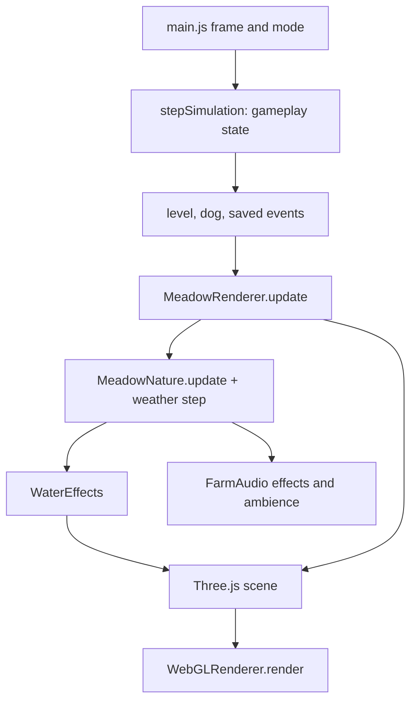
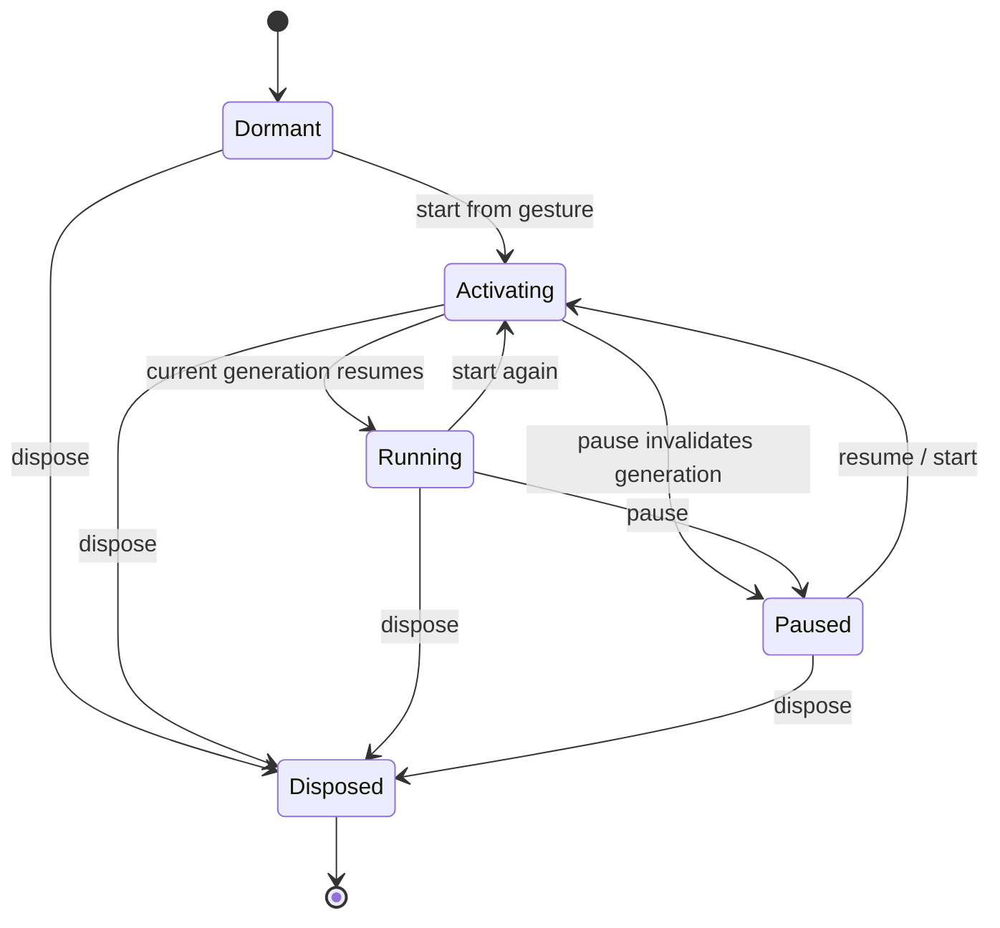

# Presentation: renderer, nature and audio

## Sharp click follow-up — 24 October 2026

F-POLISH-003 removes short noise-buffer hats and snares from the music cycle, preserving extended chords, bass, swing and soft sinekick. Music-only attacks now ramp from .0001 gain over35ms for keys,25ms for bass and20ms for kick; game rewardeffects and recordedanimals retain their separate paths. Supplied2.825srecording has four dominant high-frequency impulses separated by.833333seconds, matching the72BPM even-eighth clock. This strongly supports musical timing rather than movement audio, but its impulse amplitude exceeds the current nominalhatgain, so the exact original source mechanism is inferred, not proven. No listeningclaim.

## Lo-fi music and current animal mix — 24 October 2026

F-POLISH-002 supersedes prior mix: livestock gain .05775 is exactly .75 of .077; initial calls8–40seconds, calm/wander26–50seconds and herded/bolt60–120seconds. Existing immediate bolt onset,1.25herdedgain and realrecording/fallback contracts remain. Procedural music runs at72BPM with extended Am9/Dm9/Gmaj9/Cmaj9 harmony, low-pass keys, soft bass, restrained kick/snare/hat,14%odd-eighth swing and sparse answers. Bounded scheduling skips missed beats, caps voices and disposes source/filter nodes. Audio events explicitly identify Pip(.78playbackrate) and Buddy(1.0); legacy unspecified bark retains1.0. The same cached recorded buffer is used, with pitch-adjusted duration. Listening remains pending.

## Clay bird follow-up — 24 October 2026

Birds now use seeded forage/takeoff/flight/landing states. Forage gestures alternate bounded dry-ground hops and head/body pecks while feet retain support. Rounded head, beak, eye, breast, tail, leg and foot parts share one instanced body batch; a shoulder-local custom wing mesh uses mirrored bounded hinges, folded rearward and static on ground. Takeoff and landing blend altitude and wing extension, and threats interrupt ground/landing. Population remains capped at six; existing eight nature batches and resource ownership are preserved. No extra per-frame geometry/material construction. Elevated perches, nests and bird audio remain future scope.

## Animal audio and softer waves follow-up — 24 October 2026

F-POLISH-001 supersedes the earlier animal mix: recorded CC0 dog/sheep/cow MP3 assets are bundled under `public/audio/`; provenance and exact license/source links are in `public/audio/CREDITS.md`. FarmAudio asynchronously fetches/decode-caches them once after permitted audio activation, relative to the current document directory for dev/root hosting. Loading never blocks game start or replays a missed call. Decode failure retains an explicit synthesis fallback; disposal/generation guards reject stale completion. Livestock gain is .077 (45% below .14), initial calls stagger 4–20 seconds, calm/wandering calls recur 13–25 seconds and herded/bolting calls 30–60 seconds. Herded/bolt calls retain a 1.25 gain ratio; bolt onset remains immediate. Sheep playback rate is narrowly bounded .94–.965, cows modestly raised to 1.10–1.14. Recorded duration determines source stop time. Audible realism/mix still requires listening approval.

River flow retains the accepted centerline strip/collision footprint with a 128-square tile combining broken, modulated primary crests and finer secondary ripples. Softer blue-gray crests and lower weather-bounded opacity replace bright uniform bands; integer-period modulation preserves wrapping seams, transparent troughs/banks and pause. No new draw or per-frame geometry cost.

## Herd gestures, vocal calls, wildlife and waves — 24 October 2026

`herd-pose.js` owns per-animal presentation clocks, anticipation, attention, ear/tail/blink/chew gestures, with quiet gaps and immediate threat priority. Relaxation comes from simulation; head-down grazing still requires eligible grass/bush surfaces. Cached anatomy carries gesture tags/pivots; cached gesture materials accompany the anatomy and each level owns its small instance gesture buffer, with no per-frame geometry allocation or added animal draw batches. Dispose level wrappers without disposing shared anatomy buffers. Animation does not control collision, delivery or rewards.

`FarmAudio.updateLivestock` uses individual seeded transient schedules: ordinary wandering/calm calls every 5–10 seconds after staggered startup, herded/bolting calls every 12–24 seconds at 1.25 times baseline per-voice gain before distance attenuation. A new bolt triggers immediately; six active voices bound overlap, with ordinary starts limited per frame. Cached synthesized dog/sheep/cow PCM buffers replace the electronic bark sweep. Calls stop on pause/mute/replacement/disposal; missed calls are not replayed on resume. Recognizable timbre and phone mix need listening acceptance.

Squirrels and rabbits now define four visible paws and use four-instance indexing for pose, shelter and hide operations. Existing species batches are reused. River flow crests use pale color and transparent troughs with weather-bounded opacity, preserving physical river geometry and local flow direction. An owned strip uses three shared vertices per centerline station with explicit bank/center U and cumulative V; conservative average-normal joins keep the overlay inside the source river without long union-triangle interpolation or refinement budget starvation. Phone readability, visual seams and GPU cost remain separate from matrix/source checks.

## Stateful scenery batching — F-032, 23 October 2026

Gate lamp domes set `userData.dynamicScenery=true`. `batchScenery` excludes these meshes so `gateView.update` swaps the materials of the actual visible scene objects. The prior optimizer detached opaque red domes into immutable scenery instances while the gate view updated only detached originals; sprites already escaped that mesh-only batch. State transitions now retain original ownership and material disposal. Static housing/highlight meshes can still batch. Validate this through `MeadowRenderer.setLevel` and contact-driven `update`, including both lamp sides and restart; isolated gate-view tests do not cover this boundary.

## Grass continuity and visible lamps — 23 October 2026 follow-up

The outer ground no longer clones grass with a .72 color multiplier. Ground and angular playable turf share `this.grass`, its wetness snapshots and receiving-glow uniforms. Polygon U matches the surrounding plane; V uses `.5 - (z-centerZ)/depth` to match the plane after its X rotation. Fences and the minimap continue to identify playable boundaries. This supersedes the darker-countryside requirement below.

Gate lamps now use curved luminous domes so the elevated camera sees colored surface even when a fence is edge-on. Bright untone-mapped basic red/green materials, a small hotspot and a restrained radial sprite halo convey illumination independently of sun/shadow exposure. The halo depth-tests against scenery; no per-lamp point light or bloom pass is added. Domes and halos follow actual gate state together; fixed mounts and simulation contacts are unchanged. Geometry, materials and a shared 32×32 halo texture belong to the gate view and dispose on replacement.

Novy accepted the continuous barn roof and existing road terminal fade on dev runtime `d739fa2`; F-VIS-001 is archived. Gate illumination and road reversal/junction rounding remain follow-up work rather than changes to the accepted roof.

`roadNetwork(roads,{widthExtra,ragged,y,seed,fadeLength})` now creates one unioned road geometry per core/shoulder layer. Road-only outer arcs and rounded reversal caps replace squared bevel nubs. Shared endpoint nodes keep opaque junction centers and a soft exposed circular rim; continuing-road coverage prevents faded seams. Standalone terminals retain their accepted fade. Visual centerline sampling stays within .025 units and bounds spans to 2.5 units before sweeping, without altering physical routes. Original sampled routes still determine coverage. `roadRibbon` remains a single-road wrapper; ordinary river `ribbon` behavior is preserved. Union sweep performance uses active X ranges and sorted edge candidates instead of allocating/sorting every slab's hits. Both road layers retain the existing material shader, weather/glow registration and owned disposal.

## Mounted lights and continuous surfaces — 23 October 2026

Gate switches are fixed vertical housings on both barrier faces beside the opening, with a bezel and emissive lamp: red closed, green open. They stay fixed while the leaf slides. The barn roof is one continuous indexed sheet with shallow grooves and clay UVs; the existing cutaway still fades it and facing walls to .7, freezes when paused, restores opaque shadows and disposes clones on replacement.

`roadRibbon` adds rounded caps and subdivides terminal neighborhoods for interpolated coverage. `createRoadMaterial` composes existing shader hooks with alpha-hashed coverage, retaining depth writes; both core and shoulder fade. Each level owns two shared road material clones, separate from barn floors and water. Weather restores source baselines before replacement, and road cores join explicit wetness tracking. Hashed coverage needs device review for visible grain; source checks do not establish rendered blending.

## Centered gameplay camera — F-UI-013, 22 October 2026

Gameplay camera follows Pip independently of flock centroid or goal position. The desired camera center is Pip's X and Z + 2, canceling the existing ground look-at offset. Both axes interpolate at the same rate, with lag limited to 12% of their respective half-view dimensions; level jumps cannot leave Pip near an edge. Intro framing remains unchanged. Projection tests cover portrait/landscape and sideways, vertical, diagonal and reversing travel, including distant livestock. These are real Three.js camera calculations with a substituted GPU, not device feel or rendered-pixel evidence.

## Current minimap placement — F-057

The minimap is anchored at `left:50%` with a negative half-width translation and `top:var(--hud-top)`, including short landscape. Existing 166px desktop/132px mobile and short-landscape sizes are retained. Below 384px, the map uses `top:calc(var(--hud-top) + 76px)` to clear the top-left weather/count/timer and top-right pause/help. This supersedes historical right-aligned placement below.

## Current minimal HUD and level introduction — 18 October 2026

This supersedes the full-title presentation below. The transparent top-left `#mission` has one weather/count row and a separate active-only countdown below; reward score/objective/progress/title nodes are removed. Results and reward simulation are unchanged. The center overlay contains only `#level-number`, a 36px “Level #” heading. Active elapsed time drives fade-in (0–0.65s), expansion (0.72–1.2 scale over 3s) and fade-out (1.8–3s). It stays centered, accepts no pointer input, freezes/hides in menus and resets per level/restart. `prefers-reduced-motion` disables the scale transform while retaining centering and fade. No white background/panel is used.

## Centered level-title introduction — F-063

`#level-introduction` sits at the viewport center with at least 20px safe side margins. The text appears directly over the game with no background panel or box shadow, as clarified on 18 October. Its small level number and 28px Outfit title are centered; long names wrap naturally, including an unbroken word, without changing the title font size. Pointer events pass through and modal dialogs sit above it. The controller uses active elapsed gameplay time: 2.5 seconds fully visible, 1.25 seconds fading, then hidden. Menus hide it and freeze the timer; restart/new level replay it and completion hides it. The top-left panel retains mission stats, weather and delivery countdown, with the full level identity also retained in its accessible name.

## Pip floating-motion follow-up

**Accepted:** Novy signed off the current Pip presentation and movement on 17 October 2026 at 20:56 America/Creston, runtime `f0cb0c2` / Pages `c4e275b` on dev2. F-053 is Done; earlier native-acceptance wording below is historical. No independent FPS measurement is implied.

F-053 motion uses a visual body rig with an independently articulated head. The root retains simulation position and heading so collision and ground guidance remain unchanged. Presentation samples velocity/heading history to derive hover, head yaw, turn roll (maximum 20 degrees), and acceleration/braking pitch (maximum 10 degrees each way). Constant speed should settle pitch to level in about two seconds. Transform pod anchors through the visual rig before updating hover rings and surface-glow footprints; ground illumination stays on receiving surfaces. Pause, reset, heading wrap, teleports and frame-rate independence require source checks. Native feel remains for user acceptance.

## Pip size and ground glow follow-up

Current glow strength is 0.595 (0.85 multiplied by 0.7), following the additional 30% brightness reduction. Pod-scaled radius remains 0.54 and the diffuse falloff/color are unchanged; only emitted brightness changes.

Glow tuning halves peak emissive strength from 1.7 to 0.85, widens the pod-scaled radius from 0.36 to 0.54, and uses squared smoothstep radial falloff. This makes the light subtler and softer without making the ground transparent. Program cache suffix is `pip-ground-glow-v2`; receiving surfaces and world-space tracking are unchanged.

The latest F-053 size target is 1.0125 (75% of the published 1.35), superseding the unfinished 33% edit. Pale silver steel/trim retain a lighter finish. Pods and rings scale with Pip; inverse-scaled halo/pointer retain world dimensions. `ThrusterGroundGlow` colors the actual grass, path and bridge receiving surfaces in their material shaders. Four world-space pod centers drive soft blue emissive footprints; the upward-normal and height masks restrict illumination to the ground/deck. Body bob and ring trails do not affect the surface height. There are no separate glow planes, scene lights or shadow passes. Bridge materials are cloned and owned by the level to preserve shared fence materials; ground materials retain the same uniform owner across levels. Native appearance/performance require device review.

## User sign-off - 15 October 2026, 16:34 Vancouver

Novy explicitly signed off all pending Review items: **F-022, F-023, F-024 and F-040 are Done**. Acceptance applies to the live development build at Pages `bf26e67732434e902fdbaef10cac72d6814c33b0`, runtime source `1909c87bc1f70c4e53f4b38d64beaa2d4bb6d3aa`, including full-view/angled rain, no storm wildlife, accumulating puddles, deeper variable 3-5 second reverberant thunder after lightning, the 50% master volume increase and brighter lightning. This is user acceptance; historical headless checks and device-performance evidence retain their original limits. **At that weather sign-off checkpoint no items remained in Review.** The later flock-behavior batch F-035/F-037/F-039/F-041 is now Review. Open queued items remain Open; F-008 clouds remain Deferred. Older Review/pending wording below describes earlier checkpoints and is superseded by this sign-off. Documentation only; game bytes are unchanged.


Current weather repairs: [requirements](../REQUIREMENTS.md#weather-follow-up---15-october-2026-1222-vancouver). Weather is Done by user acceptance on 15 October 2026 at 16:34 Vancouver; clouds remain Deferred.


This describes the implementation at the documentation baseline, not a promise that the open art requests are complete. The application uses Three.js 0.180.0 and generated geometry/textures; there is no ThreeRust runtime, downloaded model pipeline or recorded soundtrack. Source behavior and headless tests are inspectable; real browser rendering, phone performance and perceived sound balance remain unverified here. See [quality scope](../QUALITY.md) and the [open issue tracker](../ISSUES.md).

## Boundaries and frame data flow

[main.js](../../src/main.js) owns the animation loop, application mode and the `FarmAudio` instance. Simulation owns robotic positions and gameplay decisions. [render.js](../../src/render.js) reads the level and separate player-dog state to build scene transforms, then renders; [nature.js](../../src/nature.js) advances shared weather and maintains ambient fauna. Wildlife never pushes the robotic herd or awards progress. In the current source candidate, nature advances weather once; atmosphere, water, renderer lighting and audio read that same mutable state.



The frame interval is capped at `.05` seconds. Simulation and event sounds run only in `playing`. The renderer receives positive `dt` in `playing`, `intro` and `complete`; other modes pass zero. Ambience updates only in `playing`. Thus completion/intro can animate visual scenery without advancing gameplay; a modal freezes renderer time but the frame loop still redraws. Backgrounding during play opens the menu, which pauses audio and resets input. There is no main-loop call to `FarmAudio.dispose()` on page teardown.

The integration has this shape (abridged from `main.js`; mode handling is essential):

```js
const dt = Math.min((now - last) / 1000, .05);
if (mode === 'playing') {
  const result = stepSimulation(level, dog, input, dt, profile.upgrades);
  for (const event of result.events)
    if (event.type === 'animalSaved') audio.play('saved');
}
renderer.update(level, dog,
  ['playing', 'intro', 'complete'].includes(mode) ? dt : 0,
  mode === 'intro');
if (mode === 'playing')
  audio.updateAmbience(dt, { weather: renderer.nature.weather });

// Inside MeadowRenderer.setLevel/update, abridged:
this.nature.setLevel(level);                 // creates the one shared weather state
this.atmosphere.setLevel(level, this.nature.weather);
this.waterEffects.setLevel(level, {
  grassMaterials: [this.grass], pathMaterials: [this.path], waterMaterial: this.water,
  rivers: riverViews // { mesh, points, width, heading } per rendered river
});
this.nature.update(dt, { dog, animals, paused: dt <= 0 }); // advances weather exactly once
const weather = this.nature.weather;
this.atmosphere.update(dt, { weather, camera, paused: dt <= 0 });
this.waterEffects.update(dt, { weather, movers, paused: dt <= 0 });
```

| Interface | Consumer / responsibility |
| --- | --- |
| `new MeadowRenderer(canvas)` | Creates WebGL renderer, camera, shared materials, scene groups and nature root. Requires browser Canvas/WebGL globals. |
| `setLevel(level)` | Replaces level-owned presentation resources; builds terrain, structures, scenery and species batches. |
| `update(level, dog, dt, preview=false)` | Camera follow, poses, nature, particles, per-instance culling, final draw. Animal array order must match the last `setLevel`. |
| `resize()` | Reads viewport size and aspect; projection changes on the next update. |
| `bark()` / `celebrate(x,z)` | Presentation effects triggered by application actions/events. |
| `drawMap(canvas, level, dog)` | Separate Canvas 2D map derived from world coordinates, not a scene render. Main updates it at roughly 10 Hz. |
| `MeadowNature.setLevel/update/dispose` | Owns cosmetic weather/fauna state and all its per-level GPU resources. |
| `Atmosphere.setLevel/update/dispose` | Dormant cloud module retained for future work; the game renderer does not instantiate or update it after the 15 October cloud-removal request. |
| `WaterEffects.setLevel/update/dispose` | Owns local-arc-length river overlays, wetness material snapshots, up to eight puddles and 12 reusable splashes. |
| `createGateControl` / `createGateView` / `createStoneWallView` | Contextual one-thumb gate action and render groups whose state/geometry matches world collision. |
| `FarmAudio.start/resume/pause/setMuted/play/updateAmbience/dispose` | Owns Web Audio lifecycle, music timer, procedural sources and cleanup. |

## Scene construction and materials

`MeadowRenderer` configures antialiasing, pixel ratio capped at `1.6`, sRGB output, ACES filmic tone mapping and exposure `1.05`. A hemisphere light and moving directional sun light the scene. The sun has a 1024-square PCF soft shadow map and an orthographic shadow volume of ±30 units. Background and fog share a pale blue color; fog spans 95–195 world units. These are configuration values, not measured quality/performance guarantees.

`setLevel` builds a plane larger than the bounds, decorative hills, road/river ribbons, bridge meshes, target marker, fences, structures, obstacle trees and bounded decorative details. Roads and rivers use sampled centerlines supplied by the world. Road shoulders may wander cosmetically; river width follows the physical half-width. Fence/gate/target segments come from world collision geometry. Selected fence segments render as stone masonry; level-20+ closed gate panels render and slide open from the contextual action. Seeded bush clusters sit outside routes, water, obstacles, fence lines, spawn and target. `WaterEffects` clones each river ribbon geometry and projects its vertices to local centerline arc-length UVs; the generated streak texture advances along local V, so flow follows bends independently of map compass heading. Each cloned texture uses repeat `1×1`; the overlay owns its geometry, texture and material while preserving the source river mesh/material. `surfaces.js` builds ribbons by unioning convex stroke pieces into disjoint trapezoids, then upward triangles with world-coordinate UVs. Bevel center fans bound sharp joins. The union removes stacked coplanar pieces at turns, reversals and self-crossings. Headless topology checks support the repair; Novy accepted the path repair on 14 October 2026.

[models.js](../../src/models.js) supplies Pip, flock species, helpers, vegetation and structures. Its primitive geometry cache is keyed by constructor/arguments, and its material cache persists across levels. `bakeModel` clones transformed component geometry, merges it by material, disposes temporary clones and returns fewer meshes. Model clones share the baked geometry/materials. `createAnimal` bakes the body separately from four articulated legs: each leg retains `limbIndex` and a hip `pivot`, with shared material meshes in hip coordinates.

Material textures are generated locally. Models use deterministic 128-square clay/wood Canvas textures. The renderer creates deterministic 512-square grass/path color and bump maps; color textures are sRGB and repeat over the ground. Rain uses line segments; `WaterEffects` builds procedural flow textures. The dormant `Atmosphere` module can build cloud textures in standalone tests, but the game does not create them. `WaterEffects` snapshots only the explicitly passed grass/path/water materials, gradually darkens the base colors and adjusts roughness, then restores original values on level replacement/disposal without disposing shared source maps. Candidate wetness rates remain +0.012 x rainIntensity/s and sunny drying -0.004/s. Puddle area grows independently over the estimated level duration from the seeded empty/small baseline; visibility begins above depth .008 and opacity increases with area. These are visual tuning choices awaiting device acceptance.

## Batching, poses and visibility

Static scenery and flock animals have separate submission paths:

| Path | Construction | Per-frame submission |
| --- | --- | --- |
| Static scenery | `batchScenery()` groups eligible terrain pieces by **geometry identity + material identity**. It skips world-owned geometry and transparent materials; groups smaller than two remain meshes. Tufts/reeds are explicitly instanced. | `trackScenery()` retains immutable source matrices and transformed bounding spheres. `cullScenery()` compacts visible matrices into the front of each instance buffer and updates `count` and upload range. |
| Sheep/cows | One logical `Object3D` pose per animal; separate `InstancedMesh` for every baked body/limb material piece of each species. Original animal indices are stored in the species batch. | A conservative species radius includes limb pivot envelopes. The same compacted `visibleIndices` order feeds every body/leg mesh; gait uses original indices, so disappearing/reappearing animals retain their phase and pose. |
| Pip/helpers | Normal articulated scene groups; helper meshes are keyed by helper type. | Pip and ground helper legs/tails animate; drone propellers rotate and it bobs above ground. The map is designed for one helper per type. |
| Nature / rain | Batched wildlife body/wing/paw instances and optional `RainView` line segments; no cloud/shadow batch. | Updates wildlife matrices and bounded rain streaks, with pause handling and owned resource cleanup. |

The renderer creates its own camera frustum before both scenery and animal culling. Automatic aggregate `InstancedMesh` frustum culling is disabled for these batches. Scenery spheres receive two extra world units; flock bounds receive three, retaining edge silhouettes and nearby sun shadows. Only the compacted prefix is uploaded. This reduces submitted instances, while CPU work still scans the stored instances/animals each frame. Only batched fence parts cast shadows in the static batching path; other eligible batched scenery does not inherit arbitrary original shadow flags.

Flock locomotion uses a stop-motion pose clock, `Math.floor(time * 12) / 12`. Root bob/roll and leg swings depend on speed. The limb matrix order is important:

```js
// Same transform contract used by createAnimal and updateAnimalBatches.
const limbWorld = animalWorld.clone()
  .multiply(new THREE.Matrix4().makeTranslation(...pivot))
  .multiply(new THREE.Matrix4().makeRotationX(gait));
```

World-height samples place Pip, flock and ground helpers on bridges/terrain. Saved animals remain rendered with their simulated heading and gait. The rectangular goal marker pulses; `goal-view.js` derives its surface/outline and barn floor from `targetFootprint` world vertices. The map projects those same corners rather than drawing a circular goal dot. Celebration allocates 36 short-lived confetti meshes, updated and disposed in the main renderer update.

Bark uses `barkSurface(level,origin,scale,geometry)`: it splits expanding ring pieces at deck and individual plank boundaries before assigning surface heights, keeping triangles above land and raised planks even across deck edges. Depth testing remains enabled and depth writes disabled so fences/rails retain normal occlusion. `updateBarks(dt)` freezes at zero `dt`, finishes after .6 seconds, reuses dynamic geometry buffers, and disposes expired effects; a hard cap of four and level replacement bound resources.

## Covered structure visibility

`StructureCutaway` in `cutaway.js` clones each section material so fades cannot affect shared scenery. Whenever Pip, a helper dog, or any flock animal (including saved animals) is covered by the barn footprint, it fades the complete roof and the camera-facing wall; a diagonal view fades both adjacent walls. Target-local side selection uses orthographic camera direction and supports rotated barns, with a .18-unit membership hysteresis and exponential blend. The faded opacity is .70 (30% transparent). Faded panels disable depth writes and shadow casting; opacity/transparency/shadow settings restore when clear. A zero-time update freezes membership/fades. Collision and admission never read this visual state. Tests inspect camera-side selection/material state and disposal; they do not prove real transparent draw ordering.

## Camera and map

The camera is orthographic and tilted from `(center.x,36,center.z+29)` toward `(center.x,0,center.z-2)`. Normal view height is 39 in portrait aspect below `.8`, otherwise 36; preview height is 50 or 44. Preview follows the spawn. Gameplay follows a weighted dog/unsaved-flock center (or goal when all are saved), with leading space, smoothing, and clamps that retain Pip when a helper moves the flock far away. The sun follows the same center. These clamps are covered by projected-position tests, not physical-device readability checks.

The map draws roads, continuous rivers/bridges, world fence segments (stone uses a distinct line), closed gates, goal, every flock animal, Pip and helpers. It scales x and z independently into the map rectangle, so it is a navigation overview rather than a camera projection or a guaranteed equal-scale plan.

## Resource ownership and level changes

Before replacement, `setLevel` traverses terrain and actors, disposes `InstancedMesh` instance resources, and disposes geometries/materials explicitly tagged `ownedGeometry`/`ownedMaterial`. Label textures are disposed via `ownedLabel`. It clears groups and batch/helper/particle state, then builds the next world. Cached model geometry/materials and shared fence geometry deliberately survive. Distinct resources are deduplicated with sets before disposal.

Nature has an independent `resources` set. `clear()` disposes instance resources, removes children, disposes owned geometry/materials/textures, and resets state; `setLevel()` calls it first. `Atmosphere` is currently dormant: no cloud/shadow resources are created by the game renderer. Its standalone unit tests still exercise ownership for future reference. `WaterEffects` reuses a bounded splash mesh/material pool, caps puddle sites, owns per-river cloned flow maps and per-effect materials, and restores only the explicit surface material snapshots. Source river geometry/maps are shared and never disposed by the overlay; the overlay owns its cloned UV geometry and disposes it on level replacement. `dispose()` removes each system root. The renderer has no comprehensive public `dispose()` method for its shared renderer/material/model resources. Bark effects are updated within renderer time and cleared/disposed on level replacement. Structure cutaway restores original materials and shadow flags and disposes its per-panel clones before terrain replacement.

## Nature: implemented behavior and requested work

`weather.js` chooses one seeded weather kind when a level is created. Its `type` is `sun`, `wind` or `rain`; `kind` additionally distinguishes `heavy-rain` and `storm`. Environmental fields are fixed for the entire level. There are no 90-second episodes, ramps or snow; `snowIntensity` is retained as zero for old callers. Levels 1–5 are sunny, 6–8 are dry/sometimes breezy, light rain unlocks at public level 9, heavy rain at 16 and storms at 24. The unlock levels are guaranteed QA fixtures for every seed; other levels use seeded weighted selection among unlocked weather. Heavy/storm thresholds are tuning choices, not explicit user-specified numbers.

`MeadowNature.update` remains the sole weather-time owner. `stepWeather` advances only elapsed time and storm lightning events, never kind/rain/wind/severity/daylight. Presentation time runs during visible playing/intro/results; menus, QA, pause and hidden tabs freeze effects. Lightning begins 8–12 seconds into a storm, repeats at 24-second intervals, peaks at .90 and fades over .22 seconds; thunder uses the same event ID with .8–1.6-second delay. Weather labels in the mission panel identify the fixed condition without a waiting period.

| Source candidate | Behavior and limits |
| --- | --- |
| `Atmosphere` | Disabled at Novy’s 11:22 Vancouver request on 15 October 2026. Neither cloud puffs nor cloud ground shadows are created or updated in the game. The source and standalone tests remain dormant for future work. |
| Wildlife | Seeded area-scaled populations: squirrels 1–7, rabbits 1–8, birds 2–6, butterflies 0–8. Spawn search tries up to 240 deterministic candidates per animal and hides unavailable slots. Each squirrel/rabbit uses a merged vertex-colored anatomical body batch and a separate animated paw batch; rabbits advance in push/air phases and crouch on landing. Ground fauna can cross fences and travel at most `.45` units beyond the field boundary; trees, water, barn walls and stone walls remain obstacles. |
| Shelter response | Candidate severity thresholds are butterfly `.54`, squirrel `.58`, bird `.64`, rabbit `.76`; shelter motion builds toward nearby trees at severity and retreats with `.12` hysteresis when severity drops. Light-rain severity `.28` remains below these thresholds. Heavy-rain severity `.6` shelters smaller fauna; fixed storms spawn no ambient wildlife at all. Rendered shelter and return readability still need review. |
| Precipitation | `RainView` in `rain-view.js` renders bounded downward line streaks rather than pollen-like points: 96 light, 176 heavy and 256 storm drops, with .8/1.3/1.8-unit streaks and 16/23/30-unit-per-second fall speeds. Rain is a camera-local foreground curtain with depth testing disabled, overscanning +/-1.25 screen coordinates, initialized across the view and recycled beyond its top/side edges. Storm wind visibly slants streaks. It advances only while unpaused. No snow texture/particle path remains. |
| Lightning/audio | Only fixed storm levels produce deterministic events, first after 8–12 seconds and then once per 24 seconds; flash peaks at `.38` and fades over `.22s`. Audio schedules low-pass synthesized thunder from the same event ID after `.8`–`1.6s`, if audio is active in time. |
| Water and wetness | `WaterEffects` supplies one locally oriented, procedural flow overlay per river ribbon; it snapshots only explicit grass/path/water materials. A fixed rainy meadow starts with a small existing wetness (.03 light, .35 heavy, .60 storm); all rainy tiers start with a seeded choice of no puddles or 1-3 puddles at area fraction .10-.20. Area and opacity grow over longest-route length / 2 plus the delivery countdown, clamped to 45-240 seconds. Up to eight safe-land puddles become visible above area fraction .008. Restart restores the same baseline; dry levels have no accumulation. Actor splashes require movement through the actual grown ellipse; at most 12 ring splashes are reused. The full puddle perimeter is sampled against collision/bounds so puddles do not overlap rivers, decks, barriers, trees or leave the playable field. |
| Gates/walls and vegetation | Gates are operable at public level 20+; contextual opening requires Pip within 3.2 units and a clear approach. The panel slides along its barrier and there is no close action. Stone barrier segments appear on selected levels from public level 8; collision remains world-owned. `vegetation.js` generates seeded, non-colliding bush groups away from roads, water, obstacles, fences, spawn and goal. |

Novy approved the original squirrel/rabbit/vegetation/gate/wall/tail/wander and fence-crossing implementations on 15 October 2026. The weather visibility repair remains a P1 candidate pending fresh visual acceptance. New gate/wall/progression enhancements are queued separately in F-030–F-039. Focused source tests cover determinism, shared-state time advancement, pause/resource cleanup, collisions and bounded pools, including seeded rainy growth and a bent river's UV flow; puddle footprint safety samples the perimeter against collision and bounds. The tests do not verify rendered pixel quality, transparency ordering, real touch reachability, perceived storm intensity, frame rate or human pacing. Independent source reviews are recorded in QUALITY.md; physical/device acceptance remains pending. F-013 and F-015 remain Open.

## Synthesized audio lifecycle

[audio.js](../../src/audio.js) has no fetched samples. `start()` is intended for a user gesture; it lazily creates one AudioContext and three gain buses (music `.42`, effects `.6`, ambience `.38`) into a master gain (`.975`, or zero when muted). It awaits `context.resume()` and returns a success boolean; unsupported/restricted audio fails silently so gameplay can continue.

Each activation increments `activationGeneration`. After asynchronous resume, activation succeeds only if its generation and context remain current and the instance is not disposed. `pause()`, a later start/resume, or `dispose()` invalidates pending completions. Main also rechecks mode after awaiting audio start, preserving a modal opened while activation was pending.



Mute is independent of this state diagram: it changes master gain, stops ambience immediately, and prevents `play()`/ambience source creation. It does **not** stop the music scheduler; music can continue advancing behind zero master gain. Pause stops the scheduler, stops/disconnects ambience, and fades the music bus toward `.0001`; it leaves the AudioContext running and permits UI effects. Already scheduled music sources are not individually canceled by pause. Resume restarts scheduling at the current sequence step with a fresh initial delay.

Music runs at tempo 106 over 128 eighth-note steps: eight bars with C/F/C/G/Am/F/G/C roots and generated bass, pluck and melody voices. `_note` creates an oscillator/envelope, schedules its stop, and disconnects both on end; marimba adds a quieter upper partial. Effects select short note phrases or the two synthesized bark sweeps.

Scheduling is bounded in two ways: there is at most one 100 ms interval, and each callback schedules at most eight steps within a `.25` second lookahead. If late, it advances the modulo-128 sequence mathematically past overdue steps instead of creating old oscillators. Invalid tempos return without scheduling. Per-frame ambience creates no interval and never creates an AudioContext.

Birds use two or three short sine sweeps with variation; each lasts `.17` seconds. Their countdown subtracts at most `.25` seconds per ambience update, so a large frame gap cannot replay a backlog. Normal gaps are 4–10 seconds; rain uses 10–20 seconds and suppresses chirps at intensity ≥`.7`. Bird chirps are independent of visual bird instances/positions but explicitly suppressed for storm kind. Thunder uses a 400-to-85 Hz nonresonant falling lowpass, a soft-onset rumble with independently randomized 3-5 second fades and five irregular diminishing reflections whose delays scale with that duration on the effects bus, and temporarily ducks music from .42 to .16 with scheduled recovery. Pause/mute/weather replacement/disposal cancel the event and restore the mix. Weather loops one shared two-second generated noise buffer through a low-pass filter; gains scale by clamped intensity (rain `.032`, wind `.024` before bus/master gain). Weather changes stop/disconnect the previous chain.

Main passes the shared `renderer.nature.weather` object to ambience while playing. Audio reads its current `type`, `intensity`, and lightning event identity/timing; it does not advance weather. Nature remains the single advancing owner, while atmosphere, water and renderer lighting consume the same fields.

`dispose()` is idempotent and final: it invalidates activation, clears the interval, releases ambience synchronously, stops/disconnects tracked sources, closes the context and drops node/buffer references. Subsequent `start()` returns false.

## Verification and known defects

These targeted checks run without a browser from the repository root:

```sh
node --test tests/render.test.js tests/nature.test.js tests/audio.test.js
```

[render.test.js](../../tests/render.test.js) constructs actual Three.js geometry/matrices with Canvas and WebGL substitutes. It checks finite poses/cameras, portrait Pip retention, world-resource disposal without disposing shared animal/fence geometry, bounded scenery submissions, conservative instance/shadow retention, bounded route-adjacent detail, animal compaction and articulated pose restoration. Counts are geometry/submission evidence; they do not establish FPS, correct pixels or artifact-free transparency.

[nature.test.js](../../tests/nature.test.js) checks deterministic fixed weather and removal of snow, safe spawning, fleeing from saved animals/helpers, squirrel occupancy, matching cloud-shadow positions, pause freezing and one-time resource disposal. [audio.test.js](../../tests/audio.test.js) uses fake contexts/parameters/timers to check competing pending activation, pause/dispose races, bounded overdue scheduling, one reusable context/timer/noise buffer, chirp limits, mute/pause effects and cleanup. Those substitutes do not verify browser autoplay behavior, audible timbre or listening balance.

F-001/F-002/F-010/F-016 are Done by Novy’s user acceptance on 14 October 2026. Eleven original P2 items including F-003 were accepted by Novy; the reopened fixed-weather P1 candidate has independent source reviews in QUALITY.md and awaits fresh visual acceptance; F-013 and F-015 remain Open. The runbook retains regression scenarios for levels 4/8 path bends, bridge bark, rotated targets, covered structures, transparent overlap, pause/restart and phone audio. See [P0/P1 runbook](../validation/P0-P1.md); headless geometry/ray tests do not close temporal flicker or transparency acceptance.

### Decorative grass and bark composition

Decorative instanced grass blades are an opacity-one transparent pass with depth testing enabled and depth writes disabled. They render over the opaque meadow normally. Bark renders afterward (`renderOrder=1`) while keeping depth testing; opaque fences and bridge rails still supply depth and hide the lower ring. This specifically prevents blade tips from cutting holes in the bark without raising it above rails or disabling scene depth globally. A real Three.js blade/ring/fence ray-and-queue regression supports the policy; actual transparent-pass appearance still requires device rendering.


### Delivered-animal roaming (F-028)

Delivered animals use their simulated velocity and heading for the same body/leg gait as the active flock; the renderer must not replace saved headings with a fixed decorative angle. Their motion is confined by simulation to the shared goal footprint. Barn cutaways continue to treat delivered animals as covered actors. Result-screen movement is saved-only and cannot change results or rewards; menus, QA editing and hidden-page state freeze it.

Latest rendering policy: visible clouds and their shadows are temporarily removed (F-008 Deferred). `cloudCoverage` is retained as weather metadata for sky/fog/daylight and river color; it creates no cloud meshes. `RainView`, wildlife, wetness and paired storm audio continue normally. This overrides prior cloud visibility/opacity descriptions in historical records.

### Rain-volume tuning - 15 October 2026, 16:42 Vancouver

The rain loop still scales with intensity, with an additional tier multiplier: gentle/light rain .50, heavy rain .85, thunderstorm 1.00. Gentle rain is 50% quieter than its previous mix; level 16 heavy rain is exactly 15% quieter; storm rain retains its accepted volume. The overall master gain, thunder and music are unchanged. Tier changes reuse the loop and mute/unmute restores the correct tier mix.

### Compact HUD follow-up

Mission and minimap align horizontally. Tip lifetime uses active gameplay time and resets on each displayed message; automatic dismissal exposes the help toggle. Manual help remains open until hidden. The renderer owns a disposable triangle outside Pip’s halo, cancels dog rotation and aims directly at the goal; the old route/distance chip is removed. Phone visual acceptance remains pending.


F-051 evidence: implementation commit `1e000ce` on `flock_3D_chatgpt-work`; controller/markup/styles are in `src/main.js`, `index.html`, `src/style.css`; the goal triangle is in `src/render.js`. `tests/ui.test.js` exercises tip expiry, reopening, hiding and meadow reset. `npm test` passes 275 tests; `npm run build` plus the release mode check passes with zero QA assets, and `npm run build:dev` plus the development mode check passes with two QA assets. Generated documentation checks pass. These are source/DOM/build checks; there is no dedicated pointer render regression or native phone evidence for halo placement or portrait usability.


F-051 follow-up: every tutorial tip must remain visible for its full display interval. Early animal delivery must not skip tip 02 or shorten its interval. The automatic sequence advances at most once per frame; reopening/dismissing help and final-tip expiry retain their existing behavior. Source regression includes delivery before the second tip.


F-051 reopened-help refinement: pressing ? to unhide help resets the applicable tip list to 01 and starts a repeating 14-second cycle. After the final tip it returns to 01 until toggled/dismissed; pause freezes this timer. The initial automatic sequence still finishes and hides, exposing ?. New meadows reset help state.


F-052: `src/qa.js` owns the gear launcher and accessible QA/test-session identity; `src/qa.css` anchors it at bottom center with safe-area spacing. Existing QA lifecycle and release exclusion remain unchanged.


## Pip hover presentation (F-053)

Player Pip uses a reference-inspired angular metallic shell, plate ears, expressive eyes and four fixed hover pods. Buddy now uses a separate rounded silver puppy shell with a proportionally larger face, short muzzle and mismatched folded ears. Its .82 relative renderer scale is a legibility choice, not a collider change. Both use independent floating/body/head pose histories and blue ring pools without flame meshes. Each has four receiving-surface blue glows at terrain/bridge height. Rendering owns the motion trail and does not change simulation position, collision or herding. Pause freezes both poses and trails; level recreation clears their histories and owned materials.


## Tree appearance request (F-054)

Current acceptance: Novy approved the welded-tree appearance in dev2 on 17 October 2026 (America/Creston). F-054 is Done; Pages `6dddee1` is the accepted build. Earlier pending-review statements below describe the implementation history and are superseded by this visual sign-off. Mobile FPS remains unmeasured.

The latest F-054 request follows the phone visual failures in IMG8395 and IMG8396: the earlier segmented-looking wood mesh must become one genuinely contiguous, smooth trunk-and-branch surface. Forks must be welded into the same continuous surface, with no detached rings, chunk steps, seams, caps or separate-looking branch pieces. Retain the slightly bent, gradually tapered trunk and curved limbs; the first fork sits around mid-height, with additional forks staggered upward. Fork radii follow Leonardo branching exponent 2: parent radius² equals the sum of child radii², including the continuing trunk. Apply seeded yaw variation across trees. Use varied overlapping foliage in several clusters around the center, with more foliage on larger trees. Reduce trunk thickness by 30% at the smallest and 10% at the largest supported rendered size, interpolating linearly. Crown mesh sizes grow near the trunk axis and shrink farther away. The fork rule is described in [PLOS ONE](https://journals.plos.org/plosone/article?id=10.1371/journal.pone.0093535). These visual requirements do not change tree placement or gameplay collision contracts in [WORLD.md](WORLD.md). Prior publications and source-only reviews, including the earlier `bf5bb48` and organic branching candidate, are historical; they did not establish phone pixels for this new contiguous-surface request. Status remains Review pending fresh visual sign-off on `pip_update` / `dev2`. The user selected `gpt-6-astra` at high effort for implementation and final mesh/visual review.


Historical organic-branching source candidate (`5399dcc`): nine bounded palette/maturity models have 7/9/11 overlapping crowns, including three central clusters. Skeleton limbs share an open tapered frustum geometry and joint-cover geometry; curved centerlines use short connected segments. Four staggered forks solve continuing radius as `sqrt(parentRadius² - sideRadius²)`. This source description and its review do not demonstrate that the rendered tree is a truly contiguous smooth surface; the phone references IMG8395 and IMG8396 expose a segmented appearance that the new implementation must fix. Prior source reviews did not establish phone pixels. Do not treat these historical implementation details or validation as completion of the latest request. Native appearance remains pending.


Current contiguous implementation: `src/tree-geometry.js` builds three cached wood variants, each a single indexed, closed surface (274 vertices / 544 triangles). Side patches of the trunk are replaced by branch surfaces that reuse their boundary vertices. Smooth normals follow the continuous width deformation; a dedicated tree material uses subtle vertex-color grain instead of the former cylindrical bark texture. The first fork is at 1.56m of a 3.15m trunk, with three further forks staggered upward. A continuous bent centerline, tapered radii and curved limbs preserve the handmade silhouette. Instanced width attributes compact with instance matrices during culling; batch-owned geometry is disposed on level recreation. Ordinary bush bark remains independent. Nine bounded palette/maturity prototypes retain 7/9/11 overlapping foliage meshes, including multiple central clusters.


## F-064 cow art — 18 October 2026

On `art_update_cow` from main, replace the cow appearance with a rounded clay Holstein following IMG_8387: irregular black/cream coat, expressive eyes, broad pink muzzle with nostrils, dark ears, small curved ivory horns, cloven hooves and tail. Use 1.5× sheep linear body size; preserve sheep and existing instanced gait/rendering contracts. Publish only to `/Flock/dev/`; user visual acceptance is a separate Review milestone.

## UI refinement candidate — F-055–F-059

The candidate on `UI_refinement` uses a compact top status panel and adjacent minimap, with Pause/help at upper right. Branding, wallet and sound stay out of active gameplay; Pause owns sound and workshop access. Delivered count and score are separate readable values; the running timer has a large active-only display and static final-ten-second emphasis. A small labelled weather icon replaces the full weather row. Objective and destination billboard introductions last four active seconds; the billboard then fades over 1.2 seconds. Tips retain automatic finite sequencing and manually reopened looping, using shorter instructions and a visible numbered badge, restored at the user's request on 18 October. Joystick decoration/instruction captions are simplified; Woof remains circular with a cooldown progress ring. UI layout and hit targets require phone acceptance; source/DOM/scene tests only establish behavior. Production publication is separate from this development candidate.

F-060 governs this candidate’s implementation/review/publication workflow through [AGENTS.md](../../AGENTS.md); product criteria remain F-055–F-059. The billboard width changes from 6 to 4.5 world units (25% reduction), and height from 1.5 to 1.125.

F-055–F-059 development publication is verified at source `d47ae6c` / Pages `ce24bf3`; 17 live files match and production is unchanged. Native visual/touch sign-off is pending. See [publication manifest](../validation/UI-refinement-publication.json).

18 October F-056/F-057 follow-up: the map frame grows from 92 to 132 CSS pixels on phones, 126 to 166 on desktop, and 108 to 132 in short landscape. Its canvas retains a 3:2 aspect ratio. A deep forest background separates the map from the meadow; routes, rivers, boundaries and outlined actor markers have stronger contrast. Mission headings show only Level N, with destination retained in the accessible mission label and brief objective. Inline Delivered/Score rows reduce panel width; the active countdown occupies reserved heading space rather than squeezing the numeric rows. Font-metric diagnostics support maximum numeric fit; native appearance requires new user acceptance. This follow-up is live on dev2 at source `e2f55d2` / Pages `dbdf3c1`, with all 17 files verified and production unchanged. [Evidence](../validation/UI-minimap-followup-publication.json).


## F-064 cow proportions and herd size variation — 18 October 2026

Requested follow-up on `art_update_cow`: lengthen the cow torso 25% along its forward/back axis, moving attached anatomy to suit. Then assign each cow one of four uniform sizes: 100%, 108⅓%, 116⅔%, 125% of that revised base cow. These are linear scale factors, not volume percentages. Assign using a separate seeded random stream at herd creation; preserve layout, sheep and stable sizes during animation/pause/restart. Each choice has equal probability; small herds need not contain all four. Share the same baked mesh/materials, scaling both body and articulated hip transforms per instance and conservative culling bounds. Physical clearance/separation, bridge traversal, delivery and QA placement must honor the selected cow size. Status: In progress; final appearance sign-off remains Review.

Approach: adjust the procedural cow anatomy and scale existing instanced poses; avoid four duplicate geometry sets. Geometry/rendering and generation/physical sizing use disjoint agent ownership. Follow established independent source review and full build/check process before dev publication.


## F-064 varied cow coats and horn placement — 18 October 2026

On `art_update_cow`, vary the black/cream patch layout between herd cows while retaining the organic Holstein clay appearance. Patterns must remain stable for each animal across animation, camera culling, pause and level restart, and vary independently from the four existing body sizes. Move both horns slightly toward the front of the head (+0.05 local forward Z); preserve body proportions, size range, sheep and physical gameplay. Keep geometry/material resource use bounded and avoid duplicating every cow body/limb batch just for coat variation. Source implementation and fresh blind review precede development publication; user rendered acceptance remains Review.


## F-064 production acceptance — 18 October 2026

Novy approved the current cow update at 17:30 America/Creston and authorized merging `art_update_cow` into main and production-root deployment. F-064 is Done by user acceptance, superseding prior Review/hold wording for this cow work. Accepted dev runtime `b3fb4f5` / Pages `90ee1f5`; current source docs `e05bf79`. Production source must preserve accepted UI/Buddy behavior and exclude QA. Runtime identity and publication verification follow separately; user acceptance adds no independent device FPS measurement.


## Pip favicon and Home Screen artwork

`public/icons/` contains a closeup on grass-green `#779c4d` of the actual `createPip()` head mesh. `index.html` links browser SVG/PNG and Apple touch PNG variants. `public/site.webmanifest` keeps start URL, scope and identity relative so production and dev installations stay separate. No service worker or offline cache is introduced. `scripts/generate-pip-icons.mjs` uses Three SVGRenderer and jsdom to project the existing geometry with simplified material lighting (no texture sampling). Run `node scripts/generate-pip-icons.mjs` at repository root with Inkscape and Python/Pillow installed; it regenerates SVG and every PNG in one command. PNG backgrounds are fully opaque grass green, matching the base field texture colour. iOS final appearance requires device review.

