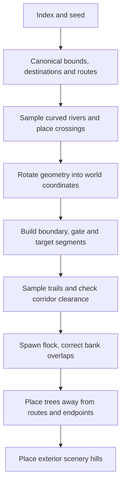

# World generation, collision, and navigation

Current contracts come from [world.js](../../src/world.js); [GAMEPLAY.md](GAMEPLAY.md) explains its simulation callers. The [issue tracker](../ISSUES.md) is the authority for proposed geometry and gameplay changes. This module imports neither renderer nor browser APIs.

## Map generation candidate — 22 October 2026

Current source on `map_generation_improvements` implements F-031/F-032/F-034/F-038; the tracker retains separate validation and acceptance state. This section supersedes the older fixed stone sequence, universally gated late maps and one-way contextual gate action described below.

`level.boundary` is the ordered world-space polygon for the playable meadow; `bounds` is its axis-aligned framing/search extent. Ordinary early/medium maps retain a rectangle. From public level 40, an independent seeded shape choice produces a concave L-shaped or stepped angular outline, mirrored and rotated with the level. The cut stays beyond the route/destination envelope with clearance, and interior barriers stop at the polygon boundary. Boundary fence segments, occupancy/path checks, ground rendering and minimap consume the same outline. The renderer triangulates the concave polygon as brighter playable turf above darker surrounding countryside, with an owned geometry disposed on level replacement; a point inside the bounds rectangle may still be outside playable ground. Concave corners remain physical barriers. Large maps use a local minimap viewport following Pip, clamped to the map AABB; compact levels retain fit-to-map framing. The viewport height cap of 120 world units is source tuning, with width derived from the minimap aspect ratio. Boundary, roads and actor markers are clipped to its frame; the existing goal-direction arrow continues guidance outside the viewport.

Early lessons retain their route layout. Public level 20 onward adds longitudinal and lateral growth, wider route spacing, alternating river-crossing offsets and a seeded lateral destination offset. Existing bridge turning planes and herd breathing room are preserved. Herds over 30 receive an extra .1-unit downstream breathing tolerance so the smallest measured gate/bridge exit gap stays at least 26 units; river bases remain unchanged. This is a precision/spacing implementation correction, not a new user balance target. These dimensions and shape weights are tuning choices for review, not user-provided balance numbers. Tree placement remains excluded from routes, spawns and goals and is restricted to occupiable ground.

Gate distribution and stone selection use independent seeded streams, avoiding layout-RNG coupling. At public level 20 onward, a 65% gated-map choice and, on eligible multi-gap gated maps, a 50% omitted-panel choice provide gate-free maps and gated maps with an ungated alternative. The omitted panel does not fill its route gap. Below level 20, gaps remain open and non-operable. Stone uses the requested 15% per-level probability for boundary/interior segments; target walls retain their own material.

`gateButtons(gate)` in `gates.js` derives two ground pads beside the traffic lane, forward ±2 units and lateral `width/2 - .9`, with a .65-unit pad radius. `updateGateContacts(level,dog)` runs in the active simulation for Pip only: fresh overlap toggles, remaining in contact is latched and leaving both pads by a .2-unit release margin rearms. Closing is refused while the panel intersects Pip, a livestock body at its actual radius or a ground Buddy. Success increments `geometryRevision`, clears flock visibility and emits `gateToggled`; safe refusal emits `gateBlocked`. Controller toasts use the existing status region. The normal game no longer creates the contextual Open button; legacy exports remain for compatibility.

Both pad meshes read the same panel state, red when closed and green when open; gate panel, collision, navigation and minimap also read that descriptor. All pad/gate resources belong to the level view and are disposed with it. Contact state resets with a newly generated level and does not advance during pause. No profile, bark, reward or helper-activation semantics change.

## Coordinates and generated state

Positions use `{x, z}` on a flat ground plane; vertical height belongs to rendering. Distances are Euclidean world units. Heading is radians, with forward `{x:sin(h), z:cos(h)}` and lateral `{x:cos(h), z:-sin(h)}`. Do not assume destination progress always means increasing world X.

`createLevel(index = 0, seed = index * 7919 + 42)` floors/clamps the index to 0–99 and converts the seed to unsigned 32-bit. The default parameter expression uses the argument before index normalization; pass explicit valid indexes for ordinary campaign reproducibility. The same index/seed yields deeply equal fresh state. Randomness is a private seeded generator, not `Math.random()`.

| Field | Meaning |
|---|---|
| `index`, `seed`, `title`, `description`, `reward` | Campaign metadata; displayed level is `index + 1`; reward is `80 + index * 25`. |
| `bounds`, `boundary` | Axis-aligned framing extent and ordered playable-boundary polygon; the polygon may be concave. |
| `spawn`, `dog`, `animals` | Flock origin, Pip origin, initial body states. |
| `target` | `{x,z,radius,type,heading}`; type cycles pen → field → barn by index modulo 3. |
| `rivers` | Sampled centerline `points`, width, rotated bridge deck descriptors. |
| `fenceSegments` | Physical `{a,b,kind,material}` segments: boundary, interior, target; material is wood or stone. `fences` currently starts empty. |
| `gates` | `{id,x,z,width,heading,operable,open,material}` panels; displayed levels 20+ begin closed. |
| `routes`, `roads` | Sampled routes `{id,points,length}`; roads reference route points plus width. |
| `obstacles`, `sceneryHills` | Circular tree collision footprints; decorative hills outside bounds. |

Simulation attaches runtime state such as time, completion, helpers and visibility caches. Do not reuse a stepped level as a pristine generation fixture.

Generation starts in canonical longitudinal/lateral coordinates, then rotates by quarter turns. Early indexes 0–4 have a 48-unit lateral footprint, one route and longitudinal end `15 + 3*index`. Index 0 points east; other early levels choose east/west from seed parity. Later levels choose all four directions by `seed % 4`, use longitudinal end `48 + 3*index`, and lateral half-width `84 + floor(index/15)*14`; transformed bounds also retain at least that world-Z span. Thus rotated late bounds may be larger than simply rotating the canonical rectangle.

Flock count is `min(5 + 3*index, 65)`. From index 3, every fourth animal is a cow. Bodies start in a compact grid with seeded jitter and Pip behind them. If a curved bank clips a body, the generator tries up to seven half-unit backward translations of the entire grid, preserving its shape. This finite correction is tested on selected custom seeds; it is not a formal proof for every unsigned seed.

## Generation pipeline and routes



Index 0 has no river. Indexes 1–4 have one; indexes 5–14 have one; indexes 15+ have two. River centerlines are gentle sinusoids sampled every 2 canonical lateral units, extending beyond the fenced map. Each route gets a bridge over each river. Route counts are one for early levels; thereafter one on even indexes/two on odd indexes below 15; indexes 15+ have three when divisible by 3, otherwise two. From index 2, an interior barrier has gate gaps for each route. Displayed levels 1–19 keep open, non-operable gaps; index 19 onward begins with closed operable panels. Gates open permanently for the current run through a contextual button while Pip is within 3.2 units and has an unobstructed ground approach to the panel. Helpers never activate gates. Recreating the level resets every panel. The button is independent of the Woof action and can be tapped after releasing the movement thumb.

`gateSegment(gate)` derives the physical panel endpoints from width and heading. Closed panels participate in occupancy, solid path and player-signal queries; opening a gate removes that panel and clears the flock visibility cache. `accessibleGate` and `openNearbyGate` in `gates.js` select and revalidate the nearest accessible gate. `createGateControl` owns its contextual DOM button; no cooldown or bark dispatch is involved. A fresh `geometryRevision` increments on opening. `gate-view.js` owns its Three.js resources and returns groups with explicit `dispose()`; its gate group `update()` reads live state. Open panels slide into the adjacent solid barrier instead of projecting into the passage.

Displayed levels 8, 12, 16, 20 and every fourth level thereafter use stone for boundary and interior segments (`index >= 7 && index % 4 === 3`). Target enclosures retain their own geometry and presentation. Stone segments have a .3-unit physical half-thickness and block player signals; ordinary wood remains .18 and transmits the low-fence call. Masonry is .6 units wide and 1.3 high, with gaps inherited from the same segment endpoints. Gate openings do not change width in stone variants.

Routes connect spawn, bridge approaches/centers, gates and destination approaches. They express potential passage after Pip opens panels; generation and connectivity tests validate route clearance with panels open. Runtime movement/path queries always use current closed state. Closed gates are intentionally absent from corridor sampling, so they cannot erase a valid generated route or cause a straight fallback to replace the road. `wander` samples each leg roughly every 1.2 units; ordinary legs gain seeded meanders. Legs adjoining bridges/gates or ending at target stay straight. A candidate meander is kept only if every sampled segment has 0.85-unit ground clearance against already-built geometry; otherwise that leg uses straight interpolation. Trees are added afterward, excluded from a `7 + tree.radius` corridor around route segments, within 14 of spawn, or within `target.radius + 10` of destination. Maximum attempted tree count is `min(10 + 2*index,130)`, so actual counts vary.

Roads are visual/guidance data, not forces. Nothing in `stepSimulation` attracts animals toward `routes` or `target`. The route API can guide Pip and ground companions; player pressure drives delivery.

## Shared bridge and enclosure geometry

A bridge `{x,z,width,length,heading}` is a straight rotated rectangle. In its local frame a body is over the deck when longitudinal distance is at most `length/2 + radius` and lateral distance at most `width/2 - radius`. The longitudinal extension lets bodies enter from dry ground; lateral contraction preserves body clearance. Bridge length is river width plus 1.5, leaving a short 0.75-unit landing on each bank while covering sampled river curvature across the full deck width. Deck heading is perpendicular to the actual sampled river segment at its center; the bridge approach, center and departure are collinear. Usable path widths are 9.4 at index 1, 4.1 at other early indexes and 4.8 later; deck width is exactly 1.25 × that width. Decorative shoulders are excluded. The wide level-2 crossing is preserved by widening its road together with its deck. Later branches retain their common dry trail turning planes independently of the shorter deck to avoid cutting neighboring rail ends. Pressured animals whose forward motion hits a bank or rail steer through collision-checked local waypoints around the nearest bridge end, including when already aligned with the opening; this does not select a destination. Steering uses each animal’s physical radius (0.55 for sheep, 0.78 for cows), so valid sheep bank positions are not rejected by cow-sized navigation clearance.

Each side rail runs from `-length/2 - 0.1` to `length/2 + 0.1` at lateral `±width/2`, with beam radius 0.05 and four post footprints of radius 0.065 per side. Rails remain solid beyond the wet river edge, so a body on dry land beside a deck cannot cut sideways through its end rail. It must walk around an open end. Rail and river bounds are cached in WeakMaps keyed by geometry object; treat generated descriptors as static or replace the object when editing rather than mutating cached geometry in place.

`terrainHeight(level,x,z)` returns a deck arch `0.18 + 0.12*sin(π*(along/length + 0.5))` inside the zero-radius bridge footprint, otherwise 0. It does not change collision into a 3D physics system. See [render.js](../../src/render.js) for presentation of these descriptors.

`targetFootprint(target)` defines a rotated rectangle with half-length/half-width `target.radius + 1.4`, a 7-unit entrance on the upstream side, world corners and entrance point. `targetLocalPoint` converts positions to forward/lateral coordinates; `targetWorldPoint` performs the inverse. `containsTarget(target,point,bodyRadius)` requires the entire circular body within both edges. `createLevel` derives the five target wall segments from that same footprint. Thus corner regions outside the former circle are admissible when the full body is inside; a center sitting on a wall is insufficient.

The renderer's `goal-view.js` uses these world corners for the highlight surface, outline and barn floor, and projects them for the minimap. Square enclosure rotation is expressed in world vertices, avoiding inconsistent plane rotation conventions. Target radius still sets size and Pip attendance distance; it no longer defines admission. See [admission](GAMEPLAY.md#admission-rewards-and-profile-lifecycle) and geometry/goal-view tests.

## Clearance is not one query

| Export | What it answers |
|---|---|
| `canOccupy(level,x,z,radius=.55)` | May a circular body occupy one point? Bounds inset by `radius + .18`, wood thickness .18/stone .3, closed gate panels, expanded trees/water and solid bridge rails all apply. Water is traversable only within a bridge footprint. |
| `moveBody(level,body,dx,dz,radius=.55)` | Mutates position with steps of at most .25 units, tries combined displacement, then axis sliding; returns `{blockedX,blockedZ}`. It does not set velocity or heading. |
| `hasClearGroundPath(level,a,b,radius=.55)` | Is a straight ground segment clear? Solid fences/rails, trees, water and inset endpoint bounds apply. Water checks sample at intervals no greater than .45 units. |
| `hasClearPlayerSignal(level,a,b)` | Radius .15 audible pressure line: ignores low wooden fences and bridge rails; stone walls and closed gates shield, and target fence segments shield only barns. Trees, water outside decks and bounds still block. |
| `separatedByBank(level,a,b)` | Specialized river/rail separation query, not general obstacle clearance or a substitute for ground path validation. |

The player signal is used for Pip's pressure only. Flock cohesion/alignment visibility, companion selection/attendance/support and destination attendance use solid ground paths. A sheep can hear Pip over a low pen rail while neither body can cross it; that does not mean a companion may pull through it or admission may ignore it. Physical separation forces between very close animals are distinct from neighbor visibility.

`moveBody` subdivides displacement to limit tunneling; `stepSimulation` additionally caps dt. Neither is a swept 3D rigid-body solver. Rivers are sampled polylines with radius-expanded checks, and trees are circular footprints, not mesh intersection tests.

## Navigation exports

| Export | Behavior and limit |
|---|---|
| `distance`, `closestOnSegment`, `segmentDistance` | Shared ground-plane geometry; projection result includes clamped `t`. |
| `routeProgress(level,position,routeId?)` | Nearest projection on matching sampled route segments; returns route/id, segment index, point, off-route distance, arclength progress and route length; `null` if none. |
| `nextNavigationPoint(level,position,routeId?)` | First sampled point at least 7 arclength units after projection, otherwise target. This is not exactly a point seven straight-line units away. |
| `navigationTarget(level,body,desired,radius=.62)` | Returns desired when clear, otherwise route projection/lookahead; near bridge rails or the enclosure builds a small visibility graph around up to two bridges plus exterior enclosure corners and real entrance nodes. Route projection/lookahead and graph edges use the caller’s actual body radius. It is a local waypoint heuristic, not global pathfinding for arbitrary user geometry. |
| `destinationApproach(level,body)` | Oriented waypoint around enclosure walls toward upstream entrance. Used by journey-test player policy, not an animal's automatic goal drive. |
| `openingSteer(level,body,vx,vz,radius=.78)` | Adds steering toward the closest opening on a nearby pressed barrier, using the moving animal’s physical clearance and walking around bridge rail ends and enclosure side/far corners when necessary. A nearby pressed target wall selects the enclosure entrance detour; idle animals gain no goal force. Only used under player pressure; alias `steeringOpening` is also exported. |

Run this from repository root with Node 22+:

```sh
node --input-type=module <<'JS'
import assert from 'node:assert/strict';
import {
  createLevel, distance, canOccupy, moveBody,
  hasClearGroundPath, routeProgress, nextNavigationPoint, terrainHeight,
} from './src/world.js';
const level = createLevel(23, 201);
assert.deepEqual(level, createLevel(23, 201));
const bridge = level.rivers[0].bridges[0];
assert.equal(canOccupy(level, bridge.x, bridge.z, .8), true);
assert.ok(Math.abs(terrainHeight(level, bridge.x, bridge.z) - .3) < 1e-8);
for (const gate of level.gates) gate.open = true; // Validate passage after interaction.
const route = level.routes[0], walker = {...level.spawn};
for (const point of route.points) {
  assert.ok(hasClearGroundPath(level, walker, point, .8));
  moveBody(level, walker, point.x-walker.x, point.z-walker.z, .8);
  assert.ok(distance(walker, point) < .001);
}
assert.ok(distance(walker, level.target) < .001);
const info = routeProgress(level, level.spawn, route.id);
assert.equal(info.routeId, route.id);
assert.ok(nextNavigationPoint(level, level.spawn, route.id));
console.log('deterministic world, deck height and traversable route passed');
JS
```

## Evidence and queued changes

[world.test.js](../../tests/world.test.js) checks all 100 default campaign indexes for cow-clear route traversal with actual `moveBody` calls, safe default spawns, destination margins, exterior hills and geometry constraints. It also covers selected custom seeds, four rotations, audible-versus-solid fences and dry-end rail navigation. [simulation.test.js](../../tests/simulation.test.js) checks actual movement against banks, bounds and destination walls. [herding-journey.test.js](../../tests/herding-journey.test.js) covers five bounded full-delivery journeys. Those scopes are narrower than all possible seeds or real-device verification.

Bridge alignment/width and shared enclosure geometry are Done by user acceptance on 14 October 2026; interactive gates and stone walls have implementation and automated evidence in this P2 batch; rendered/device acceptance and broader environment changes remain tracked in [ISSUES.md](../ISSUES.md). F-025 deployment migration is Done; the P1 development batch is published and hash-verified (see the validation runbook). Geometry evidence is not rendered/device acceptance.

`gates.test.js` exercises the level-20 transition, closed movement for dog/sheep/cow radii, four rotations, remote/obstructed interaction rejection, touch activation using the actual controller, restart, visibility-cache invalidation, stone signals, disposable visual state and a companion simulation that cannot open or deliver through a closed panel. Potential-route tests explicitly open panels before validating the full route; this does not assert closed routes are traversable.


### P2 Node 22 enclosure retrieval regression

Stone walls changed physical thickness and player-signal visibility, exposing late retrieval behind destination walls in the unchanged public level-16 journey: 46/50 delivered on Node 22. Threading the true radius through route fallback improved clearance but did not fully recover the flock. `30abd2a` adds exterior enclosure corners and real entrance nodes to the local visibility graph and selects this detour for pressured bodies against nearby target walls. The same five ordinary-input journeys pass on Node 22 and Node 24 without changing timers, collision/signal policy, wander cohort or test controls. `enclosure-navigation.test.js` checks 36 rotated side/far-wall paths at sheep, dog and cow radii and rejects unsafe smaller-radius fallback behavior. These are bounded source regressions, not human pacing evidence for F-013.


## Room between crossings — 20 October 2026

From public level 6, levels with more than 30 animals gain extra trail before the gate: 0.4 m per animal above 30, capped at 14 m. The river positions relative to the spawn are unchanged, so the space is added between the last bridge and the gate. For 65-animal levels the trail from the last bridge exit to the gate grows from about 22 m to 30–37 m. Levels 1–5 are unchanged. `tests/chokepoints.test.js` checks the gap on sampled large-herd levels.
