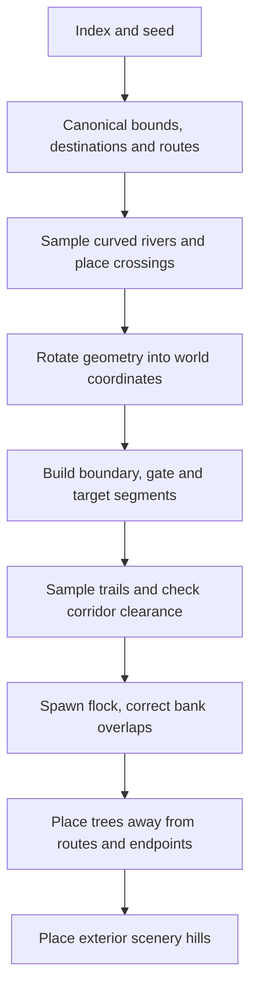

# World generation, collision, and navigation

Current contracts come from [world.js](../../src/world.js); [GAMEPLAY.md](GAMEPLAY.md) explains its simulation callers. The [issue tracker](../ISSUES.md) is the authority for proposed geometry and gameplay changes. This module imports neither renderer nor browser APIs.

## Coordinates and generated state

Positions use `{x, z}` on a flat ground plane; vertical height belongs to rendering. Distances are Euclidean world units. Heading is radians, with forward `{x:sin(h), z:cos(h)}` and lateral `{x:cos(h), z:-sin(h)}`. Do not assume destination progress always means increasing world X.

`createLevel(index = 0, seed = index * 7919 + 42)` floors/clamps the index to 0–99 and converts the seed to unsigned 32-bit. The default parameter expression uses the argument before index normalization; pass explicit valid indexes for ordinary campaign reproducibility. The same index/seed yields deeply equal fresh state. Randomness is a private seeded generator, not `Math.random()`.

| Field | Meaning |
|---|---|
| `index`, `seed`, `title`, `description`, `reward` | Campaign metadata; displayed level is `index + 1`; reward is `80 + index * 25`. |
| `bounds` | `{minX,maxX,minZ,maxZ}` world-space axis-aligned playable bounds. |
| `spawn`, `dog`, `animals` | Flock origin, Pip origin, initial body states. |
| `target` | `{x,z,radius,type,heading}`; type cycles pen → field → barn by index modulo 3. |
| `rivers` | Sampled centerline `points`, width, rotated bridge deck descriptors. |
| `fenceSegments` | Physical `{a,b,kind}` segments: boundary, interior, target. `fences` currently starts empty. |
| `gates` | Open gap descriptors, not animated door state. |
| `routes`, `roads` | Sampled routes `{id,points,length}`; roads reference route points plus width. |
| `obstacles`, `sceneryHills` | Circular tree collision footprints; decorative hills outside bounds. |

Simulation attaches runtime state such as time, completion, helpers and visibility caches. Do not reuse a stepped level as a pristine generation fixture.

Generation starts in canonical longitudinal/lateral coordinates, then rotates by quarter turns. Early indexes 0–4 have a 48-unit lateral footprint, one route and longitudinal end `15 + 3*index`. Index 0 points east; other early levels choose east/west from seed parity. Later levels choose all four directions by `seed % 4`, use longitudinal end `48 + 3*index`, and lateral half-width `84 + floor(index/15)*14`; transformed bounds also retain at least that world-Z span. Thus rotated late bounds may be larger than simply rotating the canonical rectangle.

Flock count is `min(5 + 3*index, 65)`. From index 3, every fourth animal is a cow. Bodies start in a compact grid with seeded jitter and Pip behind them. If a curved bank clips a body, the generator tries up to seven half-unit backward translations of the entire grid, preserving its shape. This finite correction is tested on selected custom seeds; it is not a formal proof for every unsigned seed.

## Generation pipeline and routes



Index 0 has no river. Indexes 1–4 have one; indexes 5–14 have one; indexes 15+ have two. River centerlines are gentle sinusoids sampled every 2 canonical lateral units, extending beyond the fenced map. Each route gets a bridge over each river. Route counts are one for early levels; thereafter one on even indexes/two on odd indexes below 15; indexes 15+ have three when divisible by 3, otherwise two. From index 2, an interior fence has open gate gaps for each route.

Routes connect spawn, bridge approaches/centers, gates and destination approaches. `wander` samples each leg roughly every 1.2 units; ordinary legs gain seeded meanders. Legs adjoining bridges/gates or ending at target stay straight. A candidate meander is kept only if every sampled segment has 0.85-unit ground clearance against already-built geometry; otherwise that leg uses straight interpolation. Trees are added afterward, excluded from a `7 + tree.radius` corridor around route segments, within 14 of spawn, or within `target.radius + 10` of destination. Maximum attempted tree count is `min(10 + 2*index,130)`, so actual counts vary.

Roads are visual/guidance data, not forces. Nothing in `stepSimulation` attracts animals toward `routes` or `target`. The route API can guide Pip and ground companions; player pressure drives delivery.

## Shared bridge and enclosure geometry

A bridge `{x,z,width,length,heading}` is a straight rotated rectangle. In its local frame a body is over the deck when longitudinal distance is at most `length/2 + radius` and lateral distance at most `width/2 - radius`. The longitudinal extension lets bodies enter from dry ground; lateral contraction preserves body clearance. Bridge length is river width plus 5. Index 1 uses width 11.5, indexes 2–4 use 8.5, and later decks use 10. These current dimensions are not a claim that decks already satisfy the queued perpendicular-crossing/path-width requirement.

Each side rail runs from `-length/2 - 0.1` to `length/2 + 0.1` at lateral `±width/2`, with beam radius 0.05 and four post footprints of radius 0.065 per side. Rails remain solid beyond the wet river edge, so a body on dry land beside a deck cannot cut sideways through its end rail. It must walk around an open end. Rail and river bounds are cached in WeakMaps keyed by geometry object; treat generated descriptors as static or replace the object when editing rather than mutating cached geometry in place.

`terrainHeight(level,x,z)` returns a deck arch `0.18 + 0.12*sin(π*(along/length + 0.5))` inside the zero-radius bridge footprint, otherwise 0. It does not change collision into a 3D physics system. See [render.js](../../src/render.js) for presentation of these descriptors.

Destination segments form a box of half-extent `target.radius + 1.4`, with a 7-unit entrance on its upstream side. The target's admission circle is a separate current gameplay test; see [admission](GAMEPLAY.md#admission-rewards-and-profile-lifecycle). A visual enclosure does not imply an exact rectangular admission region.

## Clearance is not one query

| Export | What it answers |
|---|---|
| `canOccupy(level,x,z,radius=.55)` | May a circular body occupy one point? Bounds inset by `radius + .18`, fence thickness .18, expanded trees/water and solid bridge rails all apply. Water is traversable only within a bridge footprint. |
| `moveBody(level,body,dx,dz,radius=.55)` | Mutates position with steps of at most .25 units, tries combined displacement, then axis sliding; returns `{blockedX,blockedZ}`. It does not set velocity or heading. |
| `hasClearGroundPath(level,a,b,radius=.55)` | Is a straight ground segment clear? Solid fences/rails, trees, water and inset endpoint bounds apply. Water checks sample at intervals no greater than .45 units. |
| `hasClearPlayerSignal(level,a,b)` | Radius .15 audible pressure line: ignores low fences and bridge rails; target fence segments shield only barns. Trees, water outside decks and bounds still block. |
| `separatedByBank(level,a,b)` | Specialized river/rail separation query, not general obstacle clearance or a substitute for ground path validation. |

The player signal is used for Pip's pressure only. Flock cohesion/alignment visibility, companion selection/attendance/support and destination attendance use solid ground paths. A sheep can hear Pip over a low pen rail while neither body can cross it; that does not mean a companion may pull through it or admission may ignore it. Physical separation forces between very close animals are distinct from neighbor visibility.

`moveBody` subdivides displacement to limit tunneling; `stepSimulation` additionally caps dt. Neither is a swept 3D rigid-body solver. Rivers are sampled polylines with radius-expanded checks, and trees are circular footprints, not mesh intersection tests.

## Navigation exports

| Export | Behavior and limit |
|---|---|
| `distance`, `closestOnSegment`, `segmentDistance` | Shared ground-plane geometry; projection result includes clamped `t`. |
| `routeProgress(level,position,routeId?)` | Nearest projection on matching sampled route segments; returns route/id, segment index, point, off-route distance, arclength progress and route length; `null` if none. |
| `nextNavigationPoint(level,position,routeId?)` | First sampled point at least 7 arclength units after projection, otherwise target. This is not exactly a point seven straight-line units away. |
| `navigationTarget(level,body,desired,radius=.62)` | Returns desired when clear, otherwise route projection/lookahead; near bridge rails builds a small visibility graph around up to two bridges to walk around open ends. It is a local waypoint heuristic, not global pathfinding for arbitrary user geometry. |
| `destinationApproach(level,body)` | Oriented waypoint around enclosure walls toward upstream entrance. Used by journey-test player policy, not an animal's automatic goal drive. |
| `openingSteer(level,body,vx,vz)` | Adds lateral steering toward the closest opening on a nearby pressed barrier. Only used under player pressure; alias `steeringOpening` is also exported. |

Run this from repository root with Node 22+:

```sh
node --input-type=module <<'JS'
import assert from 'node:assert/strict';
import {
  createLevel, distance, canOccupy, moveBody,
  hasClearGroundPath, routeProgress, nextNavigationPoint, terrainHeight,
} from './src/world.js';
const level = createLevel(23, 201);
assert.deepEqual(level, createLevel(23, 201));
const bridge = level.rivers[0].bridges[0];
assert.equal(canOccupy(level, bridge.x, bridge.z, .8), true);
assert.ok(Math.abs(terrainHeight(level, bridge.x, bridge.z) - .3) < 1e-8);
const route = level.routes[0], walker = {...level.spawn};
for (const point of route.points) {
  assert.ok(hasClearGroundPath(level, walker, point, .8));
  moveBody(level, walker, point.x-walker.x, point.z-walker.z, .8);
  assert.ok(distance(walker, point) < .001);
}
assert.ok(distance(walker, level.target) < .001);
const info = routeProgress(level, level.spawn, route.id);
assert.equal(info.routeId, route.id);
assert.ok(nextNavigationPoint(level, level.spawn, route.id));
console.log('deterministic world, deck height and traversable route passed');
JS
```

## Evidence and queued changes

[world.test.js](../../tests/world.test.js) checks all 100 default campaign indexes for cow-clear route traversal with actual `moveBody` calls, safe default spawns, destination margins, exterior hills and geometry constraints. It also covers selected custom seeds, four rotations, audible-versus-solid fences and dry-end rail navigation. [simulation.test.js](../../tests/simulation.test.js) checks actual movement against banks, bounds and destination walls. [herding-journey.test.js](../../tests/herding-journey.test.js) covers five bounded full-delivery journeys. Those scopes are narrower than all possible seeds or real-device verification.

Future bridge orientation/width, interactive gates, stone walls, enclosure shape matching and environment changes remain tracked in [ISSUES.md](../ISSUES.md); this document does not implement or approve them. The tracker also records the pending deployment-path correction. No documentation change is evidence of a live deployment.
